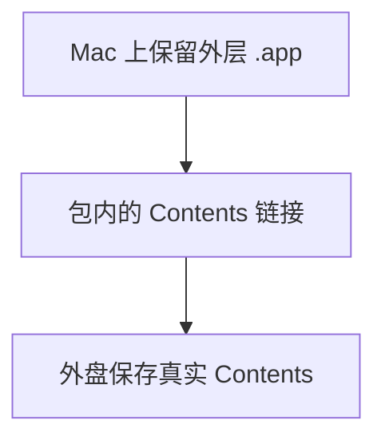

# 已归档：早期应用迁移方式

::: warning 历史方式与原型
本页解释旧入口结构与实现变化。当前新迁移的默认方式见[应用迁移方式](/docs/migration-strategy/portal)。仍能识别旧入口，不代表新迁移会继续选择它。
:::

## Contents 目录迁移 {#deep-contents}

早期的 Deep Contents Wrapper 将应用的 `Contents` 内容放到外部，本地保留外层 `.app`，内部通过链接访问外部内容。它希望保留熟悉的应用外观，并释放本地空间。

但一些应用或更新器会解析链接的实际位置，在外部真实目录上替换、删除或改写内容。路径、签名和更新行为因此难以一致处理。从历史更新记录看，1.2.0 开始引入 Stub Portal 替代这一方向。当前仍识别旧 Contents 结构以便管理，不将它作为新迁移的默认方案。

## 整体符号链接 {#whole-symlink}

Whole App Symlink 把整个应用移到外部，在本地创建指向 `.app` 的符号链接。它结构简单，但 Finder 可能显示链接箭头，应用更新、查找资源和系统入口的表现也取决于具体应用。

当前仍保留“使用传统链接迁移”的手动入口，扫描与恢复也会识别已有结构；应用套件内同样可能包含指向外部的链接。整体符号链接是旧方式中仍可选用的一种，并未全部停用。不能因看到链接就断定迁移错误，也不应手工把所有启动壳都换成整包链接。

## 早期更新框架混合入口 {#legacy-hybrid}

旧实现还出现过 Sparkle Hybrid、Electron Hybrid：在本地应用包装内，用链接连接外部的框架、资源等组件。当前仍识别这些遗留结构，以便定位真实应用并执行恢复或解链；它们不再作为新的默认迁移方式。

这种历史混合入口与下面的 Transparent Hybrid 原型是不同阶段的方案，不能只凭“Hybrid”名称视为同一种功能。

## 启动壳的实现变化 {#stub-versions}

Stub Portal 只在本地保留启动入口，运行时打开外部真实应用。早期实现使用脚本启动器；历史 1.6.2 更新记录记载了原生启动器的引入，用于改善双击关联文档时的打开行为。

旧版还分别描述过普通 Mac 应用与 iOS 应用的启动入口差异。这个差异服务于启动和系统识别，不能理解为重签 iOS 应用或绕过设备支持。当前由 AppPorts 判断入口方式，不要求用户手工选脚本或原生实现。

已有入口的具体版本由扫描和兼容处理识别。将所有历史启动壳统称为某一种实现，会遗漏仍需处理的旧记录。

## 透明混合原型 {#hybrid}

Transparent Hybrid 是代码中存在的默认关闭原型，尝试兼顾本地应用外观和外部内容访问。它不是面向普通用户提供的推荐选项，也没有被本页描述为已正式普及的替代方式。

原型与正式默认方式分开记录，避免将“代码里存在”误读成“已支持选择”。需要使用当前功能时，从[迁移应用](/docs/core)开始。

## 已有旧迁移怎么办 {#existing}

旧入口仍能正常使用时，不必只因名称属于历史方案就删除它。需要调整时，先连接原盘，使用 AppPorts 的迁回或链接管理操作，确认真实应用与数据都在。应用本体还原不会自动还原另行迁移的数据。

相关内容：[还原与接回](/docs/restore) · [更新保护](/docs/migration-strategy/portal#updates) · [历史功能归档](/docs/archive/overview)
