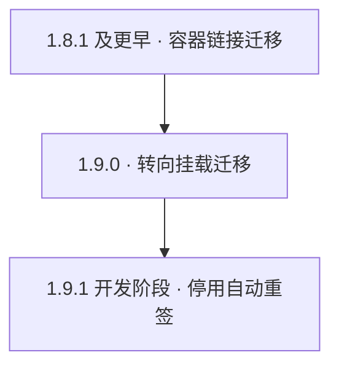

# 已归档：旧版数据链接与自动重签名

::: warning 历史功能
本页保留旧版本做法。当前版本将迁移与手动签名分开，并停用所有系统上的登录自动重签。新操作请看[迁移数据](/docs/datamigrae/operation)；旧迁移的恢复请看[升级与修复](/docs/macos-27)。
:::

## 版本与状态 {#versions}

| 功能 | 历史行为 | 当前状态 |
| --- | --- | --- |
| 容器数据符号链接迁移 | 1.8.1 及更早版本采用的主要方式，将数据搬到外部，再在原位置建立链接。 | 默认改用挂载迁移；旧链接管理在经典模式中受限保留。 |
| 迁移后重签名 | 旧数据目录工具栏提供开关，容器迁移前也曾提供“仅迁移”与重签确认。1.9.0 过渡期仅经典模式保留相关流程。 | 1.9.1 开发版停用自动串联，迁移不附带签名操作。 |
| 开机自动重签名 | 旧版安装登录任务，每次登录按当时的记录与策略检查、重签应用。1.9.0 在 macOS 27 上停用，较早系统仍有过渡行为。 | 1.9.1 开发版在所有系统停用，并尝试关闭、移除旧任务；build 31 移除常驻设置卡，仅清理失败时显示重试。 |
| 仅记录签名身份的旧备份 | 记录应用标识、路径、身份名称和时间，没有完整保存原应用。 | 不足以恢复原始签名；仍有来源价值的记录保留，满足核验条件后才自动清理。 |
| 内盘完整原包备份 | 后续实现将官方应用原包保存在内盘，用于恢复应用内容和签名。 | build 31 将新的长期原包统一保存到外盘；旧有效原包在条件满足时自动迁出，验证成功后清理内部副本。 |

## 旧流程做了什么 {#flow}

旧链接迁移将数据复制到外部受管位置，再把原位置换成符号链接。若同时选择重签，应用数据迁移与 Ad-hoc 重签会先后进行；签名必须作用于真实应用，而不是本地启动壳。

登录自动重签另有独立后台任务，标识为 `com.shimoko.AppPorts.re-sign`。它不是容器数据自动接回任务。旧版设置、脚本规则和默认值曾随版本调整，不能将其中一次行为当成所有历史版本的一致承诺。

工具目录和普通自选文件夹仍可使用链接迁移。本次停用的是自动签名流程，并非取消所有符号链接功能。

## 为什么不再沿用 {#why}

本地重签会改变应用身份，并可能移除或改变沙盒、应用组和钥匙串等授权。它不能替代原开发者签名，也不能保证修复容器访问。在已测试的 macOS 27 环境中，部分重签应用即使数据在本地也无法正常启动。

签名失败与迁移失败还可能发生在不同阶段。把两个操作自动串联，会让用户难以判断数据已经搬走还是应用身份已经改变。当前流程将它们分开，需要时由独立签名操作处理。

## 旧备份与恢复材料 {#backups}

旧签名记录保存在 AppPorts 的 `signature-backups` 目录中。仅有身份名称的记录不能凭空恢复原应用；历史上移除签名或重新做 Ad-hoc 签名，也不等于恢复官方签名。

后来的完整备份同时保存原应用文件与核对信息，可在符合条件时恢复。当前仍需验证应用版本、开发者身份和内容，不能用旧备份覆盖新版应用。build 31 保留这类恢复能力，将新的长期原包放到外盘可见的 `AppPorts Backups` 文件夹；旧内盘原包在确认仍有用、外盘可用且没有待续操作依赖时自动迁出。外盘副本验证成功前，内部原件继续保留。

只有身份名称的记录、或已确认原包缺失的索引，并非一律删除。没有未完成操作依赖，且来源信息已在其他记录中可靠保留，或当前安装已验证为对应的官方应用时，AppPorts 才自动清理。无法确认归属、仍是唯一来源信息的小记录会继续保留。

外盘未连接与文件确实缺失不同；不能按保存时间或签名变化认定备份无用。仍有恢复价值的完整原包继续保留，当前保存、恢复与手动清理方法见[签名原包说明](/docs/settings#signature-backups)。

## 现在如何处理 {#transition}

先连接原外置盘并退出相关应用；还原旧式容器链接数据，再检查是否需要恢复官方应用。更新 AppPorts 后打开一次，让它处理旧登录任务；若提示尚未关闭，在设置中重试。

关闭经典模式不会自行迁回数据或恢复签名。处理完旧状态后，符合条件的数据可以改用挂载迁移，普通目录继续按实际需要使用链接迁移。

相关内容：[经典模式](/docs/classic-mode) · [签名状态](/docs/badges#signing) · [历史功能归档](/docs/archive/overview)
