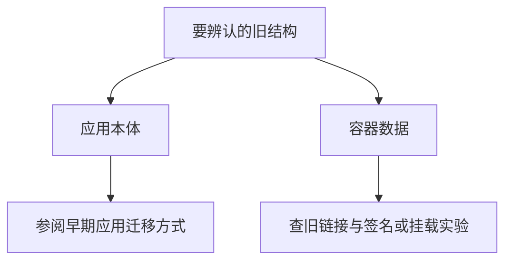

# 历史功能归档索引

这里保留已停用功能、早期迁移方式和没有采用的实验方案，方便使用旧版本或检查旧迁移的读者查阅。**归档不表示这些功能仍在当前版本中提供，也不表示需要把已有迁移立即重做。**

## 按主题查阅 {#topics}

| 归档内容 | 适用阶段与状态 | 当前入口 |
| --- | --- | --- |
| [旧版数据链接与自动重签名](/docs/archive/data-signing) | 1.8.1 及更早的容器链接方式；1.9.0 的过渡期；1.9.1 开发版停用自动签名。 | [迁移数据](/docs/datamigrae/operation)、[经典模式](/docs/classic-mode) |
| [早期应用迁移方式](/docs/archive/app-strategies) | Contents 等旧结构与启动壳实现变化；整体符号链接仍可手动选用，另列默认关闭原型。 | [应用迁移方式](/docs/migration-strategy/portal) |
| [未采用的挂载实验方案](/docs/archive/mount-experiments) | 2026 年 9 月实验中的磁盘映像、系统挂载配置与守护进程方案；不能当作正式功能。 | [挂载迁移](/docs/datamigrae/baseinfo#mount)、[自动接回实验](/docs/blog/why-mount-and-apfs#startup-method) |

## 怎样理解版本说明 {#versions}

当前正文按最新界面和行为整理。某个功能在旧版本出现过，不意味着当前开关仍有效。旧版“迁移后重签名”“开机自动重签名”的操作与局限在归档中保留，当前应按[设置与权限](/docs/settings)处理。

需要了解每次发布的变化，可查[更新日志](/docs/changelog)。遇到旧方式迁移后的异常，先保留数据和备份，按[macOS 27 升级与修复](/docs/macos-27)检查，不要仅为复现旧流程而降级或重新签名。
