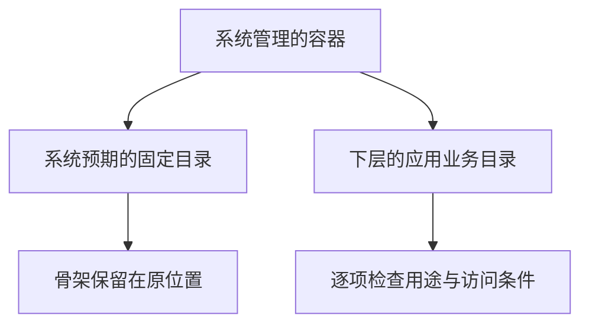

# 为什么有些数据目录不能迁移

**研究整理：2026 年 10 月 15 日 · 主要实验：2026 年 10 月 1 日**

## 摘要 {#abstract}

一次企业微信故障中，数据已经复制，外置卷也成功挂载，应用却在启动时崩溃。调查发现，macOS 会检查容器中的部分固定目录：路径看起来没变，如果这些目录已经属于另一个文件系统，仍可能被拒绝。

后续实验还发现另一种边界：有些业务子目录可以通过启动前的结构检查，但变成挂载点以后，跨卷移动、删除目录根等操作的行为会改变。AppPorts 因此需要同时考虑系统结构、目录层级、应用工作流和复制一致性，不能仅凭“这个文件夹能复制”决定是否迁移。

本文依据历史实验与 AppPorts 1.9.1 开发代码整理。所述代码固定在公开提交 `468c788`，不代表这些行为已经全部进入已发布的 v1.9.0。个人路径、账户标识和业务内容均不公开。

## 1. 起点：迁移成功，为什么应用打不开 {#starting-point}

[公开问题 #65](https://github.com/wzh4869/AppPorts/issues/65)报告了企业微信迁移部分数据后启动崩溃。AppPorts 的操作日志记录了复制和挂载成功，这只能说明迁移动作完成，不能证明原应用接受了新的目录布局。

问题报告与复现实验的环境并不完全相同：

| 项目 | 问题报告 | 复现实验 |
| --- | --- | --- |
| 系统 | macOS 27.0.1（26A434） | macOS 27.0（26A428），Apple Silicon |
| 企业微信 | 5.0.11（99998） | 5.0.11（99998），保留官方签名 |
| 数据存储 | 外置 APFS | 外置 USB APFS |
| 操作方式 | AppPorts 1.9.0 | 独立测试卷与同类底层建卷、挂载操作 |

复现并非重新点击 AppPorts 完成整套迁移。实验保留原目录，逐项改变布局，检查应用主界面、崩溃记录和实际数据访问，以缩小原因范围。

| 对照条件 | 观察结果 |
| --- | --- |
| 原始数据保持本地 | 正常进入主界面。 |
| 只把 `Data/tmp` 挂到外置 APFS | 很快崩溃；还原本地 `tmp` 后恢复。 |
| 只迁移业务目录 `Data/Documents/cefcache` | 正常启动，并观察到外置数据访问。 |
| 业务目录保持外置，`tmp` 换成本地复制副本 | 正常启动。目录对象变了，仍可用。 |
| 在上一条件下再次把 `tmp` 挂到外置卷 | 再次出现相同崩溃。 |

失败样本中，`tmp` 的常规权限和所有者设置与原目录一致；本地复制副本通过，也排除了“只要换过目录对象就会失败”的解释。两次失败都指向启动前的容器完整性检查。

### 为什么要逐项改变，而不是重新迁移一遍 {#hypotheses}

一次操作同时移动多个目录，只能说明这组变化之后出现了问题。它不能告诉我们是哪一项造成故障，更不能说明故障来自复制、挂载、授权还是应用自身。

因此实验先回到能够正常启动的本地状态，再只改变一个条件。第一次只挂出 `tmp` 就重现了失败；恢复它后，应用又能使用。随后让一个已验证的业务目录保持外置，再次比较本地和外置 `tmp`，检查故障是否仍跟随这个变化。

| 当时需要区分的解释 | 怎样核对 | 能得出的结论 |
| --- | --- | --- |
| 文件没有复制完整 | 保留原目录，用本地复制副本与外置副本作对照；同时追踪系统实际拒绝原因。 | 本地副本可以启动，失败不只是“复制过一次”。这不代表该轮检查了所有业务文件的全部属性。 |
| 所有者或权限设置错误 | 对比失败样本与原目录的常规权限、所有者和组。 | 这些值相同仍失败，不能用这几项的明显差异解释样本。 |
| 目录对象身份改变 | 本地换用一个新的目录副本。 | 新目录对象仍能运行，因此不是目录对象一变就失败。 |
| 外置盘上的任何数据都会被拒绝 | `tmp` 留本地，只把 `cefcache` 挂到外置卷。 | 业务目录有成功访问，不能把故障概括为企业微信一律不能用外盘。 |
| 固定结构被接到了另一个文件系统 | 对齐失败日志、系统判断分支，再用独立布局验证。 | 三种证据共同指向 `tmp` 的文件系统设备号不匹配。 |

“排除”也有范围：本地副本成功不能证明任何复制器都正确，权限值一致不能证明所有权限机制都无关。它们的作用是缩小这次故障的解释范围，让后续检查有明确对象。

## 2. 从错误日志到系统检查，再回到实验 {#investigation}

对齐失败进程的系统日志后，找到一条关键原因：

```text
directory tmp is on a different device
```

这里的 **device 指文件系统设备标识**，不是硬盘品牌、接口或“外置盘”标签。同一块物理硬盘上的两个 APFS 卷，也可能拥有不同的设备标识。因此，“都在同一块硬盘上”“格式都是 APFS”不能让这项检查自动通过。

调查接着只读分析了该版系统的 AppContainer 框架：从错误字符串定位目录校验函数，检查其控制流程与固定路径表，再用合成容器直接调用系统原校验函数，进行正反对照。实验没有修改校验返回值，也没有把会改变系统状态的注册接口当作探针。

得到的机制是：校验会检查 `Data` 与容器父目录的设备关系，再检查一组固定条目。固定条目存在时，必须是符合要求的真实目录，并与参照目录处于同一文件系统。该校验不递归检查任意业务后代。

### 第一轮：用同一个卷比较不同位置 {#first-probe}

第一轮隔离探针使用独立合成目录和一个新建外置 APFS 卷，每种布局分别套用微信与企业微信标识。整个过程只调用目录校验方法，不启动这两款真实应用，也不替换它们的目录。六种布局、两个标识，共 12 条结果：

| 合成布局 | 企业微信标识 | 微信标识 |
| --- | --- | --- |
| 所有结构保持本地 | 通过 | 通过 |
| 将同一个外置卷接到 `Data/tmp` | 拒绝 | 拒绝 |
| 将该卷接到 `Data/cache-probe` | 通过 | 通过 |
| 将该卷接到 `Data/Documents/cache-probe` | 通过 | 通过 |
| `tmp` 改成指向本地目录的符号链接 | 拒绝 | 拒绝 |
| 恢复本地结构 | 通过 | 通过 |

这里保持卷不变、改变挂载位置，是为了区分“这个卷不能使用”与“这个位置不能成为另一卷”。两个业务位置通过，说明所测校验关注目录层级。换成本地符号链接仍失败，则说明满足设备关系还不够：固定条目本身也必须是校验接受的目录类型。

### 第二轮：验证整张表与入口条件 {#second-probe}

第二轮探针先后使用两个 128 MB 的本机 APFS 磁盘映像与合成目录，未对真实外置盘增删卷，也未覆盖真实可移动卷的隐私授权判定。共记录 144 条结果，其中 136 条预设断言全部符合预期，另 8 条记录入口打开行为。这些包含大量**按预期被拒绝**的样本，不是 144 次应用成功运行。以下列出与迁移边界直接相关的对照：

| 合成布局 | 系统原函数或入口的结果 |
| --- | --- |
| 固定结构保持本地 | 通过。 |
| 11 个固定条目分别直接挂到另一卷 | 均被拒绝。 |
| 11 个固定条目分别改为本地符号链接 | 均被拒绝；链接不能代替要求的真实目录。 |
| 在各固定条目之下挂载更深的测试子目录 | 通过所测结构校验。 |
| 固定表中的某一条目不存在 | 该函数跳过缺失项。 |
| `Data` 入口本身缺失、不可搜索或经过不允许的链接 | 在入口阶段就可能失败。 |

“缺失项被跳过”并不意味着可以删除系统目录来规避限制。上游容器管理还有创建、修复和身份检查；目录访问权限也会影响能否走到这一步。

一个容易误读的结果来自 `Data` 的符号链接入口。探针如果故意采用较宽松的方式打开目标目录，再把已经打开的目录交给校验函数，可能得到通过；用与真实入口一致的“不沿符号链接搜索”条件打开时，却会先失败。**绕开入口后某个内部函数返回通过，不能证明真实启动能走通。**

权限实验也说明了相同问题。校验没有逐项要求所有目录都等于某一个权限数值，但中间的 `Library` 不能被搜索时，它下面的结构就可能无法检查。因此不能把“没有直接比较权限位”写成“权限不重要”。

### 错误为什么出现在应用启动时 {#failure-chain}

将本机实现整理成便于阅读的逻辑，大致是下面这样。这是调查者对特定系统版本的解释，不是 Apple 公开源代码或可供应用调用的稳定接口：

```text
取得容器父目录的文件系统设备标识
打开 Data，并检查它与参照目录的设备关系
逐项检查固定路径表：
  条目不存在 → 这一项跳过
  其他读取错误 → 拒绝
  不是要求的目录类型 → 拒绝
  与参照目录不在同一文件系统 → 拒绝
上述检查通过 → 继续后续流程
```

本次失败由目录检查向上返回，系统将它汇总为 `EINVAL`，也就是“参数不合法”；沙盒初始化失败再传给应用，最终触发 `SIGTRAP` 退出。这里的 `EINVAL` 不是挂载命令本身返回的错误，所以“挂载成功”和“随后启动失败”可以同时成立。

调查也检查了已有注册与沙盒配置缓存等可能解释。已追踪的调用顺序中，配置缓存不能代替前面的容器检查；相关路径也没有发现微信因 SDK 版本而获得 `tmp` 豁免。两款受对照的真实主程序都保留有效官方签名。这个结论只限定已核对的路径，不能推广成整个系统不存在其他身份分支。

探针分别使用微信和企业微信标识。它们帮助核对了这张表的行为，**没有做真实微信迁走 `tmp` 后启动的实验**。结构探针、真实启动和完整业务测试是三种不同证据。

## 3. 哪些目录不能整体迁移 {#protected-directories}

先分清这里的“容器”：它是某个应用在 `~/Library/Containers/` 下的数据空间，与外置盘中的“APFS 容器”是不同概念。

普通应用容器可以简化为：

```text
~/Library/Containers/应用标识/
└── Data/
    ├── Documents/                 固定结构
    │   └── 某项业务数据/           需要单独判断
    ├── Library/                   固定结构
    │   └── Application Support/   固定结构
    │       └── 某项业务数据/       需要单独判断
    └── tmp/                       固定结构
```

AppPorts 当前保护**普通容器根、`Data` 本身，以及下面 11 个精确节点**。表内路径均相对于该应用容器的 `Data`，不是用户个人的 `~/Documents` 或整个 `~/Library`。

| 受保护的精确节点 | 受保护的精确节点 |
| --- | --- |
| `Documents` | `Library` |
| `Library/Application Scripts` | `Library/Application Support` |
| `Library/Caches` | `Library/Images` |
| `Library/Logs` | `Library/Preferences` |
| `Library/Saved Application State` | `SystemData` |
| `tmp` | |

保护的是这些节点自身，不自动等于禁止其所有后代。例如 `Documents` 自身不能整体迁走，不代表其中每个业务子目录都被相同规则禁止。容器内 `Data` 以外的其他节点也不会被当作普通业务目录随意迁移。

还有两项独立规则：

- **共享容器根**：`~/Library/Group Containers/组标识` 自身受保护。共享容器有独立布局和授权关系，不能直接把上表套在它的根上；下级目录仍需其他检查。
- **微信兼容范围**：对 `com.tencent.xinWeChat`，当前路径策略只放行 `Data/Documents/xwechat_files` 下的直接账户子目录，以及 `Data/Library/Application Support/com.tencent.xinWeChat`。账户名称不影响这里的解释，本文不展示真实标识。

微信规则比普通结构表更保守。早期实验曾在更高的 `xwechat_files` 层级完成访问，因此不能把它的全部限制都说成“macOS 明文禁止”。这是 AppPorts 当前选定的兼容范围；是否可以实际执行，还要通过卷状态、占用和父子路径等检查。[路径策略源码](https://github.com/wzh4869/AppPorts/blob/468c7889f367281543c96e9c8f40515c37b65403/AppPorts/Models/DataPathPolicy.swift)



### 同名目录，为什么不能只看名字判断 {#path-ownership}

不同应用都有自己的 `Data/Documents`，它们不因此成为同一个目录。某个容器中也可能存在通向用户桌面、下载等个人位置的入口；看见一个熟悉名称，不足以认定它是应用独占的数据。

当前策略以实际用户的容器根和精确路径组成部分识别结构，同时检查表面路径与解析符号链接后的路径。它不会因为另一个普通文件夹恰好名叫 `Containers` 就套用全部规则，也不能通过换一条别名路径解除真实容器的保护。

执行入口还拒绝整体迁移 `~/Library/Containers`、`~/Library/Group Containers` 及包含这些根的上层目录。因此，结构保护不能用“改选更大的父文件夹”绕过。看见更多目录、展开结构，或从自选目录进入，都不等于获得了新的迁移权限。

## 4. 业务目录的成功，证明到哪一步 {#business-directories}

排除 `tmp` 后，对企业微信四个已有真实数据的业务目录继续测试：

| 相对于容器的路径 | 用途辨认 |
| --- | --- |
| `Data/Documents/cefcache` | 一项应用业务目录。 |
| `Data/Documents/Profiles` | 一项应用业务目录。 |
| `Data/Library/Application Support/WXWork` | 应用支持数据。 |
| `Data/Library/WebKit` | 应用使用的 WebKit 数据。 |

四个目录共有 15 种非空组合：4 个单项、6 个双项、4 个三项和 1 个四项。每组主进程至少观察约 30 秒，同时检查基础界面、实际外置访问和卷身份。15 组均通过这些检查，未出现新的相关崩溃。

每一组都需要先退出应用，安排该组测试卷的挂载，再启动应用观察。检查不止“窗口出现了”：还要确认基础界面可用、应用确实打开了外置数据，以及被访问的卷就是本组指定的卷。否则，程序可能只是读到了另一份本地数据。

四个单项还各补了一次完整界面与卷身份核对，因此原记录有 19 条，仍然只有 15 种不同组合。打开文件记录数也不能当作去重文件数，同一文件可能被多个进程或多次打开。这里采用“组合数、观察时长、检查项目”说明覆盖范围，避免把日志条数当成更多独立实验。

这说明固定结构留在本地时，部分业务目录可以迁出；它没有证明企业微信全部功能或全部数据都适用。各组没有都恢复到同一个初始快照，也没有覆盖所有迁移顺序、长期运行、应用升级、首次登录和断盘重连。

原问题中的 `UpgradeBeta`、`Wedoc`、`AIModel` 当时没有真实数据，未用空文件夹代替实际业务测试。因此不能写成“七个目录的 127 种组合全部验证”。

## 5. 为什么临时子目录也值得谨慎 {#temporary-directories}

如果 `tmp` 自身不能迁，迁走它里面的子目录是否就可以？为回答这个问题，实验读取了 25 个隐藏临时目录的独立副本，在合成容器与自有 APFS 磁盘映像中逐个验证，没有移动真实企业微信目录，也没有启动应用。

25 个子目录均通过系统原结构校验。隐藏名称并不是这项校验的限制。但清空实验副本后，**删除挂载点本身全部失败**，返回 `EBUSY`，即“资源正忙”。随后另建的随机临时兄弟目录仍留在本机，并不会因为旧目录迁走而自动进入外置卷。

该轮还对复制与还原前后的相对路径、文件类型、权限位、文件长度、内容散列和符号链接目标作了比较，25 份样本均匹配。但复制使用的是独立实验工具，清单没有覆盖访问控制列表、所有扩展属性和全部时间戳，所以这不是生产迁移器的完整保全验收。

这区分了三个问题：隐藏目录是否被扫描发现、内容是否能复制、该目录的生命周期是否适合长期挂载。补全扫描可以改善占用显示，却不能直接把所有隐藏占用都算成“可安全释放”。

更细的文件操作对照解释了这个结果：

| 操作 | 本地普通目录 | 变成独立 APFS 挂载点后 |
| --- | --- | --- |
| 在目录内部创建、读取、删除文件 | 成功 | 成功。 |
| 在同一目录内部改名并替换文件 | 成功 | 成功。 |
| 从本地 `tmp` 原子移动文件到迁移目录 | 成功 | 跨文件系统，返回 `EXDEV`。 |
| 从本地 `tmp` 建立硬链接到迁移目录 | 成功 | 跨文件系统，返回 `EXDEV`。 |
| 清空后删除目录根 | 成功 | 挂载点正忙，返回 `EBUSY`。 |
| 用另一目录替换该根，或跨父目录移动该根 | 成功 | 所测操作返回 `EXDEV`。 |
| 同一父目录内，把根改名为一个不存在的名称 | 成功 | 所测条件下成功，不能说挂载点一律不能改名。 |

“原子移动”可以理解为一次完成名字或位置的切换，不让其他程序看到复制到一半的状态。若应用先在本地临时目录写好文件，再原子替换外置目录中的正式文件，两个位置分属不同卷，就不能继续使用原来的跨路径操作。有些高级接口会改为复制再删除，但这已不是相同的原子保证。

这类临时目录常会被整体清理、替换或重新生成。即便某个旧子目录可以挂载，也可能既影响清理，又不能持续把未来临时文件放到外盘。这个结论来自隔离的文件系统实验，**没有追踪并复现企业微信自身的完整清理失败流程**。

更细的操作矩阵使用自建合成容器和 256 MB APFS 磁盘映像，共记录 44 条结构、系统调用、数据库与新目录检查。创建、读写等成功与删除、跨卷改名等失败都是结果的一部分，不能写成“44 次应用运行成功”。其中路径授权测试使用自定义沙盒规则；SQLite 和随机新目录是未套用该规则的文件系统对照，均不能冒充企业微信的完整运行环境。

想象一个应用每次启动都创建“临时目录 A”，关闭时删除它，下次又创建“临时目录 B”。把 A 放到独立卷上，首先改变了关闭时删除 A 的条件；其次 B 仍会在本机创建。即使 A 在那一次启动中读写正常，也没有实现“以后所有临时数据都在外盘”。这是根路径稳定的业务数据与随机临时单元的重要区别。

当前代码仍有一个需要明确的差别：普通容器策略锁定 `tmp` 本身，**尚未全面禁止它的所有后代**；微信的额外规则则限制了这棵子树。本文的“不建议默认迁移随机临时目录”是有实验依据的建议，不能写成已经全面实施的拦截功能。

## 6. 为什么迁移父目录和迁移子目录不同 {#topology}

一个业务目录内部的文件原本在同一卷。若把它的几个子目录分别挂到不同卷，兄弟目录之间也会新增文件系统边界。反过来，如果已有子目录挂载，再把父目录整体迁走，还可能漏掉子卷内容或形成重复管理。

历史隔离实验发现，旧复制实现使用的一种目录枚举方式不会继续进入遍历途中遇到的子挂载。复制父目录返回成功，并不意味着其中挂载的数据也已复制。它不是对所有目录枚举接口的结论，却足以说明只检查选中目录本身不够。

当前 AppPorts 的路径关系检查同时考虑受管父目录、子目录、真实挂载、符号链接别名、离线记录和未完成操作。调整迁移层级，应先通过 AppPorts 还原已有迁移，再选择新层级；不能把父子迁移叠起来。[路径关系检查源码](https://github.com/wzh4869/AppPorts/blob/468c7889f367281543c96e9c8f40515c37b65403/AppPorts/Services/DataPathTopology.swift)

如果共同父目录本身就是受保护的 `Documents` 或 `tmp`，也不能为了维持内部同卷关系而整体迁走。此时需要缩小可兼容的数据范围，或使用应用自身提供的存储位置设置。

### 一个层级选择的例子 {#granularity-example}

假设某个应用的业务目录包含数据库、附件与它自己的临时文件，下面只是示意，不代表某个真实应用的推荐路径：

```text
业务目录/
├── 数据库/
├── 附件/
└── 业务临时文件/
```

如果这个业务目录本身允许迁移，把它作为一个单元接到同一卷，三者内部仍能维持同卷操作。若分别迁移数据库和附件，而临时文件留本地，原先同卷的路径之间就出现了边界。能否接受，取决于应用是否需要在这些位置之间原子改名、建立硬链接，或整体替换目录。

这不是“父目录总比子目录好”的建议。父目录可能是受保护结构，也可能已经包含受管子项。正确顺序是先判断允许范围，再判断文件关系与现有迁移，最后选择能够验证的稳定单元。

离线记录也必须参与检查。拔掉外盘只会让数据暂时不可见，不会让原来的迁移关系消失；否则在空入口上再建一套迁移，原盘回来时就可能出现两套互相覆盖的记录。

## 7. 路径允许以后，还要确认什么 {#copy-and-switch}

目录边界还有时间上的一面：复制期间，原件可能继续被后台程序写入。

### 方法：把内容、属性与时间分开检查 {#integrity-method}

2026 年 10 月 1 日，在 macOS 27.0（26A428）、Swift 6.4、arm64 环境中，研究使用合成数据和当时的旧复制实现，分别检查三类问题。

第一类是静态属性：先建立普通文件、目录属性和硬链接关系，复制后逐项比较。内容散列相同，只说明读到的文件字节相同；访问控制列表决定额外的访问权限，扩展属性保存文件附加信息，硬链接则表示两个名字指向同一份文件对象。这些都不能从一个普通文件的散列值推出来。

第二类是复制期间写入：一个独立进程提前持有普通文件或 SQLite 连接，复制器通过已有进度接口与它同步。测试刻意让“文件已经复制”和“复制方法返回成功”之间发生新写入，再检查目标是否包含变化。控制信号放在被复制目录之外，避免信号文件自身干扰样本。

第三类是完整往返：在独立的 4 GiB、未加密 APFS 磁盘映像中调用旧迁移与还原程序，检查复制之后的切换、备份清理与还原结果。它是程序接口级验证，不是实际用户资料的界面迁移，也不是物理拔盘实验。

### 结果：成功返回与最新数据之间的差距 {#integrity-results}

| 实验 | 对照方式 | 结果 |
| --- | --- | --- |
| 同卷属性复制 | 比较内容和各类属性、文件关系。 | 普通文件内容一致，但部分目录访问控制、文件标志、组属性和硬链接关系未完整保留。 |
| 普通文件静态对照 | 独立写入进程保持静止。 | 源与目标一致。 |
| 普通文件晚写入，两种时点 | 单个文件复制后或最后进度回调中，修改旧文件并新增文件。 | 旧方法返回成功，目标遗漏变化。 |
| SQLite 静态对照 | 连接保持打开，但不继续提交。 | 源与目标各 1 行，内容匹配。 |
| SQLite 晚提交，两种时点 | WAL 已复制后或最后进度回调中提交新事务。 | 源 3 行、目标 1 行，两边完整性检查均为 `ok`。 |
| APFS 映像静态往返 | 静态文件和已关闭的 100 行数据库。 | 迁移、还原后的内容一致。 |
| APFS 映像晚写入往返 | 最后回调中把源从 19 字节写为 48 字节，并同步。 | 旧流程成功并清理原备份，挂载与还原内容仍是 19 字节。 |

SQLite 的 WAL 可以理解为数据库旁边记录已提交变化的日志。该实验先让第一条记录进入 WAL，复制过程经过受控等待时，再提交第二、三条。独立标记确认新提交已经完成，然后才允许复制器继续返回。因此，“目标只有一条”不能解释为写入还没提交。

两边的 `integrity_check` 都是 `ok`，说明目标是结构可读的旧版本，而非本样本中已经证明的物理损坏或撕裂事务。数据库能打开，不足以证明最新记录没有遗漏。

两个静态对照与四个晚写入场景也不能拿来计算故障率：晚写入时点是人为安排的，真实进度回调通常没有这种等待。实验的价值在于证明旧方法允许出现这条时序，再据此要求切换和清理前核对；它没有证明某款真实应用退出后必然继续写入。

### 当前实现怎样回应这些结果 {#copy-current}

当前数据复制器校验内容及可移植元数据，迁移流程在切换和清理前复核相应基线；发现原件变化或不能确认身份时保留材料。它也不会为了“复制过去就算成功”而跟随未知子挂载或忽略不能保全的文件关系。[复制实现](https://github.com/wzh4869/AppPorts/blob/468c7889f367281543c96e9c8f40515c37b65403/AppPorts/Utils/TreeCopySession.swift)

这并不是冻结任意后台写入的能力。系统管理的标签、普通文件属性和特殊节点还分别有处理规则，不能把早期实验中的拒绝范围原封不动当作今天的功能限制。

| 发现的问题 | 当前对应措施 | 仍不能保证什么 |
| --- | --- | --- |
| 只隐藏按钮，其他入口仍可能操作结构目录 | `DataPathPolicy` 分类，`DataOperationSafety` 在执行时重新检查。 | 不能静态推知所有第三方应用的工作流。 |
| 已有父子迁移或离线关系被忽略 | 同时检查真实路径、别名、受管记录和未完成操作。 | 不能靠把盘拔掉或换入口消除历史关系。 |
| 应用退出，但还有进程持有数据 | 操作时检查关联应用及可识别的写入占用；检查失败会停止。 | 这是当时的观察，不能锁住任意未来写入。 |
| 内容相同，属性或文件关系已改变 | 独立数据树复制器检查内容、可移植属性和受支持的关系。 | 不能承诺新旧 inode、访问时间或物理压缩形式完全相同。 |
| 复制后原件继续变化 | 完成进度回调后、切换或清理前复核相应内容基线。 | 不能将曾经通过的一次检查当作永久证明。 |
| 原件或落点出现无法解释的新内容 | 保留材料、记录失败或恢复状态，不覆盖另一份数据。 | 不能自动判断两份独立变化的业务数据应如何合并。 |

执行检查的实际入口可在[DataOperationSafety](https://github.com/wzh4869/AppPorts/blob/468c7889f367281543c96e9c8f40515c37b65403/AppPorts/Services/DataOperationSafety.swift)中核对。对应[回归用例](https://github.com/wzh4869/AppPorts/blob/468c7889f367281543c96e9c8f40515c37b65403/AppPortsTests/DataOperationSafetyTests.swift)分别检查结构节点、离线和父子记录、旧链接、损坏记录库以及占用者；这些用例不是新的真实应用兼容性声明。

### 完整性实验没有回答的问题 {#integrity-limits}

同卷属性实验不能证明任意目标文件系统都能保留任何所有者或属性。映像中的静态往返不能代替物理外盘、系统断电或全部应用功能验证。旧反例推动了当前保护，但不据此断言当前版本仍产生相同结果。

使用上仍应先保存并退出相关应用、下载、构建或同步任务。未知占用或检查错误应先处理，完整性验证不能代替独立备份。

## 8. 给使用者的判断方法 {#practical-boundary}

| 看到的情况 | 怎样理解 |
| --- | --- |
| 容器根、`Data` 或固定结构显示锁定 | 该节点不能整体新迁移；可以继续查看允许的业务子目录。 |
| 微信某层不提供迁移 | 可能来自额外兼容规则，并非目录越深就越自由。 |
| 临时目录占用空间，甚至可以选中 | 占用、显示和适合长期迁移是三件事。 |
| 父目录或子目录已有迁移 | 先处理现有关系，不要叠加迁移。 |
| 检查发现写入、冲突或无法完整读取 | 停止本次操作，保留现有数据并查明原因。 |
| 旧版曾迁走现在被保护的目录 | 新迁移限制不会取消历史还原出口；从[还原指南](/docs/restore)处理。 |

一个候选要真正适用，需要同时满足：系统结构允许、路径关系无冲突、数据可以验证、应用接受新布局。看到“可迁移”也仍需在完成后检查原有内容和保存功能。

## 9. 研究范围与参考 {#references}

系统内部检查依据 macOS 27.0（26A428）的特定实现，不是 Apple 承诺不变的公开接口。真实应用矩阵范围有限，其他版本、共享容器成员、助手程序、长期使用及硬件异常仍需要分别验证。本次写作整理已有记录并核对代码，没有重新执行破坏性实验。

- [公开问题 AppPorts #65](https://github.com/wzh4869/AppPorts/issues/65)：事故背景；问题报告与本地复现的系统版本不同。
- [本文的容器结构实验](/docs/blog/data-migration-boundaries#starting-point)：真实启动和系统函数探针的条件与限制。
- [本文的数据完整性实验](/docs/blog/data-migration-boundaries#copy-and-switch)：属性、后台写入和往返反例。
- [AppPorts 路径策略与回归用例](https://github.com/wzh4869/AppPorts/blob/468c7889f367281543c96e9c8f40515c37b65403/AppPortsTests/DataPathPolicyTests.swift)：包括微信额外范围与历史行为。
- [Apple 公开 XNU 文件系统实现](https://github.com/apple-oss-distributions/xnu/blob/main/bsd/vfs/vfs_syscalls.c)：可查跨卷改名、硬链接和挂载根删除相关规则。公开源码不保证与受测内核逐行同版，本文结果另有本机对照。

接着阅读：[为什么 AppPorts 选择挂载迁移，又为什么是 APFS](/docs/blog/why-mount-and-apfs) · [迁移数据](/docs/datamigrae/operation) · [名词解释](/docs/glossary)
