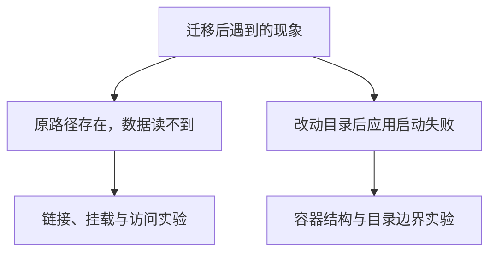

# 博客文章列表

AppPorts 的一些选择，来自看似成功的迁移之后暴露的问题。这里把实验、失败和后来的改进串起来，解释这些选择是怎样形成的。

## 为什么选择挂载迁移，又为什么是 APFS {#mount-and-apfs}

符号链接还在，应用为什么读不到数据？磁盘映像看起来更灵活，为什么没有成为默认方案？从最初的访问实验，到拔盘、重启和真实外盘验证，回顾这条路线的取舍。

[阅读：为什么 AppPorts 选择挂载迁移，又为什么是 APFS](/docs/blog/why-mount-and-apfs)

## 为什么有些数据目录不能迁移 {#directory-boundaries}

一次企业微信启动崩溃，让调查从 `tmp` 目录追到了系统容器检查。哪些目录必须留在本机？为什么子目录能挂载，也不一定适合迁移？这篇文章给出证据和当前边界。

[阅读：为什么有些数据目录不能迁移](/docs/blog/data-migration-boundaries)

## 怎样阅读这些文章 {#reading}

文章标明实验日期、系统与应用版本，并区分真实应用测试、隔离样本和代码核对。过去一次成功或失败，只能说明相应条件下的结果；当前行为以文章注明的代码基线为准。

想直接操作，可从[快速开始](/docs/faststart)进入。原先独立的六篇实验已融入这两篇文章，可按下面的主题直接定位。遇到陌生概念，可查[名词解释](/docs/glossary)。

## 按实验主题查阅 {#experiments}

| 想了解的事情 | 所在章节 |
| --- | --- |
| 链接还在，应用为什么读不到 | [符号链接的路径与签名对照](/docs/blog/why-mount-and-apfs#symlink-experiment) |
| 挂载后，哪些应用可用、哪些仍被拒绝 | [挂载与系统授权](/docs/blog/why-mount-and-apfs#mount-experiment) |
| 原生 APFS 和映像如何应对意外断开 | [两轮拔盘实验](/docs/blog/why-mount-and-apfs#unplug-experiment) |
| 重启后为什么还要等数据接回 | [启动时序与实际挂载位置](/docs/blog/why-mount-and-apfs#startup-method) |
| 为什么保护容器骨架、怎样找到这条规则 | [真实崩溃与系统探针](/docs/blog/data-migration-boundaries#starting-point) |
| 文件复制完，为什么还不算验证完整 | [属性、晚写入与完整往返](/docs/blog/data-migration-boundaries#copy-and-switch) |

已停用的功能和未采用的方案，另见[历史功能归档](/docs/archive/overview)。
