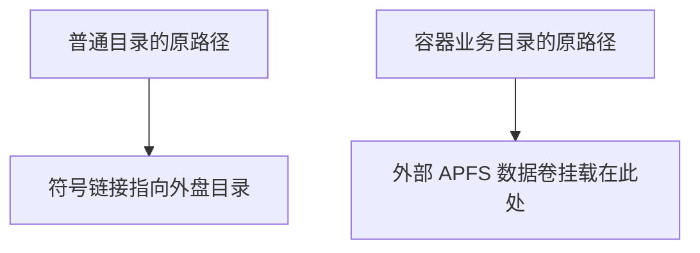

# 数据迁移方式

应用保存数据时，通常会访问一个固定位置。AppPorts 要解决的不只是把文件复制出去，还要让应用在迁移后仍能找到需要的数据。

## 普通目录：链接迁移 {#symlink}

对适用的普通目录，AppPorts 把数据移到外置存储，在原位置留下一个符号链接。应用访问原位置时，会沿链接找到外部数据。

工具缓存、部分应用支持文件和自选目录可以采用这种方式，具体以检查结果为准。链接依赖目标仍在原位置；手动移动外部数据后，原链接可能失效。

## 容器数据：挂载迁移 {#mount}

一些应用的数据放在系统管理的“容器”里。容器有自己的访问限制，不能假设在原位置放一个链接，应用就能访问链接指向的任何地方。

对符合条件的容器业务目录，AppPorts 会在外置盘创建专用 APFS 数据卷，把数据复制进去，再把卷接到原目录。应用仍从原来的路径访问数据，这个过程叫**挂载迁移**。

| 比较 | 链接迁移 | 挂载迁移 |
| --- | --- | --- |
| 原位置保留什么 | 指向外部位置的链接 | 接入外部数据卷的目录 |
| 典型用途 | 工具目录、自选文件夹和适用的普通数据 | 通过检查的容器业务数据 |
| 外部存储条件 | 取决于内容与文件系统能力 | 当前要求APFS |
| 是否自动重签应用 | 当前迁移流程不自动重签 | 不需要替换应用签名 |

## 为什么不是整个容器都能搬 {#structure}

容器中既有业务数据，也有系统要求保持原状的结构。即使复制和挂载成功，改变受保护的结构仍可能让应用无法启动。

因此，AppPorts 可以展示某个目录，却不提供迁移按钮。不要把“看得见”理解成“可以移动”，也不要通过自选目录绕过保护。相关实验见[为什么有些容器目录不能搬](/docs/blog/data-migration-boundaries#starting-point)。

## 迁移成功还需要什么 {#access}

应用能否使用迁移后的数据，还取决于外置盘在线、系统授权和应用自身行为。AppPorts 有权移动数据，不等于应用已经获得读取外部存储的权限。

迁移完成后，确认状态正常，再打开应用检查原有内容和保存功能。重要数据应另有备份；副本检查不能保证任意后台程序都不会继续改写源数据。

相关内容：[迁移数据的步骤](/docs/datamigrae/operation) · [挂载与系统授权实验](/docs/blog/why-mount-and-apfs#mount-experiment) · [经典模式](/docs/classic-mode) · [名词解释](/docs/glossary)

延伸阅读：[为什么 AppPorts 选择挂载迁移，又为什么是 APFS](/docs/blog/why-mount-and-apfs) · [数据目录的迁移边界](/docs/blog/data-migration-boundaries)。
