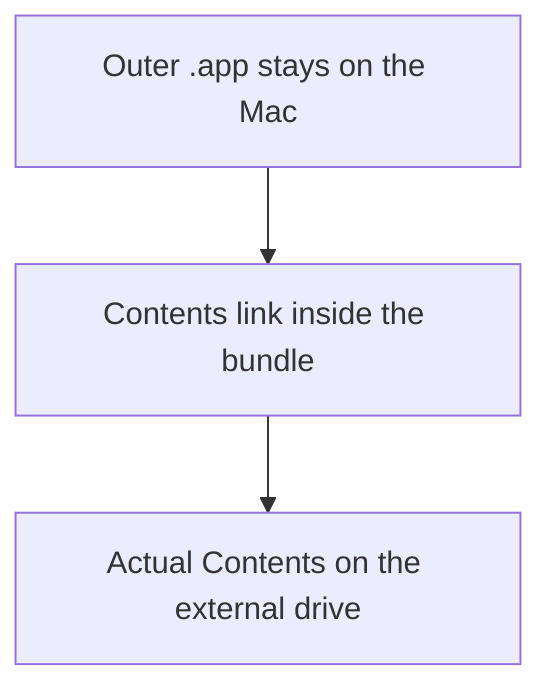

# Archived: earlier app migration methods

::: warning Historical methods and prototypes
This page explains older entry layouts and implementation changes. For the current default, see [app migration methods](/docs/migration-strategy/portal). Recognizing an old entry does not mean new migrations will choose that layout.
:::

## Contents directory migration {#deep-contents}

The early Deep Contents Wrapper moved an app's `Contents` externally while retaining the outer `.app` locally, with links to external contents. It aimed to keep a familiar app appearance while freeing local space.

Some apps and updaters resolve links and replace, delete, or modify the real external contents. This made paths, signatures, and updates difficult to handle consistently. Historical release notes show Stub Portal being introduced from 1.2.0 to replace this direction. AppPorts still recognizes old Contents layouts for management, but does not use them as the default for new migrations.

## Whole-app symbolic links {#whole-symlink}

Whole App Symlink moves an entire app externally and creates a local symbolic link to its `.app`. The layout is simple, but Finder may display a link arrow, and updating, resource lookup, and system integration depend on the app.

The manual “Migrate with Traditional Link” action remains available, and scanning and recovery recognize existing layouts. App suites can also contain external links. Whole-app symlinks are a historical approach that remains selectable, not a universally retired feature. A link does not by itself indicate a broken migration, and launchers should not all be replaced manually with whole-app links.

## Earlier updater-framework hybrid entries {#legacy-hybrid}

Older implementations included Sparkle Hybrid and Electron Hybrid, linking frameworks, resources, and other external components from a local app wrapper. These layouts are still recognized so AppPorts can find the real app, restore it, or unlink it. They are no longer the default for new migrations.

These historical hybrid entries differ from the Transparent Hybrid prototype below. The word “Hybrid” alone does not identify the same feature across different periods.

## Changes to the launcher {#stub-versions}

Stub Portal keeps only a local launch entry and opens the real external app. Early implementations used a script launcher. The 1.6.2 changelog records a native launcher introduced to improve opening associated documents by double-clicking.

Older documentation also distinguished launch entries for ordinary Mac apps and iOS apps. That distinction served launching and system recognition; it did not imply re-signing iOS apps or bypassing device support. AppPorts currently chooses the entry method, without requiring users to choose a script or native implementation.

Scanning and compatibility handling identify the specific version of an existing entry. Describing every historical launcher as one implementation would overlook older records that still need handling.

## Transparent Hybrid prototype {#hybrid}

Transparent Hybrid is a prototype present in the code but disabled by default. It tries to combine a local app appearance with access to external contents. It is not a recommended end-user option or an established replacement offered by this page.

Prototypes are documented separately from the released default so that “exists in code” is not mistaken for “available to select.” For current functionality, start with [migrate apps](/docs/core).

## Existing older migrations {#existing}

Do not delete a working entry merely because its method is historical. When changes are needed, connect the original drive and use AppPorts' move-back or link-management operations after checking that the real app and its data exist. Restoring the app itself does not automatically restore separately migrated data.

Related: [restore and relink](/docs/restore) · [update protection](/docs/migration-strategy/portal#updates) · [historical feature archive](/docs/archive/overview)
