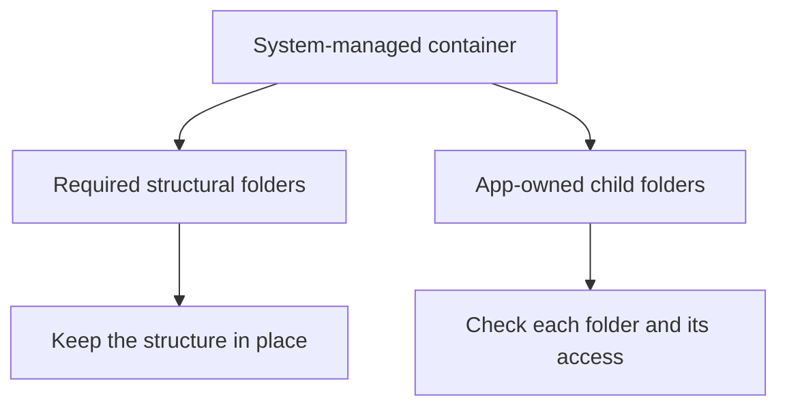

# Why some data directories cannot be migrated

**Compiled: October 15, 2026 · Main experiments: October 1, 2026**

## Abstract {#abstract}

In a WeCom failure, data had been copied and the external volume mounted successfully, yet the app crashed at startup. Investigation found that macOS checks certain fixed container directories. Even when their paths look unchanged, placing them on another filesystem can cause rejection.

Later experiments revealed another boundary: some business-data subdirectories pass startup structure checks, but becoming a mount point changes cross-volume moves and deletion of the directory root. AppPorts must consider system structure, directory hierarchy, app workflows, and copy consistency together. A folder being copyable is insufficient.

This article combines historical experiments with AppPorts 1.9.1 development code, fixed at public commit `468c788`. It does not imply every described behavior was released in v1.9.0. Personal paths, account identifiers, and business content are excluded.

## 1. Migration succeeded, so why would the app not open? {#starting-point}

[Public issue #65](https://github.com/wzh4869/AppPorts/issues/65) reported WeCom crashing after some data was migrated. AppPorts logs recorded successful copying and mounting. That established completion of those operations, not acceptance of the new layout by the original app.

The report and reproduction used different environments:

| Item | Issue report | Reproduction |
| --- | --- | --- |
| OS | macOS 27.0.1 (26A434) | macOS 27.0 (26A428), Apple Silicon |
| WeCom | 5.0.11 (99998) | 5.0.11 (99998), official signature retained |
| Storage | External APFS | External USB APFS |
| Method | AppPorts 1.9.0 | Independent test volumes and equivalent low-level creation/mount operations |

The reproduction did not rerun the entire AppPorts UI workflow. It preserved original directories, changed layouts individually, and checked the main interface, crash records, and actual access to narrow the cause.

| Condition | Observation |
| --- | --- |
| Original data kept local | Main interface opened normally. |
| Only `Data/tmp` mounted externally | Crashed quickly; restoring local `tmp` restored startup. |
| Only `Data/Documents/cefcache` migrated | Started normally; external data access observed. |
| Business directory external, `tmp` replaced with a local copy | Started normally despite a different directory object. |
| `tmp` mounted externally again in that setup | Same crash returned. |

Failed `tmp` samples had the same ordinary permissions and ownership as the original. The successful local copy also excluded “any replacement directory object fails.” Both failures pointed to a pre-startup container-integrity check.

### Why change one condition instead of repeating migration? {#hypotheses}

Moving several directories together only shows that a problem followed that group of changes. It does not identify the responsible directory or distinguish copying, mounting, authorization, and app behavior.

The experiment returned to a working local baseline, then changed one condition. Mounting only `tmp` reproduced failure; restoring it restored use. With a verified business directory kept external, comparing local and external `tmp` again tested whether the fault followed that variable.

| Possible explanation | Check | Supported conclusion |
| --- | --- | --- |
| Incomplete copying | Preserve originals, compare local and external copies, and trace the system denial. | The local copy started; failure was not simply caused by having copied once. This did not verify every attribute of every business file. |
| Wrong ownership or permissions | Compare ordinary mode, owner, and group with the original. | Failure remained with matching values, so obvious differences in those fields did not explain it. |
| Changed directory-object identity | Replace the directory with a new local copy. | The new object worked; changing the object alone did not cause failure. |
| All external data is denied | Keep `tmp` local and mount only `cefcache` externally. | Successful business-data access ruled out a blanket claim that WeCom cannot use external storage. |
| Fixed structure belongs to another filesystem | Align failure logs, system branches, and independent layouts. | All three pointed to a filesystem device-ID mismatch for `tmp`. |

These exclusions have limits. A successful local copy does not validate every copier, and matching permission bits does not rule out all authorization mechanisms. They narrowed this particular failure enough to guide the next investigation.

## 2. From logs to system checks and back to experiments {#investigation}

The failing process's system logs contained a key reason:

```text
directory tmp is on a different device
```

Here, **device means a filesystem device identifier**, not a drive brand, interface, or “external” label. Two APFS volumes on the same physical disk can have different identifiers. Sharing hardware or APFS format does not automatically satisfy the check.

Read-only analysis of that OS version's AppContainer framework located the directory-validation function through the error string, inspected its control flow and fixed path table, then called the original system validator on synthetic containers for positive and negative comparisons. Return values were not modified, and state-changing registration interfaces were not used as probes.

The validator checks the device relationship between `Data` and the container parent, then a fixed set of entries. Existing fixed entries must be acceptable real directories on the same filesystem as the reference directory. It does not recursively check arbitrary business-data descendants.

### First probe: the same volume at different positions {#first-probe}

The first isolated probe used independent synthetic directories and one new external APFS volume. Each layout was tested with both WeChat and WeCom identifiers. It called only directory validation: neither real app was launched, and neither real directory tree was replaced. Six layouts with two identifiers produced 12 records.

| Synthetic layout | WeCom identifier | WeChat identifier |
| --- | --- | --- |
| All structure local | Passed | Passed |
| Same external volume at `Data/tmp` | Rejected | Rejected |
| Volume at `Data/cache-probe` | Passed | Passed |
| Volume at `Data/Documents/cache-probe` | Passed | Passed |
| `tmp` replaced by a symlink to a local directory | Rejected | Rejected |
| Local structure restored | Passed | Passed |

Keeping the volume constant while changing its location distinguished an unusable volume from a position that cannot become another volume. Both business paths passed, showing the importance of hierarchy. The local-symlink failure showed that device relationships alone were insufficient: the fixed entry also had to be an accepted directory type.

### Second probe: the full table and entry conditions {#second-probe}

A second probe used two 128 MB local APFS disk images sequentially with synthetic directories. It added or removed no volumes on real external drives and did not test removable-volume privacy authorization. Of 144 records, all 136 predefined assertions matched expectations; eight others recorded entry-opening behavior. Many were **expected rejections**, not 144 successful app runs.

| Layout | Original system function or entry result |
| --- | --- |
| Fixed structure local | Passed. |
| Each of the 11 fixed entries mounted on another volume | All rejected. |
| Each fixed entry replaced by a local symlink | All rejected; a link did not replace the required real directory. |
| Deeper test subdirectory mounted beneath each fixed entry | Passed the tested structural check. |
| One fixed-table entry missing | That function skipped the missing entry. |
| `Data` missing, unsearchable, or reached through a disallowed link | Could fail before validation at the entry stage. |

Skipping a missing entry does not authorize deleting system directories to avoid checks. Upstream container management also creates, repairs, and verifies identity; path permissions affect whether validation can even be reached.

A symlinked `Data` entrance was particularly easy to misread. Deliberately opening its target permissively and passing an already-open directory to the validator could pass. Opening it under the real entrance's no-symlink-search conditions failed earlier. **An internal function passing after bypassing entry conditions does not establish a working real startup.**

Permission experiments made the same point. The validator did not require every directory to have one exact mode, but an unsearchable intermediate `Library` could prevent checks below it. No direct comparison of permission bits does not mean permissions are irrelevant.

### Why the error appears during app startup {#failure-chain}

The inspected implementation can be summarized as follows. This is an interpretation of one system version, not Apple source code or a stable public API:

```text
Read the container parent's filesystem device identifier
Open Data and check its device relationship with the reference directory
For each fixed path:
  Missing entry → skip this item
  Other read error → reject
  Unacceptable directory type → reject
  Different filesystem from the reference → reject
All checks pass → continue
```

The directory failure propagated upward as `EINVAL` (“invalid argument”), then sandbox initialization failed and the app exited with `SIGTRAP`. This `EINVAL` did not come from the mount command. Successful mounting and subsequent startup failure can both be true.

Existing registration and sandbox-configuration caches were also investigated. In the traced call order, cached configuration did not replace the earlier container check. The inspected paths did not reveal an SDK-based `tmp` exemption for WeChat. Both real main executables retained valid official signatures. This conclusion covers those inspected paths, not every identity-dependent branch in macOS.

The probes used both app identifiers, but **did not launch real WeChat after moving its `tmp`**. A structural probe, a real startup, and complete business testing are distinct evidence.

## 3. Which directories cannot move as a whole? {#protected-directories}

Here, “container” means an app's data area under `~/Library/Containers/`, not an APFS container on a disk.

A simplified ordinary app container is:

```text
~/Library/Containers/app-identifier/
└── Data/
    ├── Documents/                 Fixed structure
    │   └── business-data/         Requires separate evaluation
    ├── Library/                   Fixed structure
    │   └── Application Support/   Fixed structure
    │       └── business-data/     Requires separate evaluation
    └── tmp/                       Fixed structure
```

AppPorts protects **ordinary container roots, `Data` itself, and these 11 exact nodes**. Paths below are relative to the app container's `Data`, not the user's personal `~/Documents` or all of `~/Library`.

| Protected exact node | Protected exact node |
| --- | --- |
| `Documents` | `Library` |
| `Library/Application Scripts` | `Library/Application Support` |
| `Library/Caches` | `Library/Images` |
| `Library/Logs` | `Library/Preferences` |
| `Library/Saved Application State` | `SystemData` |
| `tmp` | |

Protection applies to the nodes themselves, not automatically every descendant. `Documents` cannot move as a whole, but not every business-data child is forbidden by that same rule. Nodes outside `Data` inside an app container are not treated as arbitrary ordinary business directories either.

Two independent rules also apply:

- **Group-container roots:** `~/Library/Group Containers/group-identifier` is protected. Group containers have separate layouts and authorization relationships. The table cannot simply be applied to their roots; children still need other checks.
- **WeChat compatibility scope:** for `com.tencent.xinWeChat`, the current policy permits only direct account children of `Data/Documents/xwechat_files`, plus `Data/Library/Application Support/com.tencent.xinWeChat`. Real account identifiers are not published.

The WeChat policy is narrower than the general structural table. Earlier access tests succeeded at the higher `xwechat_files` level, so its entire restriction cannot be attributed to an explicit macOS prohibition. This is AppPorts' chosen compatibility scope. Execution still requires volume, occupancy, and parent/child checks. See the [path policy](https://github.com/wzh4869/AppPorts/blob/468c7889f367281543c96e9c8f40515c37b65403/AppPorts/Models/DataPathPolicy.swift).



### A directory name alone does not establish ownership {#path-ownership}

Different apps have their own `Data/Documents`; the shared name does not make them the same directory. Containers can also include shortcuts to personal Desktop or Downloads locations. A familiar name does not prove exclusive app ownership.

The policy recognizes structure using the actual user's container roots and exact path components, checking both the visible path and the symlink-resolved path. It does not apply all container rules to an unrelated folder merely named `Containers`, and aliases cannot remove protection from a real container.

Execution also rejects moving all of `~/Library/Containers`, `~/Library/Group Containers`, or an ancestor containing those roots. Selecting a larger parent therefore cannot bypass protection. Showing more directories, expanding structure, or entering through custom folders grants no new migration permission.

## 4. What successful business-directory tests establish {#business-directories}

After excluding `tmp`, four WeCom directories containing real data were tested:

| Container-relative path | Role |
| --- | --- |
| `Data/Documents/cefcache` | App business-data directory. |
| `Data/Documents/Profiles` | App business-data directory. |
| `Data/Library/Application Support/WXWork` | App support data. |
| `Data/Library/WebKit` | WebKit data used by the app. |

Four directories produce 15 nonempty combinations: four singles, six pairs, four triples, and one group of four. The main process was observed for at least about 30 seconds per combination, checking basic UI, actual external access, and volume identity. All 15 passed these checks with no new related crash.

For each group, the app was quit, the selected test volumes were mounted, and the app restarted. A window alone was insufficient: basic UI had to work, external data had to be opened, and the accessed volume had to be the specified test volume. Otherwise the app might merely have loaded another local copy.

Each single-directory case also received another complete UI and identity check, explaining 19 original records but only 15 distinct combinations. Open-file records are not unique-file counts: multiple processes or repeated opens can refer to the same file. Combination count, observation duration, and checks describe coverage more accurately than log volume.

These results show that some business directories can move while fixed structure stays local. They do not validate all WeCom features or data. Every group was not reset to one identical initial snapshot, and the study did not cover every order of migration, long-running use, upgrades, first login, or disconnect/reconnect.

The issue's `UpgradeBeta`, `Wedoc`, and `AIModel` directories contained no real data at the time. Empty folders were not substituted for business testing. There were not seven directories with all 127 combinations validated.

## 5. Why temporary subdirectories deserve caution {#temporary-directories}

If `tmp` cannot move, could its children move instead? An experiment used independent copies of 25 hidden temporary directories in synthetic containers and owned APFS disk images. Real WeCom directories were not moved, and the app was not launched.

All 25 children passed the original structural validator. Hidden names were not the restriction. But after emptying the experimental copies, **deleting every mount root failed** with `EBUSY` (“resource busy”). Newly created random temporary siblings stayed local; moving an old child did not redirect future siblings externally.

The experiment compared relative paths, file types, mode bits, lengths, content hashes, and symlink targets before and after copying/restoring. All 25 matched. However, an independent experimental copy tool was used, and manifests did not cover ACLs, every extended attribute, or all timestamps. This was not complete preservation acceptance for the production migrator.

It separates three questions: whether a hidden directory is discovered, whether its contents can be copied, and whether its lifecycle suits a permanent mount. Better scanning can improve size reporting without making every hidden byte safely reclaimable.

A finer filesystem comparison explained the result:

| Operation | Ordinary local directory | Independent APFS mount point |
| --- | --- | --- |
| Create, read, and delete files inside | Succeeded | Succeeded. |
| Rename and replace a file inside the same directory | Succeeded | Succeeded. |
| Atomically move from local `tmp` into the migrated directory | Succeeded | Cross-filesystem `EXDEV`. |
| Create a hard link from local `tmp` into it | Succeeded | Cross-filesystem `EXDEV`. |
| Delete the empty directory root | Succeeded | Busy mount point, `EBUSY`. |
| Replace the root with another directory, or move it across parents | Succeeded | Tested operations returned `EXDEV`. |
| Rename the root to an absent name within the same parent | Succeeded | Succeeded under the tested conditions; mount points cannot be described as universally unrenamable. |

An atomic move switches a name or location in one operation without exposing a half-copied state. If an app prepares a file in local temporary storage and atomically replaces an external destination, the paths now span filesystems and the original operation no longer works. Higher-level APIs may copy then delete, but that changes the atomicity guarantee.

Temporary directories are often deleted, replaced, and regenerated as units. Mounting an old child may interfere with cleanup while failing to keep future temporary data external. This conclusion comes from isolated filesystem experiments; **the complete WeCom cleanup-failure workflow was not traced and reproduced**.

The detailed matrix used a synthetic container and 256 MB APFS image, producing 44 structure, syscall, database, and new-directory records. Successful reads/writes and failed deletions/renames are both results, not 44 successful app runs. Path-authorization tests used custom sandbox rules; SQLite and new-directory controls did not use those rules. None reproduces the full WeCom runtime environment.

Imagine an app creating temporary directory A at launch, deleting it at exit, and creating B next time. Mounting A changes the conditions for deleting A, while B still appears locally. One successful session using A does not move all future temporary data externally. Stable business-data roots differ fundamentally from random temporary units.

The current code has an important remaining distinction: general container policy protects `tmp` itself but **does not comprehensively block every descendant**. WeChat's additional rules restrict that subtree. The recommendation against migrating random temporary directories by default is evidence-based guidance, not a claim of an already universal enforcement feature.

## 6. Why moving a parent differs from moving a child {#topology}

Files inside one business directory originally share a volume. Mounting several children on separate volumes creates filesystem boundaries between siblings. Conversely, moving a parent containing an already-mounted child can omit child-volume data or create overlapping management.

An older isolated experiment found that one enumeration method in the old copier did not descend into child mounts encountered during traversal. A successful parent copy therefore did not establish that mounted contents had copied. This is not a conclusion about all enumeration APIs, but shows why checking only the selected directory is inadequate.

AppPorts now checks managed parents and children, actual mounts, symlink aliases, offline records, and unfinished operations. To change granularity, first restore existing migrations through AppPorts, then select the new level. Do not stack parent and child migrations. See [path topology checks](https://github.com/wzh4869/AppPorts/blob/468c7889f367281543c96e9c8f40515c37b65403/AppPorts/Services/DataPathTopology.swift).

If the common parent is protected `Documents` or `tmp`, it still cannot move as a whole merely to preserve same-volume behavior. Narrow the compatible data scope or use the app's own storage-location setting.

### An example of choosing a unit {#granularity-example}

Suppose a business-data directory contains a database, attachments, and its own temporary files. This is illustrative, not a recommended path for a real app:

```text
business-data/
├── database/
├── attachments/
└── business-temporary-files/
```

If the parent is eligible, moving it as one volume preserves same-volume operations among all three. Moving database and attachments separately while leaving temporary files local introduces boundaries. Compatibility depends on whether the app needs atomic renames, hard links, or whole-directory replacement between them.

This does not mean parents are always better. The parent may be protected or contain managed children. First establish the allowed scope, then file relationships and existing migrations, then choose a stable unit that can be verified.

Offline records must participate. Disconnecting a drive makes data temporarily invisible; it does not erase the migration relationship. Otherwise, a new migration at the empty entry could create overlapping records when the original drive returns.

## 7. What remains to verify after a path is allowed? {#copy-and-switch}

There is also a timing boundary: background processes can keep writing to the original during copying.

### Method: separate content, attributes, and timing {#integrity-method}

On October 1, 2026, synthetic-data experiments on macOS 27.0 (26A428), Swift 6.4, arm64 tested three issues using the older copy implementation.

First were static attributes. Files, directory attributes, and hard-link relationships were created and compared after copying. Matching hashes establish matching bytes, not ACLs, extended attributes, or two names referring to one file object.

Second were writes during copying. An independent process held a file or SQLite connection and synchronized with the copier through its existing progress interface. New writes were deliberately placed between file-copy completion and the method returning success. Control signals lived outside the copied tree so they did not contaminate the sample.

Third was a complete round trip. Old migration and restoration interfaces ran inside an independent 4 GiB unencrypted APFS image, checking switching, backup cleanup, and restored results. This was API-level validation, not a UI migration of real user data or a physical unplug test.

### Results: success can still return stale data {#integrity-results}

| Experiment | Comparison | Result |
| --- | --- | --- |
| Same-volume attribute copy | Content, attributes, and file relationships. | Ordinary file contents matched; some directory ACLs, file flags, group attributes, and hard links were not fully preserved. |
| Static ordinary-file control | Independent writer remained idle. | Source and destination matched. |
| Late ordinary-file writes at two timings | Modify an old file and add another after its copy or during the final progress callback. | Old method returned success; destination omitted changes. |
| Static SQLite control | Connection open without further commits. | One row on each side, matching contents. |
| Late SQLite commits at two timings | Commit after WAL copied or during the final progress callback. | Source had three rows, destination one; both integrity checks returned `ok`. |
| Static image round trip | Static files and a closed 100-row database. | Contents matched after migration and restoration. |
| Late-write image round trip | Final callback changed source from 19 to 48 bytes and synchronized it. | Old workflow succeeded and removed the original backup; mounted and restored content remained 19 bytes. |

SQLite's WAL records committed changes beside the database. The test placed the first row in WAL, then committed rows two and three during a controlled wait. An independent marker confirmed the commits before the copier could return. The missing rows were not simply uncommitted writes.

Both `integrity_check` results were `ok`: the destination was a structurally readable old version, not evidence of physical corruption or a torn transaction in this sample. A database opening does not prove that its latest records survived.

The two static controls and four late-write cases are not a failure-rate sample. Timing was arranged deliberately; ordinary progress callbacks do not normally wait this way. The value was proving that the old method permitted this ordering, motivating checks before switching and cleanup. It did not prove that a particular real app necessarily keeps writing after exit.

### How the implementation responds {#copy-current}

The current data copier validates content and portable metadata, and migration rechecks the relevant baseline before switching and cleanup. It retains material when originals change or identity cannot be established. It does not follow unknown child mounts or ignore unsupported file relationships merely to declare a copy successful. See [TreeCopySession](https://github.com/wzh4869/AppPorts/blob/468c7889f367281543c96e9c8f40515c37b65403/AppPorts/Utils/TreeCopySession.swift).

This cannot freeze arbitrary background writers. System-managed labels, ordinary file attributes, and special nodes have distinct handling, so early experimental rejection boundaries are not automatically today's feature limits.

| Finding | Current response | Remaining limitation |
| --- | --- | --- |
| Hiding a button leaves other routes to protected structures | `DataPathPolicy` classifies paths; `DataOperationSafety` rechecks at execution. | Cannot statically infer every third-party workflow. |
| Parent/child or offline relationships overlooked | Check real paths, aliases, managed records, and unfinished operations together. | Disconnecting a drive or changing the entry does not remove history. |
| App quit but another process still holds data | Check related apps and identifiable writers; stop if checks fail. | An observation at that time cannot lock out arbitrary future writes. |
| Matching content but changed attributes or relationships | Dedicated tree copier checks bytes, portable attributes, and supported relationships. | Does not promise identical inodes, access times, or physical compression representation. |
| Originals change after copying | Recheck the relevant content baseline after the final progress callback and before switching or cleanup. | A passed check is not permanent proof. |
| Unexplained new contents at original or destination | Retain material and record failure/recovery state instead of overwriting another dataset. | Cannot decide how independently changed business data should merge. |

See [DataOperationSafety](https://github.com/wzh4869/AppPorts/blob/468c7889f367281543c96e9c8f40515c37b65403/AppPorts/Services/DataOperationSafety.swift) for execution checks. Its [regression cases](https://github.com/wzh4869/AppPorts/blob/468c7889f367281543c96e9c8f40515c37b65403/AppPortsTests/DataOperationSafetyTests.swift) cover structural nodes, offline and parent/child records, old links, corrupt record stores, and holders. These tests are not new real-app compatibility claims.

### Questions the integrity experiments do not answer {#integrity-limits}

Same-volume attribute tests do not establish preservation of every owner or attribute on arbitrary destination filesystems. A static image round trip does not substitute for physical drives, power loss, or every app feature. Old counterexamples motivated current safeguards; they do not establish identical failures in the current version.

Save and quit related apps, downloads, builds, and sync jobs first. Resolve unknown holders or check errors. Integrity verification does not replace an independent backup.

## 8. A practical way to judge candidates {#practical-boundary}

| Situation | Interpretation |
| --- | --- |
| Container root, `Data`, or a fixed structural node is locked | That node cannot be newly migrated as a whole; permitted business children may still be inspected. |
| A WeChat level has no migration action | An additional compatibility rule may apply; deeper is not automatically less restricted. |
| A temporary directory uses space or is selectable | Size, visibility, and suitability for lasting migration are separate. |
| A parent or child is already migrated | Resolve the existing relationship before adding another migration. |
| Checks find writing, conflicts, or incomplete access | Stop, retain existing data, and investigate. |
| An older release moved a directory now protected | Restrictions on new migration do not remove historical restore routes; follow [restore](/docs/restore). |

A usable candidate must satisfy structural rules, have no topology conflict, contain verifiable data, and be accepted by the app in its new layout. Even after an item is offered for migration, check original content and saving afterward.

## 9. Research scope and references {#references}

The internal system check is specific to macOS 27.0 (26A428), not a stable public interface promised by Apple. The real-app matrix is limited. Other versions, group-container members, helpers, long-term use, and hardware failures require separate validation. This article compiled existing records and inspected code without rerunning destructive experiments.

- [AppPorts issue #65](https://github.com/wzh4869/AppPorts/issues/65): incident background; report and reproduction used different OS versions.
- [Container-structure experiments](/docs/blog/data-migration-boundaries#starting-point): conditions and limits of real startup and system-function probes.
- [Data-integrity experiments](/docs/blog/data-migration-boundaries#copy-and-switch): attributes, background writes, and round-trip counterexamples.
- [Path-policy regression cases](https://github.com/wzh4869/AppPorts/blob/468c7889f367281543c96e9c8f40515c37b65403/AppPortsTests/DataPathPolicyTests.swift): WeChat's additional scope and historical behavior.
- [Apple's public XNU filesystem implementation](https://github.com/apple-oss-distributions/xnu/blob/main/bsd/vfs/vfs_syscalls.c): cross-volume rename, hard-link, and mount-root deletion rules. Public source is not guaranteed to match the tested kernel line for line; local comparisons separately support the results here.

Continue: [why mount migration and APFS](/docs/blog/why-mount-and-apfs) · [migrate data](/docs/datamigrae/operation) · [glossary](/docs/glossary)
