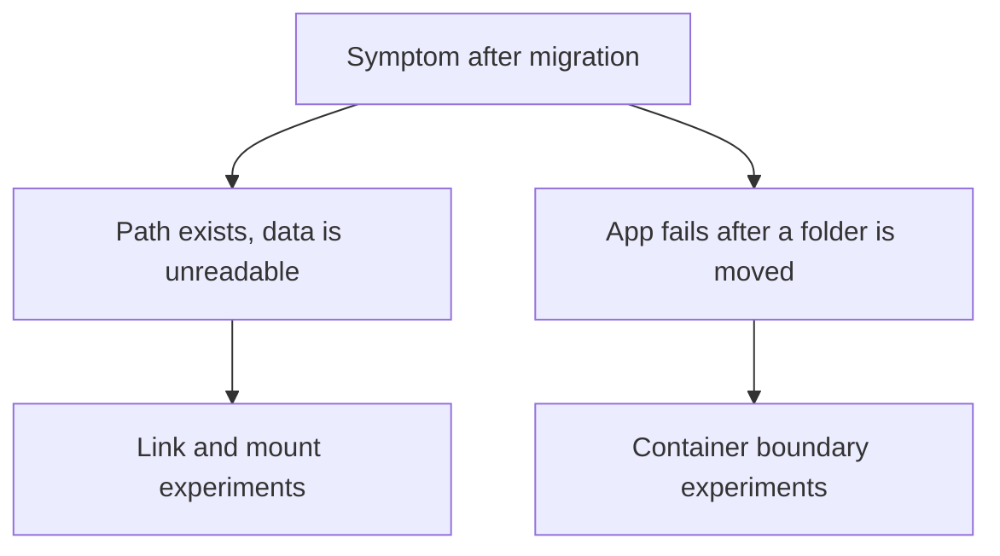

# Blog articles

Some AppPorts decisions came from problems discovered after migrations that appeared successful. These articles connect experiments, failures, and later improvements to explain how those decisions developed.

## Why mount migration, and why APFS? {#mount-and-apfs}

Why can an app fail to read data when its symbolic link still exists? Disk images seem more flexible, so why are they not the default? Follow the tradeoffs from the first access experiments through unplugging, restarting, and validation on real external drives.

[Read: Why AppPorts chose mount migration and APFS](/docs/blog/why-mount-and-apfs)

## Why some data directories cannot be migrated {#directory-boundaries}

A WeCom startup crash led an investigation from the `tmp` directory into system container checks. Which directories must remain local? Why is a subdirectory not necessarily suitable for migration even when it can be mounted? This article explains the evidence and current limits.

[Read: Why some data directories cannot be migrated](/docs/blog/data-migration-boundaries)

## How to read these articles {#reading}

Articles identify dates, OS and app versions, and distinguish real-app tests, isolated samples, and code inspection. A past success or failure establishes only what happened under those conditions. Current behavior is tied to the code baseline named in each article.

For practical instructions, start with [quick start](/docs/faststart). The six formerly separate experiments are now incorporated into these two articles; use the topic links below to find them. Unfamiliar terms are explained in the [glossary](/docs/glossary).

## Find an experiment by topic {#experiments}

| Question | Section |
| --- | --- |
| Why can an app not read data through an existing link? | [Symbolic-link paths and signatures](/docs/blog/why-mount-and-apfs#symlink-experiment) |
| Which apps work after mounting, and which are still denied? | [Mounting and system authorization](/docs/blog/why-mount-and-apfs#mount-experiment) |
| How do native APFS and images handle an unexpected disconnect? | [Two unplug-test rounds](/docs/blog/why-mount-and-apfs#unplug-experiment) |
| Why can data take time to return after a restart? | [Startup timing and actual mount locations](/docs/blog/why-mount-and-apfs#startup-method) |
| Why protect the container skeleton, and how was the rule found? | [A real crash and system probes](/docs/blog/data-migration-boundaries#starting-point) |
| Why does finishing the file copy not finish verification? | [Attributes, late writes, and a complete round trip](/docs/blog/data-migration-boundaries#copy-and-switch) |

For retired features and approaches not adopted, see the [historical feature archive](/docs/archive/overview).
