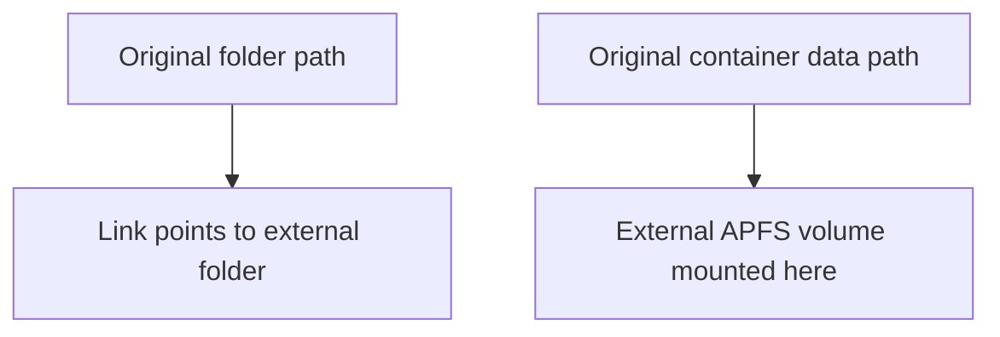

# Data migration

Apps usually look for data at a fixed location. AppPorts must do more than copy files elsewhere: the app still needs to find them after the move.

## Ordinary directories: link migration {#symlink}

For eligible ordinary directories, AppPorts moves data to external storage and leaves a symbolic link at the original location. Access through that location follows the link to the external data.

Tool caches, some application-support files and custom folders can use this method, subject to checks. The target must remain where the link points; moving external data manually can break the link.

## Container data: mount migration {#mount}

Some apps store data in system-managed containers. Containers have access restrictions; leaving a link at the original path does not necessarily let the app access any target that link names.

For eligible container data directories, AppPorts creates a dedicated APFS volume on the external drive, copies the data into it and attaches that volume at the original directory. The app continues to use the same path. This is **mount migration**.

| Comparison | Link migration | Mount migration |
| --- | --- | --- |
| What remains at the original location | A link to an external location | A directory where the external volume is attached |
| Typical use | Tool directories, custom folders and eligible ordinary data | Container data that passes the checks |
| External storage requirements | Depend on content and filesystem capabilities | Currently requires APFS |
| Does it automatically re-sign the app? | Current migration does not automatically re-sign | Replacing the app signature is unnecessary |

## Why the whole container cannot simply move {#structure}

Containers hold both application data and structures macOS requires to remain intact. Changing protected structure can prevent launch even when copying and mounting succeed.

AppPorts may therefore display a directory without offering migration. Visibility does not establish eligibility. Do not bypass protection through a custom-folder selection. See [why some container directories cannot move](/docs/blog/data-migration-boundaries#starting-point).

## What else is needed for success {#access}

Access also depends on the drive being online, system authorization and the app's own behavior. AppPorts having permission to move data does not grant the app permission to read external storage.

After migration, check the state, open the app, and verify existing content and saving. Keep a separate backup of important data. Copy verification cannot guarantee that every background program has stopped changing the source.

Related: [migration steps](/docs/datamigrae/operation), [mount and authorization experiments](/docs/blog/why-mount-and-apfs#mount-experiment), [classic mode](/docs/classic-mode), and the [glossary](/docs/glossary).

Further reading: [why AppPorts uses mounts and APFS](/docs/blog/why-mount-and-apfs), and [data-directory boundaries](/docs/blog/data-migration-boundaries).
