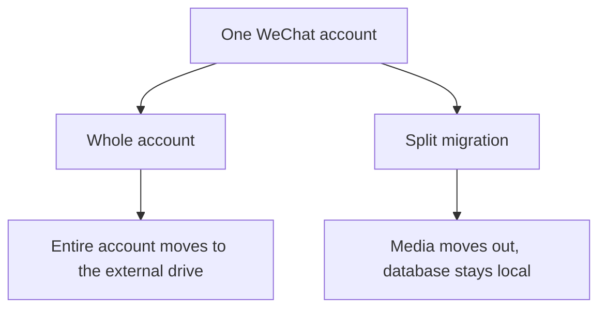

# Move data

Data migration moves application data, tool directories or your own folders. It is independent of moving the app itself: eligible data can move while the app stays local.

## Find the content to move {#choose}

| Content | Where to start |
| --- | --- |
| Messages, caches and other app-related data | App Data in the sidebar; select an app and expand its directories. |
| Package-manager caches, models and tool data | Tool Directories in the sidebar; inspect detected items. |
| Your projects, media or other folders | Directory Migration in the sidebar; use + in the local folder area and choose the source and external destination. |

*Click the arrow beside Caches, then select com.microsoft.VSCode to see its full path below the list. Click the arrow again to collapse the group.*

App Data reuses complete scan results within the current page session so revisiting an app does not rescan every time. Changes to permissions, the destination drive, migration records or mount state trigger fresh checks automatically, and Refresh Cache at the bottom of the sidebar forces remeasurement. When Full Disk Access is not ready, the page displays the permission state and a check entry rather than treating restricted reads as missing data.

The app list on the left shows the total size of the data detected for each app. Apps with migrated data appear first and show separate **Migrated** and **Local** sizes. Use the menu beside search to sort each group by **By Size** (the initial setting), **Default**, or **Alphabetical**. Sizes may be incomplete while the external drive is offline, a data volume is locked, or automatic mounting is paused. Reconnect the original drive, restore the mount, and choose **Refresh Cache** to measure again.

App Data shows eligible items and those needing attention by default. Show locked directory structure adds locked ancestors of actionable items to explain the hierarchy; locked directories with no actionable descendants remain hidden. Enable Show unsupported migration directories to see all ineligible directories. A third switch controls zero-byte directories. **An available migration action does not guarantee execution checks will pass.** Space, permissions, processes using data and parent/child relationships with existing migrations still need checking.

Click status totals such as Linked, Mount Migration or Existing Symlink to show matching items. Necessary parent paths remain visible. Selecting a total does not shrink the other status totals, but other search and filter conditions still affect them. Click again or clear the filter to return; changing app or tab also resets this selection.

A User folder shortcut to Desktop, Downloads or Pictures is not data owned exclusively by the app. Its target size is not counted, and migration and restore are unavailable. Size on this volume and Target size identify measurement scope. Parent and child rows cannot simply be added, and displayed size is not guaranteed freed space.

## Prepare before migration {#prepare}

1. Back up important data, connect the destination drive and check space in the sidebar.
2. Save work and quit apps, tools and background jobs using the data completely.
3. Click the settings gear at the bottom of the sidebar and check permissions under Readiness. AppPorts must run from Applications when moving data out.
4. Check directory name and location rather than guessing ownership from size.

If a related app is running, AppPorts may offer Quit app and continue to request a normal quit. If the app still needs a save or exit confirmation, handle that prompt, then return to AppPorts and choose Continue.

## Ordinary directories {#linked}

For an ordinary directory offering Migrate, click it, check the destination and confirm. AppPorts copies and verifies data, then creates a [symbolic link](/docs/glossary#symlink) at the original location. The resulting state is normally Linked.

Examples include npm and Gradle caches and some model or editor data. Quit the tool's jobs too; do not move directories while downloads, builds or writes are running.

A custom folder must be a real directory inside your home, not the entire home folder, and must not overlap managed directories. Check the destination shown when adding it before migration.

If an existing link points to a disconnected external drive and you want the app to start fresh locally rather than bringing old contents back, choose Force Unlink inside Link Details. After confirmation, AppPorts removes the local link and creates an empty directory without requiring the external drive online or deleting external originals; see [Restore, reconnect and unlink](/docs/restore#unlink).

## Mount migration for container data {#mount}

In default mode, eligible container data uses the Migrate button and follows mount migration after checks. In classic mode, the separate action is Mount Migration. It needs **APFS external storage**, enough space and correct permissions.

1. Choose Migrate in default mode, or Mount Migration in classic mode, and read the storage and permission checks.
2. If requirements are unmet, choose another location or keep the data local. You do not have to erase an existing disk to continue.
3. For an encrypted destination, set a password for the new data volume and choose whether to save it in this Mac’s Keychain. See [encrypted drives](/docs/storage-guide#encrypted-drives).
4. Confirm the data and destination. After completion, its state should be Mounted.
5. Open the original app. If macOS requests Removable Volumes access, authorize according to your preference.
6. Check existing content and perform a normal save.

Clicking Unmount on an individual Mounted data volume unmounts that volume and **persistently pauses automatic remounting** for it without affecting other volumes on the same drive. Restarting AppPorts or reconnecting the drive does not clear this pause; choose Mount explicitly to resume (or Resume automatic mounting if unmounting failed while the volume stayed online).

Mount migration does not replace the app's signature. System authorization and compatibility still apply. If original data is not visible, stop further writes and follow [missing-data checks](/docs/faq#missing-data).

## WeChat accounts: whole or split migration {#wechat}

Choose migration for a recognized WeChat account directory, then select a mode in the account migration panel:

- **Whole migration** moves the selected account's entire directory.
- **Split migration (`msg + business`)** moves media directories while keeping databases (`db_storage`) and configuration local. The confirmation displays moved media size and locally retained size separately.

Wait for a complete size calculation before starting. Fully restore the account’s migrated data before switching modes. When the drive is offline after split migration, moved `msg`, `msg/file` or `msg/video` entries use the same read-only, traversable protection as other managed offline directories so WeChat does not crash from a path-permission error at login; whether existing messages remain readable depends on the WeChat version, and full offline functionality is not guaranteed. Encrypted destinations also need a [data-volume password](/docs/storage-guide#encrypted-drives).

**Large files & videos only** moves just `msg/file` and `msg/video`. Chat attachments and databases stay on this Mac. Files shared with other folders get a separate external copy, and the original data still uses space on this Mac. Restore copies the external version back and leaves the files in other folders intact.

*An existing split migration. The account row shows the combined scope of msg/file and msg/video, its mounted status and the Restore button. WMPF on the next row remains local.*

## Read migration progress {#progress}

Overall progress (estimated) includes preparation, scanning, copying, disk writes, verification rounds, entry switching and cleanup. For multiple directories, the percentage combines their work into one task. Separate steps identify the current directory's preparation, scan, copy, verification, switch and cleanup. **Overall percentage, current-directory steps and copied bytes describe different scopes.** Copying at 100% does not mean the task is complete; freeing space also depends on cleanup.

*Copy-stage example. The 19% at the top estimates the whole operation. The 50% below measures copying for the current directory.*

Scanning and verification show processed items, bytes read or the current file. If activity stops for a while, the window shows time since the last activity. Consider the stage and message before acting; do not disconnect the drive or force quit merely because the percentage is unchanged.

## After completion and when things go wrong {#after}

Connect the drive and confirm reconnection before opening the app; if an app or its data lives inside the selected [APFS app library image](/docs/storage-guide#app-library-image), launching through a refreshed local entry runs a windowless check to reattach the image and its data volumes first. For Awaiting Mount, follow the mount prompt. While an external drive is offline or unmounted, managed local directories appear as read-only empty folders to protect mount points; External Drive Disconnected or a readable empty directory does not mean data was deleted or restored locally. See [data states](/docs/badges#data) for other labels.

Read [restoration and reconnection](/docs/restore) to return data locally or rebuild an entry. After interruption, or when only cleanup remains, preserve the copies AppPorts identifies and do not repeatedly start new migrations.

Related: [two data migration methods](/docs/datamigrae/baseinfo), [external storage](/docs/storage-guide#apfs) and [classic mode](/docs/classic-mode).

For the reasons behind protected directories and parent/child limits, read [data migration boundaries](/docs/blog/data-migration-boundaries).

## Manage migrations in Task Center {#task-center}

Open Task Center in the sidebar (which displays active task counts and attention indicators) to see app, app-data, tool-directory and custom-folder tasks. Select a task name to open its details. Run in Background dismisses the detail window while work continues inside AppPorts, so you can visit other pages and return later. It does not let an active migration continue after quitting AppPorts.

*Click the completed IINA example in Task Center to view its details, then choose Task List to return.*

- Select one or more migration tasks and choose Pause, Continue or Cancel Task. Pausing takes effect at a safe checkpoint; critical steps such as switching entries may finish first.
- If cancellation says it is waiting for safe cleanup, keep the drive connected and wait. Cancellation does not undo completed migration steps or guarantee immediate space recovery.
- Tasks with independent resources can run concurrently. Tasks with conflicting paths or resources wait in the queue; waiting does not necessarily mean a stall.
- With Application update guardian enabled, ShipIt update recoveries handled in the background also appear in Task Center with their stage and result. These observed records do not offer pause or cancel controls, and offer Roll Back Update in details when recovery fails or stops.
- Clear Completed and the row removal button remove display history only. They do not delete files or resolve pending recovery or cleanup.

After reopening AppPorts, check migration records for tasks that were unfinished. Display history alone never automatically restarts a migration. For Needs Attention, open the task's details and choose Resolve Issues (or Roll Back Update for an observed update task), then follow the current records. See [recovery](/docs/restore#recovery).

*Task Center example. Open the task marked Needs Attention to see its explanation and available actions.*

## Launch protection during migration {#launch-protection}

While app data is migrating or being restored, an updated AppPorts native macOS launcher asks you to wait before opening the associated app. Protection remains during a copy pause; queued tasks that have not started do not block launching.

This does not intercept every launch: opening the real external app directly, an app that remains local, an older launcher or an iOS wrapper can bypass it. Still quit the app and background writers completely, and wait for the task and safe cleanup to finish before opening it again.
