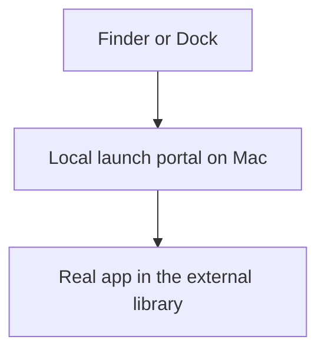

# Glossary

This page explains terms used in AppPorts and its documentation. The first sections cover product operations and states; the last covers general macOS and filesystem concepts. For individual badges, see [badges and status](/docs/badges).

## Locations and entries in AppPorts {#locations}

### Local entry, launcher, Stub Portal {#local-portal}

A small entry left on the Mac after migration that opens the real external app. It is neither a complete app nor a backup. It cannot run the full program when the external drive is offline. When an app lives inside a managed app library image, refreshed entries attempt a windowless reattachment of the image and its data volumes before launch. See [app migration methods](/docs/migration-strategy/portal#portal).

### Real app, external copy {#real-app}

The complete application bundle, as distinct from its local launcher. After migration, the “external copy” may be the only real app in use. Do not delete it merely because it is called a copy.

### App Library Image {#app-library-image}

An APFS sparse bundle disk image (`.sparsebundle`) stored on a mounted SMB share or external drive and mounted as an external application library to preserve signatures and filesystem attributes. It occupies space according to written data, is not an independent backup, and does not replace a physical external drive for saving signature originals. See [using an APFS app library image](/docs/storage-guide#app-library-image).

### Folder Mirror {#folder-mirror}

A local directory structure retained for an app suite, with entries linking to external apps or files. “Mirror” here means neither a disk image nor a second complete backup. See [app suites](/docs/migration-strategy/portal#types).

## Migration and recovery operations {#operations}

### App migration {#app-migration}

Moving the application itself and managing its local launch entry. Chat history, caches, and projects do not necessarily move with it. See [migrate apps](/docs/core).

### Data migration {#data-migration}

Moving app data, tool directories, or custom folders. It can be used independently without moving the app itself. See [migrate data](/docs/datamigrae/operation).

### Link migration {#linked-migration}

Data moves to an external location and the original directory becomes a symbolic link to it. Access through the old path leads to the target; permission restrictions still apply.

### Mount migration {#mount-migration}

Eligible container data moves into a dedicated APFS data volume, which is then attached at the original directory. The real app keeps its signature. This currently requires APFS storage. See [data migration methods](/docs/datamigrae/baseinfo#mount).

### Move back, restore {#restore}

Moving external apps or data back onto the Mac. “Move Back to Local” applies to apps; “Restore” commonly applies to data directories. Both differ from relinking, which only restores an entry. See [restore steps](/docs/restore).

### Relink, mount {#reconnect}

Restoring access to external data at its original path while keeping that data on the external drive. Relinking usually rebuilds a link; mounting attaches a data volume at the original directory. Neither copies the data back to internal storage.

### Unlink {#unlink}

Removing an app's local entry managed by AppPorts while retaining the real external app. It is not deletion of the external app or restoration of a data directory.

### Force Unlink {#force-unlink}

Removing a data directory's local symbolic link inside Link Details and creating an empty directory at the original path without requiring the external drive online or deleting external originals. Use it to start fresh locally; it is not restoration. See [unlinking apps and force-unlinking data](/docs/restore#unlink).

### Normalize {#normalize}

Adjusting a recognized managed directory or existing link into the layout AppPorts uses. Check the real target first. In the current default mode, this does not recreate old-style container links.

## Modes and protection {#modes}

### Classic data migration mode {#classic-mode}

A compatibility mode for old container link migration, off by default. Directory protection and risk confirmations still apply. It no longer includes automatic re-signing. See [classic mode](/docs/classic-mode).

### Locked Migration, update protection {#update-protection}

Locking the real external app to prevent certain updaters from altering the external bundle directly, whereas Unlocked Migration leaves it unlocked so in-app updates can be attempted. This is not disk encryption and cannot prevent drive failure. See [update protection and guardian](/docs/migration-strategy/portal#updates).

### Disk maintenance agent and Application update guardian {#background-agents}

Two background login services in Settings that are enabled by default and independently configurable: Disk maintenance agent restores managed container data volumes and the selected app library image at login, reconnection or scheduled checks; Application update guardian watches migrated apps after AppPorts quits, attempts signature-verified installation when an eligible ShipIt update fails, and reports results and Roll Back Update in Task Center. See [background agents](/docs/settings#mount-agent).

### Pending Move Out {#pending-move}

A state shown when the real local app appears newer than the external copy. After checking versions, you can migrate the newer local app again. It does not mean migration is running in the background.

### Historical feature archive {#archive}

Documentation of retired features, older workflows, and experimental approaches that were not adopted, with versions and current alternatives. These pages are not current operating instructions. See the [historical feature archive](/docs/archive/overview).

### Signature original, AppPorts Backups {#signature-backup}

A complete official app saved before manual re-signing, used to restore its contents and original signature. Since 1.9.1 build 31, it is saved automatically in `AppPorts Backups` at the root of a suitable external drive, with a `README.txt`. That drive must be connected for recovery. It does not include personal data such as chats or documents; deleting it removes that offline recovery material. See [originals and cleanup](/docs/settings#signature-backups).

## General system and file concepts {#system}

### Symbolic link, symlink {#symlink}

A special file recording another file or directory's location, much like a direction sign. The sign can remain after the target moves or goes offline. It grants no additional access permissions.

### Sandbox {#sandbox}

System restrictions on what an app can access. An app may know where a file is and still lack permission to open it. AppPorts cannot remove those restrictions by creating a link.

### App container, container data {#app-container}

Data areas managed by macOS for apps and app groups, commonly under `Containers` and `Group Containers`. These are different from APFS containers on a disk.

### APFS container and volume {#apfs}

APFS is Apple's filesystem. One APFS container can hold multiple volumes sharing storage space. AppPorts mount migration creates a dedicated data volume; it does not install an app inside another program.

### Mount point {#mountpoint}

The location where a volume appears in the filesystem. After an external volume is mounted at an app's original directory, access to that directory reaches the volume's contents. System permissions still apply.

### Developer signature, re-signing {#signing}

A developer signature helps macOS verify an app's origin and integrity. AppPorts' local, ad-hoc signing replaces that signature. It cannot impersonate the original developer and may change authorization behavior.

### Restore Original Signature {#original-signature}

Using verified original official app files to restore the signature and related contents, rather than applying another ad-hoc signature. A record containing only an old identity name is insufficient; a valid original copy or suitable official release is needed. See [upgrade and repair](/docs/macos-27#repair).
