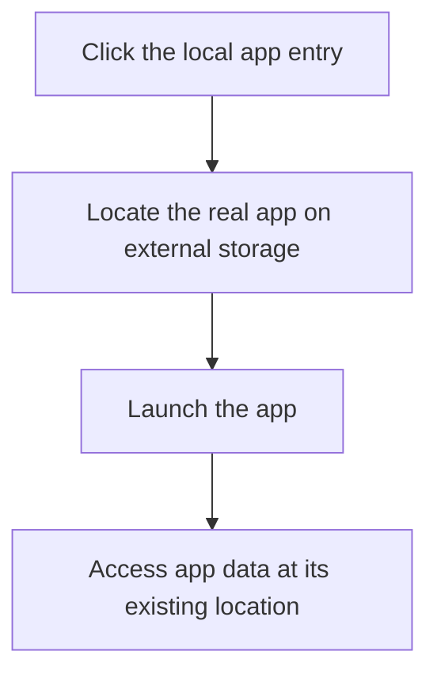

# Application migration

After moving an app externally, AppPorts retains a suitable local entry. The real app that occupies space and the entry you click may be in different locations.

## The real app and its local entry {#portal}

Ordinary apps use a lightweight **Stub Portal** by default. Clicking the local entry launches the real app on the external drive. It is neither another complete app nor a backup. Without the drive, the entry cannot substitute for the real app.

The last step explains why app and data migration are separate: messages and other data may stay local after the app moves.

When an app lives inside an [APFS app library image](/docs/storage-guide#app-library-image) (or uses data volumes inside that image), a local entry refreshed to format 8 runs a silent windowless preparation step before launching the real app to reattach the required image and its data volumes; local entries for apps on ordinary physical drives continue to launch directly without that step.

## Entries for different kinds of content {#types}

| Content | How AppPorts handles it |
| --- | --- |
| Ordinary macOS app | A Stub Portal points to the real external app. |
| Eligible iPhone or iPad app | A launch entry suited to its wrapper structure; system and app restrictions still apply. |
| Folder or suite containing multiple apps | A Folder Mirror provides app entries and links to other managed content. |
| Manually selected traditional link migration | Use “Migrate Using Traditional Link” in the context menu. The whole app is external and a symbolic link remains locally. This manual option remains available; compatibility depends on the app. |
| Historical migration | The old entry is recognized and appropriate restoration or unlink actions are provided. |

Whole-app links and Contents-based entries can still appear in existing migrations. Recognizing them does not mean they are the default for new moves. Dependencies on particular directory structures or internal paths may also affect compatibility.

## Update protection and guardian {#updates}

Self-updating apps behave differently on external storage: some update cleanly in place, some fail with permission-attribution errors when writing back across volumes, and others replace or delete the external bundle while updating.

For apps with detected self-updaters (excluding apps such as NetEase Music and WorkBuddy that are handled directly as ordinary apps), AppPorts offers two options before migrating or relinking:

- **Unlocked Migration:** leaves the external app bundle unlocked so the app can attempt in-app updates. With **Application update guardian** enabled under Settings → Background agents, AppPorts keeps watching migrated apps after quitting; when an eligible ShipIt update has explicitly failed, it verifies the Developer ID signature of the complete cached build, installs or atomically swaps it while preserving the previous bundle, clears stale ShipIt retry state, and publishes results to Task Center (where failed tasks offer Roll Back Update).
- **Locked Migration:** locks the external app bundle to reduce unintended changes during updates, which may restrict in-app updating. Move the app back locally through AppPorts when you need to update it; switching to Unlocked Migration or moving back locally also clears protection locks from the app's user caches (`Caches/<Bundle ID>` and `.ShipIt`).

App lists no longer display `Sparkle` or `Electron` framework badges; update behavior is communicated directly through migration confirmation and lock-status badges. The update guardian never re-signs apps or applies delta patches, and does not guarantee compatibility with every updater framework or every ShipIt variant. See [updates after migration](/docs/core#updates).

## What this means in practice {#limits}

A local entry preserves familiar launching where possible, but does not remove the external-drive dependency or guarantee that plugins, system permissions and self-updates are unaffected. Launch the app the way you normally do and verify its everyday features after migration.

Related: [local entries and real apps](/docs/glossary#local-portal), [badges](/docs/badges), and [data migration](/docs/datamigrae/baseinfo).

Earlier Contents, whole-app link and launcher implementations are preserved in [historical application migration methods](/docs/archive/app-strategies).
