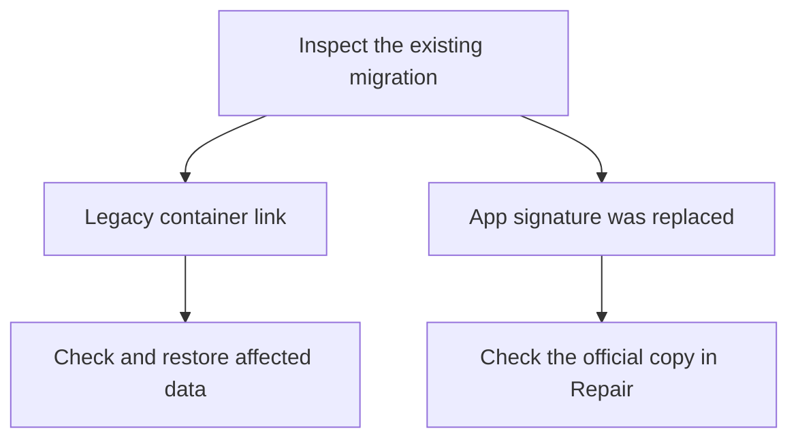

# macOS 27 and migration changes

When an app moved using an older method has launch or data-access problems on macOS 27, check **data location, application signature and system permissions** separately. They are related but distinct.

## Why older approaches can run into trouble {#why}

An application container is a data area managed by macOS. Access involves checks of app identity, permissions and parts of the directory structure.

Replacing container data with a symbolic link to an external location may take access outside its original permission scope. Re-signing can change the developer identity and entitlements, so existing container-access records no longer match.

In the tested macOS 27.0 environment, officially signed and re-signed WeChat behaved differently; some re-signed samples failed to open normally. This is evidence to investigate, not a finding that applies identically to every app and OS version.

## Why AppPorts changed its approach {#changes}

Mount migration attaches an eligible data volume at the original path while preserving the real app's signature. Migration and manual signing are now separate, so choosing a new storage location does not also change app identity.

AppPorts protects critical container structure and distinguishes Signature Replaced from Signature check pending. The latter may result from an offline drive or a failed read; it must not be treated as proof of a damaged signature.

Mounting still requires suitable storage and authorization. It does not make every container directory eligible. See [data migration methods](/docs/datamigrae/baseinfo).

## Updates, upgrades and repairs {#upgrade}

| Action | What it addresses | What it does not do automatically |
| --- | --- | --- |
| Update AppPorts | Obtain that version's checking, migration and recovery improvements | Convert old links to mounts or repair earlier signatures. |
| Upgrade macOS | Change the OS version | Check whether old migrations remain suitable. |
| Repair an existing migration | Restore data paths and app identity according to their state | Require every user to upgrade to macOS 27. |

Check legacy container migrations before upgrading macOS. If a problem has already occurred, preserve data and copies before following repair steps. A signature error alone does not prove data damage; that needs separate verification.

## Continue reading {#next}

For steps, see [macOS 27 upgrades and repair](/docs/macos-27). For evidence, read the [symbolic-link](/docs/blog/why-mount-and-apfs#symlink-experiment), [mount and permission](/docs/blog/why-mount-and-apfs#mount-experiment), and [container structure](/docs/blog/data-migration-boundaries#starting-point) experiments.
