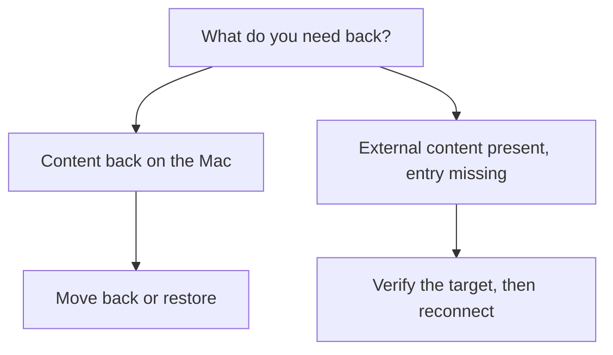

# Restore, reconnect and unlink

Decide whether you want to change the **storage location** or the **access entry**. Connect the original external drive, save your work and quit related apps. Restoring locally also requires enough internal space.

## Choose the right action {#choose}

| Goal | Action | Where content ends up |
| --- | --- | --- |
| Move an app from the external drive back to the Mac | Move Back to Local | The real app is local. |
| Return moved data to its original directory | Restore | Data returns to the original local location. |
| App is external but its launch entry is missing | Link Back to Local | The real app stays external. |
| Data is external but its local link is missing | Relink | Data stays external; a local entry is rebuilt. |
| A data volume is online but not attached at the original directory | Mount / Resume automatic mounting | Data stays external; access at the original path and automatic remounting resume. |
| Temporarily detach a single mounted data volume | Unmount | Data stays external; a read-only empty directory remains locally and automatic mounting stays paused. |
| Drive is unavailable; remove only a data symlink and start with an empty folder | Link Details → Force Unlink | An empty folder is created locally while external originals remain untouched. |
| Remove only an app's local entry | Row `…` (More Actions) or context menu in Local Apps → Delete Local Entry | The real external app is retained. |

## Move an app back locally {#apps}

1. Select it in the external library and choose Move Back to Local.
2. Check the local destination. If the external drive lacks certain filesystem capabilities, AppPorts probes outside the app bundle and warns if the copy may already be degraded; if a real app with the same name or another conflict exists, follow the prompt rather than overwriting it yourself.
3. Wait for copying, verification and cleanup. Moving back also clears protection locks from associated updater caches.
4. Open the app from Finder or the Dock and check that it uses the local copy.

Moving the app back does not automatically restore separately managed data. Continue below if that data must return too.

## Restore data to its original location {#data}

1. Find the managed item under App Data, Tool Directories or Directory Migration and choose Restore. Eligible legacy container symbolic links can also be restored locally through the recovery flow without automatically re-signing the app.
2. Confirm that the related app is closed, the original drive is online and local space is sufficient.
3. Wait for AppPorts to copy data back and switch the entry.
4. Open the app, check existing content and saving, and confirm the final state.

AppPorts then handles external copies or dedicated volumes that can safely be cleaned up. If retained content or unfinished cleanup is reported, keep it and follow the prompt. An app opening successfully does not prove all cleanup is finished.

## Restore only the entry {#reconnect}

For an Unlinked app or an external copy without an entry, use Link Back to Local. For data marked Awaiting Relink, check the external destination and use Relink; existing links already pointing to the expected managed location can also complete management records after confirmation. A container volume marked Awaiting Mount uses Mount; if you previously clicked Unmount on an individual data volume, automatic mounting stays paused until you explicitly choose Mount or Resume automatic mounting.

These actions do not move data back internally. If new content has appeared at the original local location, establish what each copy contains before proceeding; do not force reconnection by overwriting it.

For an existing symlink, **Normalize Management** requires that its target be a real directory. The action is unavailable if the target is missing, a regular file, or another symlink. If the original drive is offline and you want to recover the data, reconnect it and check the target first. AppPorts filters out macOS system shortcuts that point into `~/Library` from inside the WeChat container and blocks restoring or unlinking them.

## Unlink an application or force-unlink data {#unlink}

In the local app list, open the linked app row's `…` (More Actions) menu or context menu and choose Delete Local Entry; an orphaned link also offers Delete Orphaned Link. This removes the local entry managed by AppPorts while retaining the real external app. **It does not restore a data directory.** You can use Link Back to Local again later.

For a tool directory or ordinary data directory whose external drive is unavailable, if you do not need old contents back and only want the app to generate fresh local data, choose Force Unlink inside Link Details. After confirmation, AppPorts removes the local symlink, clears the old link record and creates an empty directory at the original path without requiring the drive online or deleting external originals. Newly created local files will not merge automatically with old external data later.

Before removing AppPorts, restore container data it still manages. Otherwise the automatic mount task may lose the program it needs. See [troubleshooting](/docs/faq) for interruption, offline drives and conflicts.

## Resolve unfinished work and retained copies {#recovery}

Open a task needing attention in Task Center and choose Resolve Issues. Read the current migration records first; the panel displays the Current data location separately from the Retained old copy path so you can tell which copy is active. Quit the associated app and connect and unlock the original drive. Use Check Permissions if needed, then retry. Check the items shown in the panel: Retry All Pending Items can affect several records.

*Recovery example. Compare the current data path with the retained copy before choosing Retry, Open Old Copy, or Decide Later.*

| Choice in the data recovery panel | Effect |
| --- | --- |
| Retry / Try Cleanup Again | Recheck and continue the relevant operation; differing old files are not forcibly deleted. |
| Authorize Old-Copy Cleanup | Shown when data has switched and the retained old copy is owned by root; prompts for macOS administrator authorization to clean it up, preserving the copy if cancelled without repeated background prompts. |
| Decide Later | Pause automatic handling and keep files; you can retry explicitly later. |
| Open Old Copy | Inspect retained content after data has switched and its location is verified. |
| Keep Copy and End Cleanup | Available only after data has switched. Stop automatic cleanup and warnings; the old copy still occupies space and can be opened or retried individually later. |

A task can still need attention when migration has finished but old-copy cleanup has not. Background cleanup of an old attempt does not prove the original migration succeeded. Check the actual directory state as well. Removing task history does not resolve these records.

The app recovery panel also offers Retry Processing, Ignore Errors and End Task, and Ignore Errors and Move Back. Prefer normal retry. Ignore Errors and End Task archives the original record as incomplete and keeps files. **Ignore Errors and Move Back skips content verification.** After a successful copy, it replaces the local entry, keeps the external original and any existing local copy, and archives the original record as incomplete. Use it only if you understand the confirmation and will check the result yourself; it is not a verified successful restore.

For an observed ShipIt update task reported by Application update guardian in Task Center, task details offer Roll Back Update: when a complete, validly signed pre-update bundle is verified, AppPorts restores it to the original external path, refreshes the local entry, and cleans up that update request's download cache and temporary copies directly without creating an archive directory. If a verified complete old version is unavailable, existing files remain in place with an explanation.
