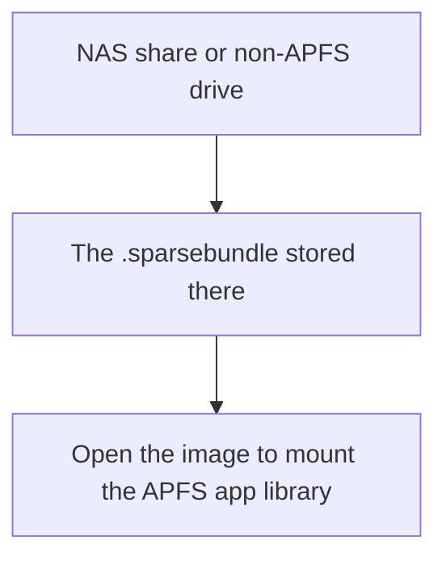

# External drives and daily use

The external drive becomes the real storage location for moved apps or data. Stable connectivity and enough space matter more than advertised speed. An external SSD is usually better for frequent app launches and small-file access.

## Which operations require APFS? {#apfs}

| Task | Storage requirements |
| --- | --- |
| Mount migration of container data | Currently requires APFS and passing preflight checks. |
| Moving ordinary apps, tool directories or custom folders | Depends on content, filesystem capabilities and permissions; container requirements do not apply universally. |
| Storing apps on a NAS (SMB share) or non-APFS drive | Direct copying is limited by server permissions and filesystem capabilities; you can create an [APFS app library image](/docs/storage-guide#app-library-image) to preserve full signatures and file attributes. A directly mounted network folder itself does not substitute for container APFS mount migration. |

You do not need to reformat a whole disk merely to move an ordinary app. If its format is unsuitable for container data, choose another destination, store apps inside an app library image, or keep container data local. See [data migration methods](/docs/datamigrae/baseinfo).

## Use an APFS app library image {#app-library-image}

From the `…` menu beside Destination Storage in the sidebar, you can use an APFS sparse bundle disk image (`.sparsebundle`) as your external app library. It grows according to actual written data and works on mounted SMB shares or external drives such as exFAT:

1. Make sure AppPorts is in Applications and the backing share or drive is mounted in Finder.
2. In the Destination Storage menu, choose Create APFS Image (set location, disk name and maximum capacity, then choose Create and Use) or Open Existing Image….
3. AppPorts verifies both the backing storage identity (SMB share URL or underlying volume UUID) and the APFS volume UUID inside the image; it never overwrites existing files or guesses targets by volume name.

When Disk maintenance agent is enabled under Settings → Background agents, login, volume events and a one-minute background check attempt to reattach the currently selected app library image. Migrated apps whose local entries have been refreshed to format 8 also run a silent windowless preparation step before launch to reattach the required image and any associated data volumes inside it. After upgrading from an earlier build, open AppPorts once while the image is online so a scan can refresh existing local entries.

When you no longer need the image mounted, choose Unmount Image from the eject menu under Destination Storage. **Unmounting an image persistently pauses automatic remounting**: restarting AppPorts, reconnecting the drive or reconnecting to the NAS will not clear the pause until you explicitly choose Mount Image Again (or reopen the image).

Keep these boundaries in mind:

- **An image is not a backup:** image corruption, NAS failures and network interruptions still require independent backups. Write to one image from only one Mac at a time.
- **Automatic recovery covers only the currently selected image:** historical images must be remounted manually, and quitting AppPorts does not unmount the image because migrated apps may still be running.
- **Credentials, underlying mounts and volume names:** reconnect in Finder if macOS has no saved SMB credentials, and unlock encrypted volumes as usual. The image mount path depends on its volume name; renaming the volume in Finder causes identity verification to fail until renamed back.
- **Signature originals still require a physical drive:** `AppPorts Backups` excludes disk images, so manual re-signing still requires a suitable local physical external drive.

## Prepare APFS storage {#prepare-apfs}

1. Back up existing disk contents and inspect device and volume formats in Disk Utility.
2. If suitable APFS storage already exists, select it in AppPorts and check again.
3. If a format change is necessary, confirm the backup is usable and follow Disk Utility's instructions. **Erasing deletes data on the selected object**; it is not an ordinary settings toggle.

AppPorts creates dedicated data volumes for mount migration. You normally do not need to create one per directory or assign a fixed size yourself.

## Encrypted external drives {#encrypted-drives}

AppPorts can create an independently encrypted data volume on an encrypted APFS destination. After preflight, enter and confirm a new data-volume password before continuing. The volume does not inherit the existing drive password, and existing passwords and files are unchanged. Multiple new volumes in a split WeChat migration share this setup.

*A new encrypted data volume requires its own password and confirmation. The checkbox controls whether the password is saved in this Mac’s Keychain.*

The option to save the password in this Mac's Keychain for automatic unlocking is selected by default and can be cleared. Saved passwords remain on this Mac and do not sync. Without a saved password, or when Keychain is unavailable, unlock manually; the background agent does not repeatedly show password dialogs. Passwords are not written to migration records or logs. Unsaved passwords are held temporarily in the process, and may need entering again after quitting. Keep the password safe: forgotten passwords cannot recover encrypted data.

Ordinary unencrypted APFS destinations also work, but someone finding the disk may be able to read the data. Another encrypted volume on the same disk does not encrypt the new volume. Read preflight prompts and confirm the new volume's protection; do not remove existing encryption just to pass a check.

## Does the external drive remember file owners? {#owners}

Some macOS storage does not record file ownership: exFAT and FAT32 have no such field, and HFS+ mounted with ownership ignored writes new files as a placeholder user. Ordinary reads and writes are unaffected, but a few apps that check ownership as an administrator — clash-verge with its privileged service, for example — refuse to work and suggest a `chown` fix. On such volumes the kernel silently drops that command, so it looks successful while changing nothing.

APFS keeps the real owner even when mounted with ownership ignored, so it is out of scope here. When migrating an ordinary data directory or a custom folder, AppPorts explains the target's situation in the confirmation dialog without blocking the operation. Prefer keeping such app data local, or use an APFS disk; for HFS+ you can untick “Ignore ownership on this volume” in Finder's Show Info and migrate again. exFAT has no such switch.

## Everyday connection and disconnection {#daily}

- Connect the drive before use. Open AppPorts if necessary and confirm Mounted or a working link.
- Save work, quit apps using external data and eject the storage normally before disconnecting.
- After restart or reconnection, with Disk maintenance agent enabled, automatic reconnection waits for the drive, unlocking and system authorization. It cannot guarantee completion before every login app starts.
- Open AppPorts once after moving or updating it so background agents can verify its program location.

Migration is not a backup. Check whether your backup tool covers external storage, especially important messages, projects and personal files.

## Space, drive changes and offline storage {#space}

Leave room for updates, copies and recovery rather than filling the disk to the current folder size. APFS volumes may share capacity, and available space may take time to update after deletion or restoration; the sidebar shows actual usage for Mac Storage and Destination Storage rather than estimating internal space saved from external logical sizes.

Before changing drives, [restore data locally](/docs/restore#data), then select the new destination and migrate again. Dragging managed data elsewhere or changing volume names or directory structure can break existing entries. If a drive or data connection is missing, start with [troubleshooting](/docs/faq#offline).

## Signature originals on external storage {#signature-backups}

After manually re-signing an official app, a visible `AppPorts Backups` folder may appear externally. AppPorts automatically selects a suitable drive for complete official originals. Its `README.txt` explains the purpose and consequences of deletion. This also applies when the installed app remains internal. Connect the drive that holds the original for recovery and keep the folder in place.

Originals do not contain personal data and are not a separate disaster-recovery backup. Re-signing an internal app still needs temporary space; internal originals are removed only after a cross-volume save is verified. See [signature originals](/docs/settings#signature-backups) for selection, inspection and cleanup.

Evidence: [unexpected disconnection](/docs/blog/why-mount-and-apfs#unplug-experiment) and [restart and automatic reconnection](/docs/blog/why-mount-and-apfs#startup-method).

## Eject the entire external disk from AppPorts {#eject}

1. Save work, quit programs using apps or data on the drive, and wait for active file operations to finish.
2. In the eject menu under Destination Storage in the sidebar, choose Eject External Disk. This targets **the entire physical disk and all its volumes**, including dedicated volumes mounted at local data paths, rather than only the selected app library.
3. AppPorts waits briefly (up to 5 seconds) for transient background maintenance locks, pauses automatic mounting for that disk, and proactively pauses UI scanning, folder monitoring, and 5-second sidebar capacity polling for that volume during unmount so macOS does not report AppPorts as holding the disk busy before asking Finder to eject it. Sending the request does not mean ejection has completed. Confirm the system result and menu state before unplugging.
4. If volumes remain mounted or the system refuses, quit programs using them and choose Retry Eject. Do not pull the cable to force ejection.

Automatic mounting stays paused after an explicit physical-disk eject request—even if Finder's ejection is cancelled or all volumes have unmounted—and automatic scanning and polling for that target stay quiet (manual refresh still works). **Unplug and reconnect the device**; mounting and monitoring resume after a new connection of the same disk is recognized. Refreshing the list, reopening AppPorts or waiting for a timeout does not replace reconnection, and there is no manual button to cancel that pause. Note that this differs from Unmount Image or clicking Unmount on an individual data volume: those pauses are not cleared by reconnecting a drive and require explicitly choosing Mount Image Again or Mount / Resume automatic mounting. For permission errors, check Finder automation permission and keep the message.
