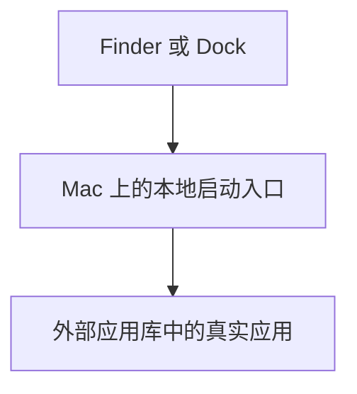

# 名词解释

这里解释 AppPorts 界面与文档中的常用说法。前半部分是产品中的操作和状态，后半部分是 macOS 与文件系统的通用概念；看到具体徽章时，可查[徽章与状态](/docs/badges)。

## AppPorts 中的位置与入口 {#locations}

### 本地入口、启动壳、壳门（Stub Portal） {#local-portal}

迁移后留在 Mac 上、负责打开外部真实应用的小入口。它不是完整应用，也不是备份；外盘不在线时不能凭这个入口运行完整程序。应用位于受管应用库映像时，新版入口在启动前会先尝试无窗口接回映像与数据卷。见[应用迁移方式](/docs/migration-strategy/portal#portal)。

### 真实应用、外部副本 {#real-app}

包含完整程序的应用本体，与本地启动壳相对。“外部副本”在迁移完成后可能是唯一正在使用的真实应用，不能仅因名称有“副本”就删除。

### 应用库映像（App Library Image） {#app-library-image}

存放在已挂载 SMB 共享或外置盘上的 APFS 稀疏捆绑映像（`.sparsebundle`），挂载后作为外部应用库使用，以保留应用签名和文件系统属性。它按实际写入占用空间，不是独立备份，也不替代保存签名原包的物理外盘。见[使用 APFS 应用库映像](/docs/storage-guide#app-library-image)。

### 文件夹镜像（Folder Mirror） {#folder-mirror}

为应用套件保留本地目录结构，内部入口连接到外部的应用或文件。这里的“镜像”不是磁盘映像，也不是另一套完整备份。见[套件目录](/docs/migration-strategy/portal#types)。

## 迁移与恢复操作 {#operations}

### 应用迁移 {#app-migration}

移动应用本体并管理本地启动入口。应用的聊天记录、缓存和项目未必随它一起移动，详见[迁移应用](/docs/core)。

### 数据迁移 {#data-migration}

移动应用数据、工具目录或自选文件夹。可以在不移动应用本体的情况下单独使用，详见[迁移数据](/docs/datamigrae/operation)。

### 链接迁移 {#linked-migration}

数据放到外部位置，原目录变成指向它的符号链接。应用访问原路径时被引导到目标位置；权限限制仍然有效。

### 挂载迁移 {#mount-migration}

把适用的容器数据放入专用 APFS 数据卷，再将卷接到原目录。它保留真实应用签名，当前需要 APFS 存储。见[数据迁移方式](/docs/datamigrae/baseinfo#mount)。

### 迁回、还原 {#restore}

把外部应用或数据搬回本机。“迁移回本地”用于应用，“还原”常用于数据目录；都不同于只恢复入口的接回。见[还原步骤](/docs/restore)。

### 接回、挂载 {#reconnect}

恢复原位置对外部数据的访问，数据仍留在外盘。“接回”常指重建链接，“挂载”是将数据卷接到原目录，不会把数据复制回内置盘。

### 解除链接 {#unlink}

移除 AppPorts 管理的应用本地入口，外部真实应用保留。它不等同于删除外部应用，也不等同于还原数据目录。

### 强制解绑 {#force-unlink}

在“链接详情”中移除数据目录的本地符号链接并在原位置创建空目录，不需要外置盘在线，也不会移动或删除外盘原件。它用于放弃当前链接并在本机重新开始，不等同于“还原”。见[解除应用链接与数据强制解绑](/docs/restore#unlink)。

### 整理 {#normalize}

将可识别的受管目录或现有链接调整到 AppPorts 使用的规范位置。执行前要核对真实目标；当前默认模式不会借此重新建立旧式容器链接。

## 模式与保护 {#modes}

### 经典数据迁移模式 {#classic-mode}

为旧式容器链接迁移保留的兼容模式，默认关闭。它仍受目录保护与风险确认约束，当前不再包含自动重签流程。见[经典模式](/docs/classic-mode)。

### 锁定迁移、更新保护 {#update-protection}

对外部真实应用加锁，限制部分更新器直接改动外部副本；非锁定迁移则保持未加锁以便尝试应用内更新。它不是磁盘加密，也不能防止硬盘故障。见[更新保护与更新守护](/docs/migration-strategy/portal#updates)。

### 磁盘维护代理与应用更新守护 {#background-agents}

设置中两项默认开启、可分别关闭的后台任务：“磁盘维护代理”负责登录、重连外盘或定时触发时接回受管数据卷与应用库映像；“应用更新守护”在 AppPorts 退出后继续观察已迁移应用，遇到已适配的 ShipIt 更新失败时尝试校验安装缓存新版，并在任务中心同步结果与“回退更新”入口。见[后台代理](/docs/settings#mount-agent)。

### 待迁出 {#pending-move}

检测到本地真实应用比外部副本更新时显示的状态。核对版本后，可以再次迁移本地新版；并不表示迁移正在后台执行。

### 历史功能归档 {#archive}

保存停用功能、旧版做法和未采用实验方案的说明，并标明版本与当前替代方式。它们不属于当前操作指南。见[历史功能归档](/docs/archive/overview)。

### 签名原包、AppPorts Backups {#signature-backup}

手动重签前保存的完整官方应用，用于恢复应用内容与原始签名。1.9.1 build 31 起，它自动保存在合适外盘根目录的 `AppPorts Backups` 文件夹，内附 `README.txt`；恢复时需要连接该盘。它不包含聊天记录、文档等个人数据，删除后会失去这份离线恢复材料。见[原包保存与清理](/docs/settings#signature-backups)。

## 系统与文件的通用概念 {#system}

### 符号链接、软链接 {#symlink}

记录另一个文件或目录位置的特殊文件，类似一张指路纸条。目标移走或离线时，纸条仍可能存在；它不会替使用者增加访问权限。

### 沙盒 {#sandbox}

系统对应用访问范围的限制。应用即使知道某个文件在哪里，也可能没有权限打开；AppPorts 无法用一个链接替应用取消这些限制。

### 应用容器、容器数据 {#app-container}

macOS 为应用及应用组管理的数据区域，常见位置名称为 `Containers` 与 `Group Containers`。它们与磁盘上的 APFS 容器不是同一概念。

### APFS 容器与卷 {#apfs}

APFS 是 Apple 的文件系统。一个 APFS 容器可以包含多个共享存储空间的卷；AppPorts 的挂载迁移会创建专用数据卷，不是把应用本身装进另一个程序。

### 挂载点 {#mountpoint}

一个卷在文件系统中出现的位置。将外部数据卷挂到应用原目录后，访问该目录就会访问卷里的内容；仍需要满足系统权限。

### 开发者签名、重签名 {#signing}

开发者签名帮助系统核对应用来源和完整性。AppPorts 所说的本地重签（Ad-hoc）会替换签名，不能冒充原开发者，还可能改变应用的授权行为。

### 恢复原始签名 {#original-signature}

使用经过检查的官方原始应用文件，恢复原有签名与相关内容，不是再次做本地重签。仅有旧身份名称的记录不足以恢复；需要有效原始副本或适用的官方原版。见[升级与修复](/docs/macos-27#repair)。
