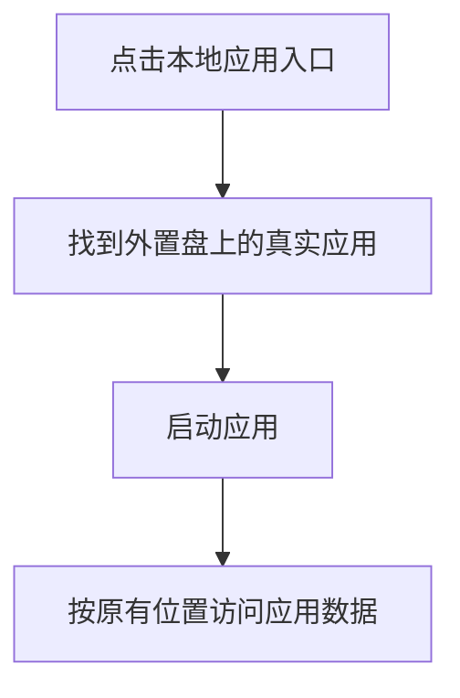

# 应用迁移方式

应用搬到外置盘后，AppPorts 会为它保留合适的本地入口。真正占空间的应用与点击时使用的入口，可能不在同一个位置。

## 真实应用与本地入口 {#portal}

普通应用默认使用轻量的**启动壳**，也叫 Stub Portal。你点击本地入口，入口再启动外置盘上的真实应用。它不是第二份完整应用，也不是备份；外置盘不在线时，入口本身不能代替真实应用运行。

最后一步解释了为什么“迁移应用”和“迁移数据”分开：应用本体移走后，聊天记录和其他数据可能仍在本机。

如果应用存放在 [APFS 应用库映像](/docs/storage-guide#app-library-image)中（或关联了该映像内的数据卷），刷新为新版格式（版本 8）的本地入口在点开时会先运行一次无窗口准备，尝试把所需映像及其中的数据卷接回，再打开真实应用；普通物理外盘上的应用入口保持独立启动，不附加这一步。

## 不同内容怎样保留入口 {#types}

| 内容 | AppPorts 的处理方式 |
| --- | --- |
| 普通 macOS 应用 | 使用启动壳指向外部真实应用。 |
| 支持迁移的 iPhone／iPad 应用 | 使用适合其包装结构的启动入口；能否迁移仍受系统和应用条件限制。 |
| 包含多个应用的文件夹或套件 | 使用文件夹镜像，为其中应用建立入口，其余受管内容通过链接关联。 |
| 手动选择传统链接迁移 | 右键“使用传统链接迁移”，将整个应用放在外部，本地保留符号链接。它仍是可用的手动选项，兼容性取决于应用。 |
| 历史迁移项目 | 识别旧入口，提供相应的还原或解除操作。 |

旧版的整体符号链接、Contents 目录入口可能仍出现在已有迁移中。“仍能识别”不代表当前新迁移默认使用它们。目录结构或应用内部路径的特殊依赖，也可能影响兼容性。

## 更新保护与更新守护 {#updates}

自更新程序在外部存储上的行为并不一致：有些应用可直接完成自更新，有些在跨卷写回时会因权限归属失败，也有些会在更新过程中改动或删除外部副本。

对检测到自更新器的应用（网易云音乐、WorkBuddy 等已确认按普通应用处理的项目除外），AppPorts 在迁移或接回前提供两种选择：

- **非锁定迁移**：不对应用包加锁，应用可尝试继续使用自身更新。在“设置 → 后台代理”开启**应用更新守护**后，即使退出 AppPorts，后台也会在已适配的 ShipIt 更新明确失败时校验完整缓存新版的开发者签名，完成安装或安全替换旧版、清理残留重试状态，并把结果同步到任务中心；失败项可在任务详情使用“回退更新”恢复已核验旧版。
- **锁定迁移**：对外部应用包加锁，降低外部副本被更新流程意外破坏的风险，但应用内更新可能受限。需要更新时可先通过 AppPorts 迁回本机；之后改为非锁定迁移或迁回本机时，AppPorts 会一并清除该应用用户缓存（`Caches/<Bundle ID>` 与 `.ShipIt`）上的保护锁。

应用列表不再展示 `Sparkle`、`Electron` 等底层框架标签，由迁移前确认与更新状态徽章直接表达处理方式。更新守护不会重签应用或拼合增量补丁，也不保证所有更新框架或全部 ShipIt 变体都能自动处理成功；具体操作见[迁移应用后的更新](/docs/core#updates)。

## 这对你意味着什么 {#limits}

本地入口尽量保留熟悉的打开方式，但它不能消除外盘依赖，也不能保证所有插件、系统权限和应用自身更新都不受影响。迁移完成后，应从平时使用的入口启动，并检查常用功能。

相关内容：[本地入口与真实应用](/docs/glossary#local-portal) · [徽章与状态](/docs/badges) · [数据迁移方式](/docs/datamigrae/baseinfo)

早期 Contents、整体符号链接及启动壳实现变化见[历史应用迁移方式](/docs/archive/app-strategies)。
