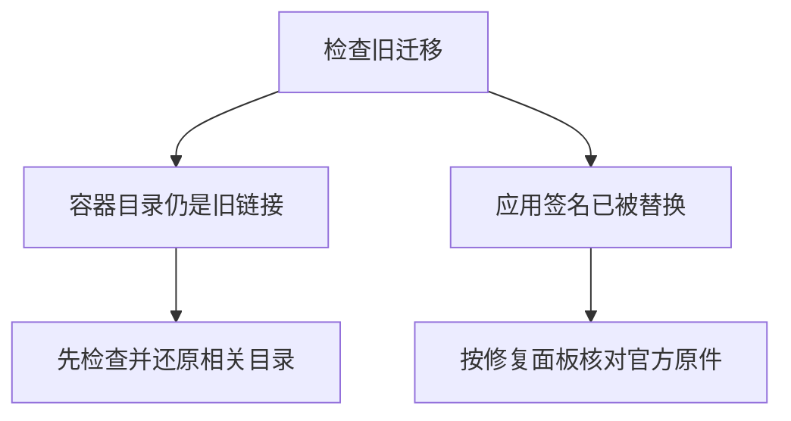

# macOS 27 与迁移方式的变化

旧方式迁移的应用在 macOS 27 上出现启动或数据访问问题时，需要分别检查**数据位置、应用签名和系统授权**。它们相互关联，但不是同一件事。

## 为什么旧做法可能遇到问题 {#why}

应用容器是系统为应用管理的数据区域。应用访问它时，系统会检查应用身份、权限以及部分目录结构。

把容器里的数据改成指向外部位置的符号链接，可能让访问离开原有授权范围。对应用重新签名又可能改变它的开发者身份与授权，导致已有的容器访问记录不再匹配。

在 macOS 27.0 的受测环境中，官方签名和被重签后的微信表现不同，部分被重签样本无法正常打开。这是需要排查的证据，不代表所有应用、所有系统版本都具有相同结果。

## AppPorts 为什么调整迁移方式 {#changes}

挂载迁移让适用的业务数据卷接到原路径，保留真实应用签名。当前迁移与独立手动签名分开，避免把“想换一个存放位置”变成“顺便更改应用身份”。

AppPorts 还会保护容器的关键结构，并区分“签名已替换”和“签名待检查”。后者可能只是外置盘离线或读取失败，不能直接当成签名损坏。

挂载仍需要存储条件和授权，也不能把任意容器目录都变成可迁移对象。具体差异见[数据迁移方式](/docs/datamigrae/baseinfo)。

## 更新、升级和修复的区别 {#upgrade}

| 动作 | 解决什么 | 不会自动完成什么 |
| --- | --- | --- |
| 更新 AppPorts | 获得对应版本的检查、迁移和恢复改进 | 不会自动把旧链接转换成挂载，也不会自动修复过去的签名。 |
| 升级 macOS | 更换系统版本 | 不会替你检查旧迁移是否仍适用。 |
| 修复已有迁移 | 按状态恢复数据路径和应用身份 | 不等于要求所有用户升级到 macOS 27。 |

如果你正在使用旧式容器迁移，应在升级系统前检查；已经遇到问题时，先保留数据和副本，再走修复流程。单纯的签名错误不证明数据损坏，是否有数据问题需要另外核对。

## 去哪里继续 {#next}

操作步骤见[macOS 27 升级与修复](/docs/macos-27)。想了解实验证据，可以读[符号链接实验](/docs/blog/why-mount-and-apfs#symlink-experiment)、[挂载与授权实验](/docs/blog/why-mount-and-apfs#mount-experiment)和[容器目录结构实验](/docs/blog/data-migration-boundaries#starting-point)。
