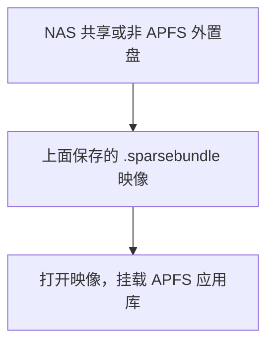

# 外置盘与日常使用

外置盘会成为迁移后应用或数据的实际存放位置。选择连接稳定、空间足够的设备，比只看标称速度更重要；需要频繁启动应用或读写小文件时，外置 SSD 通常更合适。

## 哪些操作需要 APFS {#apfs}

| 要做的事 | 存储要求 |
| --- | --- |
| 容器数据的挂载迁移 | 当前需要 APFS 存储，检查通过后才能继续。 |
| 普通应用、工具目录或自选文件夹迁移 | 按所选内容、文件系统能力和权限检查，不能据容器要求一概判断。 |
| NAS（SMB 共享）或非 APFS 外盘存放应用 | 直接复制受服务端权限和文件系统能力限制；可创建 [APFS 应用库映像](/docs/storage-guide#app-library-image) 来完整保留应用签名与文件属性。直接挂载的网络目录本身不能替代容器 APFS 挂载迁移。 |

若只是想迁移普通应用，不需要先为了容器功能重格式化整块盘。格式不合适时，可以换一个目标、使用应用库映像存放应用，或让容器数据留在本机。原因见[数据迁移方式](/docs/datamigrae/baseinfo)。

## 使用 APFS 应用库映像 {#app-library-image}

在左侧边栏“目标存储”右侧菜单（`…`）中，可以使用 APFS 稀疏捆绑映像（`.sparsebundle`）作为外部应用库，按实际写入占用空间，适合已挂载的 SMB 共享或 exFAT 等外置盘：

1. 确保 AppPorts 位于“应用程序”文件夹，且承载映像的共享或外置盘已在 Finder 中挂载。
2. 在“目标存储”菜单选择“创建 APFS 映像”（填写存放位置、磁盘名称和最大容量后点击“创建并使用”），或选择“打开已有映像…”。
3. AppPorts 会核对承载存储身份（SMB 共享地址或底层卷 UUID）与映像内 APFS 卷 UUID，不会覆盖已有文件，也不会按卷名猜测目标。

开启“设置 → 后台代理”中的“磁盘维护代理”后，登录、卷变化和后台每分钟检查都会尝试恢复当前选中的应用库映像；已刷新本地入口（版本 8）的应用在双击启动前，也会先无窗口接回所需映像及映像内关联的数据卷。若升级自较早版本，请在映像在线时打开一次 AppPorts 完成扫描，以刷新本地入口。

不再需要挂载时，可在“目标存储”的弹出菜单选择“卸载映像”。**主动卸载映像会持续暂停自动挂载**：重启 AppPorts、重新插拔外盘或重连 NAS 都不会自动解除，只有明确选择“重新挂载映像”（或重新打开该映像）才会恢复。

使用映像时请留意以下边界：

- **映像不是独立备份**：映像损坏、NAS 故障或网络中断仍需独立备份保障；同一映像同一时间只在一台 Mac 上写入。
- **仅自动恢复当前选中的映像**：历史映像需手动重新挂载；退出 AppPorts 不会自动卸载映像，因为迁出的应用可能仍在运行。
- **凭据、底层挂载与卷名**：SMB 未保存系统凭据时需先在 Finder 重连，加密卷仍需解锁；映像挂载路径依赖卷名，在 Finder 中改名会导致核验失败，改回原名即可恢复。
- **签名原包仍需物理外盘**：`AppPorts Backups` 不使用磁盘映像，手动重签应用时仍需连接合适的本地物理外盘。

## 准备 APFS 存储 {#prepare-apfs}

1. 先备份盘上已有内容，在“磁盘工具”中查看设备和卷的格式。
2. 已有合适的 APFS 存储时，返回 AppPorts 选择该位置并重新检查。
3. 确需更改格式时，先确认备份可用，再按磁盘工具的说明操作。**抹掉磁盘会清除所选对象的数据**，不能把它当作普通的设置开关。

AppPorts 会为挂载迁移创建专用数据卷；通常无需自己为每个数据目录预建卷或指定固定大小。

## 加密的外置盘 {#encrypted-drives}

AppPorts 支持在加密 APFS 目标上创建独立加密的数据卷。迁移检查后按“设置数据卷密码”输入并确认密码，再继续迁移；它不会继承外置盘现有密码，也不会更改原盘密码和文件。微信拆分迁移的多个新卷共用本次设置。

*新建加密数据卷时需要输入并确认独立密码。复选框控制是否将密码保存到本机钥匙串。*

“保存到本机钥匙串，连接外置盘后自动解锁”默认勾选，可取消。保存仅用于这台 Mac，不同步密码；未保存或钥匙串不可用时，需要手动解锁，后台不会反复弹密码框。密码不写入迁移记录或日志；未保存的密码在进程内暂存，退出后可能需要重新输入。请妥善保存密码，遗忘后无法恢复加密数据。

普通未加密 APFS 目标也能迁移，但盘丢失后他人可能读取其中数据；同盘另一卷有密码不代表新卷也已加密。查看迁移前提示并确认新卷的保护方式，不要为了通过检查先解除已有加密。

## 外置盘是否记得文件属于谁 {#owners}

macOS 的某些存储不保存文件所有者：exFAT 和 FAT32 没有这个字段；HFS+ 在忽略所有权的挂载下，新建文件会被记成占位用户。普通读写不受影响，但少数用管理员权限核对归属的应用（例如带特权后台服务的 clash-verge）会拒绝工作，并给出 `chown` 修复建议——这条命令在这类卷上会被内核静默丢弃，看起来成功、实际无效。

APFS 即使在忽略所有权的挂载下也保存真实归属，因此不在提示范围。迁移普通数据目录或自选文件夹时，AppPorts 会在确认框里说明目标盘的这一情况，不阻断继续。建议把这类应用的数据留在本机，或改用 APFS 格式的磁盘；HFS+ 可以在访达的“显示简介”里取消“忽略此宗卷上的所有权”后重新迁移。exFAT 没有该开关。

## 每天怎样连接和断开 {#daily}

- 使用前先连接外置盘，必要时打开 AppPorts，确认数据状态为“已挂载”或链接正常。
- 断开前保存工作，退出正在使用外盘数据的应用，正常弹出存储设备。
- 重启或重新插盘后，开启了“磁盘维护代理”的系统会在磁盘上线、解锁和系统授权后尝试自动接回，但不能保证早于所有登录应用。
- 移动或更新 AppPorts 后打开一次，让后台代理核对程序位置。

迁移不是备份。请检查自己的备份工具是否覆盖外置盘，尤其是重要的聊天记录、项目和个人文件。

## 空间、换盘和离线 {#space}

预留更新、复制和恢复所需的额外空间，不要只按当前文件夹大小把外盘装满。APFS 卷可能共享空间，删除或还原后的可用容量也可能稍后才更新；侧栏仅展示本机磁盘与目标存储的实际容量使用，不再用外部文件逻辑大小估算本机节省空间。

换盘前先[还原到本地](/docs/restore#data)，再选择新目标重新迁移。直接拖动受管数据或改卷名、目录结构，可能让已有入口失效。外盘找不到、数据没有接回时，先看[问题排查](/docs/faq#offline)。

## 外盘上的签名原包 {#signature-backups}

手动重签官方应用后，外盘可能出现可见的 `AppPorts Backups` 文件夹。AppPorts 自动选择合适外盘保存完整官方原包，里面的 `README.txt` 说明用途与删除影响；应用仍在内盘时也采用这一方式。恢复时需要接回保存原包的盘，保留文件夹原位置。

原包不包含个人数据，也不是另一套独立灾备。内盘应用重签时仍需要临时空间，跨卷保存经核验完成后才清理内部原件。选择外盘、查看和清理的方法见[签名原包说明](/docs/settings#signature-backups)。

实验依据：[意外断开外置盘的影响](/docs/blog/why-mount-and-apfs#unplug-experiment) · [重启与自动接回](/docs/blog/why-mount-and-apfs#startup-method)

## 从 AppPorts 弹出整块外置盘 {#eject}

1. 保存工作，退出使用外盘应用或数据的程序，等待进行中的文件操作结束。
2. 在侧栏“目标存储”区域的弹出菜单选择“弹出外置硬盘”。该操作针对**整块物理盘及其所有卷**，包括接到本地数据目录的专用卷，不只是当前选择的应用库。
3. AppPorts 先暂停该盘的自动挂载，再请求 Finder 弹出。请求已发出不代表已经弹出；按系统结果和菜单状态确认后再拔盘。
4. 仍有卷挂载或系统拒绝时，退出占用程序后使用“重试弹出”，不要强拔。

主动弹出物理外盘后，即使取消了 Finder 的弹出或全部卷已卸载，自动挂载仍保持暂停。**拔下并重新插入设备**，识别到同一盘的新连接后才会恢复；刷新列表、重开 AppPorts 或等待超时都不代替重插，也没有“取消弹出并恢复挂载”按钮。注意这与“卸载映像”或数据目录中单个数据卷的“卸载”不同：后两者不会因重新插盘解除暂停，需手动点击“重新挂载映像”或“挂载 / 恢复自动挂载”。出现权限错误时，检查 Finder 自动化权限并保留提示。
