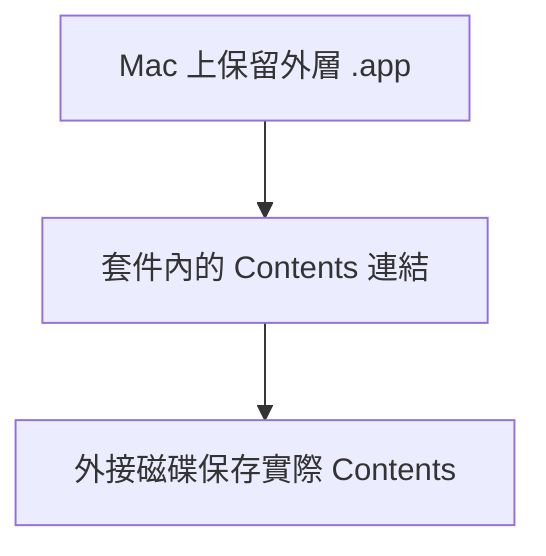

# 已歸檔：早期應用遷移方式

::: warning 歷史方式與原型
本頁解釋舊入口結構與實現變化。當前新遷移的預設方式見[應用遷移方式](/docs/migration-strategy/portal)。仍能識別舊入口，不代表新遷移會繼續選擇它。
:::

## Contents 目錄遷移 {#deep-contents}

早期的 Deep Contents Wrapper 將應用的 `Contents` 內容放到外部，本地保留外層 `.app`，內部透過連結訪問外部內容。它希望保留熟悉的應用外觀，並釋放本地空間。

但一些應用或更新器會解析連結的實際位置，在外部真實目錄上替換、刪除或改寫內容。路徑、簽名和更新行為因此難以一致處理。從歷史更新記錄看，1.2.0 開始引入 Stub Portal 替代這一方向。當前仍識別舊 Contents 結構以便管理，不將它作為新遷移的預設方案。

## 整體符號連結 {#whole-symlink}

Whole App Symlink 把整個應用移到外部，在本地建立指向 `.app` 的符號連結。它結構簡單，但 Finder 可能顯示連結箭頭，應用更新、查詢資源和系統入口的表現也取決於具體應用。

當前仍保留“使用傳統連結遷移”的手動入口，掃描與恢復也會識別已有結構；應用套件內同樣可能包含指向外部的連結。整體符號連結是舊方式中仍可選用的一種，並未全部停用。不能因看到連結就斷定遷移錯誤，也不應手工把所有啟動殼都換成整包連結。

## 早期更新框架混合入口 {#legacy-hybrid}

舊實現還出現過 Sparkle Hybrid、Electron Hybrid：在本地應用包裝內，用連結連線外部的框架、資源等元件。當前仍識別這些遺留結構，以便定位真實應用並執行恢復或解鏈；它們不再作為新的預設遷移方式。

這種歷史混合入口與下面的 Transparent Hybrid 原型是不同階段的方案，不能只憑“Hybrid”名稱視為同一種功能。

## 啟動殼的實現變化 {#stub-versions}

Stub Portal 只在本地保留啟動入口，執行時開啟外部真實應用。早期實現使用指令碼啟動器；歷史 1.6.2 更新記錄記載了原生啟動器的引入，用於改善雙擊關聯文件時的開啟行為。

舊版還分別描述過普通 Mac 應用與 iOS 應用的啟動入口差異。這個差異服務於啟動和系統識別，不能理解為重簽 iOS 應用或繞過裝置支援。當前由 AppPorts 判斷入口方式，不要求使用者手工選指令碼或原生實現。

已有入口的具體版本由掃描和相容處理識別。將所有歷史啟動殼統稱為某一種實現，會遺漏仍需處理的舊記錄。

## 透明混合原型 {#hybrid}

Transparent Hybrid 是程式碼中存在的預設關閉原型，嘗試兼顧本地應用外觀和外部內容訪問。它不是面向普通使用者提供的推薦選項，也沒有被本頁描述為已正式普及的替代方式。

原型與正式預設方式分開記錄，避免將“程式碼裡存在”誤讀成“已支援選擇”。需要使用當前功能時，從[遷移應用](/docs/core)開始。

## 已有舊遷移怎麼辦 {#existing}

舊入口仍能正常使用時，不必只因名稱屬於歷史方案就刪除它。需要調整時，先連線原盤，使用 AppPorts 的遷回或連結管理操作，確認真實應用與資料都在。應用本體還原不會自動還原另行遷移的資料。

相關內容：[還原與接回](/docs/restore) · [更新保護](/docs/migration-strategy/portal#updates) · [歷史功能歸檔](/docs/archive/overview)
