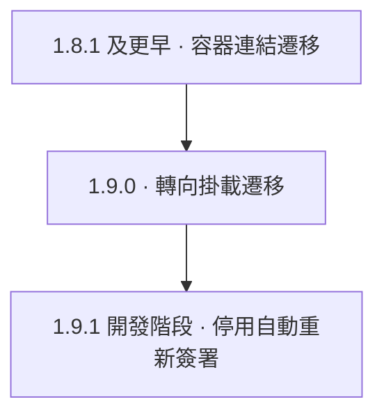

# 已歸檔：舊版資料連結與自動重簽名

::: warning 歷史功能
本頁保留舊版本做法。目前版本將遷移與手動簽名分開，並停用所有系統上的登入自動重簽。新操作請看[遷移資料](/docs/datamigrae/operation)；舊遷移的恢復請看[升級與修復](/docs/macos-27)。
:::

## 版本與狀態 {#versions}

| 功能 | 歷史行為 | 當前狀態 |
| --- | --- | --- |
| 容器資料符號連結遷移 | 1.8.1 及更早版本採用的主要方式，將資料搬到外部，再在原位置建立連結。 | 預設改用掛載遷移；舊連結管理在經典模式中受限保留。 |
| 遷移後重簽名 | 舊資料目錄工具欄提供開關，容器遷移前也曾提供“僅遷移”與重簽確認。1.9.0 過渡期僅經典模式保留相關流程。 | 1.9.1 開發版停用自動串聯，遷移不附帶簽名操作。 |
| 開機自動重簽名 | 舊版安裝登入任務，每次登入按當時的記錄與策略檢查、重簽應用。1.9.0 在 macOS 27 上停用，較早系統仍有過渡行為。 | 1.9.1 開發版在所有系統停用，並嘗試關閉、移除舊任務；build 31 移除常駐設定卡，僅清理失敗時顯示重試。 |
| 僅記錄簽名身份的舊備份 | 記錄應用標識、路徑、身份名稱和時間，沒有完整儲存原應用。 | 不足以恢復原始簽名；仍有來源價值的記錄保留，滿足核驗條件後才自動清理。 |
| 內建磁碟完整原包備份 | 後續實現將官方應用原包儲存在內建磁碟，用於恢復應用內容和簽名。 | build 31 將新的長期原包統一儲存到外接磁碟；舊有效原包在條件滿足時自動遷出，驗證成功後清理內部副本。 |

## 舊流程做了什麼 {#flow}

舊連結遷移將資料複製到外部受管位置，再把原位置換成符號連結。若同時選擇重簽，應用資料遷移與 Ad-hoc 重簽會先後進行；簽名必須作用於真實應用，而不是本地啟動殼。

登入自動重簽另有獨立背景任務，標識為 `com.shimoko.AppPorts.re-sign`。它不是容器資料自動接回任務。舊版設定、指令碼規則和預設值曾隨版本調整，不能將其中一次行為當成所有歷史版本的一致承諾。

工具目錄和普通自選資料夾仍可使用連結遷移。本次停用的是自動簽名流程，並非取消所有符號連結功能。

## 為什麼不再沿用 {#why}

本地重簽會改變應用身份，並可能移除或改變沙盒、應用組和鑰匙串等授權。它不能替代原開發者簽名，也不能保證修復容器訪問。在已測試的 macOS 27 環境中，部分重簽應用即使資料在本地也無法正常啟動。

簽名失敗與遷移失敗還可能發生在不同階段。把兩個操作自動串聯，會讓使用者難以判斷資料已經搬走還是應用身份已經改變。當前流程將它們分開，需要時由獨立簽名操作處理。

## 舊備份與恢復材料 {#backups}

舊簽名記錄儲存在 AppPorts 的 `signature-backups` 目錄中。僅有身份名稱的記錄不能憑空恢復原應用；歷史上移除簽名或重新做 Ad-hoc 簽名，也不等於恢復官方簽名。

後來的完整備份同時儲存原應用檔案與核對資訊，可在符合條件時恢復。當前仍需驗證應用版本、開發者身份和內容，不能用舊備份覆蓋新版應用。build 31 保留這類恢復能力，將新的長期原包放到外接磁碟可見的 `AppPorts Backups` 資料夾；舊內建磁碟原包在確認仍有用、外接磁碟可用且沒有待續操作依賴時自動遷出。外接磁碟副本驗證成功前，內部原件繼續保留。

只有身份名稱的記錄、或已確認原包缺失的索引，並非一律刪除。沒有未完成操作依賴，且來源資訊已在其他記錄中可靠保留，或當前安裝已驗證為對應的官方應用時，AppPorts 才自動清理。無法確認歸屬、仍是唯一來源資訊的小記錄會繼續保留。

外接磁碟未連線與檔案確實缺失不同；不能按儲存時間或簽名變化認定備份無用。仍有恢復價值的完整原包繼續保留，當前儲存、恢復與手動清理方法見[簽名原包說明](/docs/settings#signature-backups)。

## 現在如何處理 {#transition}

先連線原外接磁碟並退出相關應用；還原舊式容器連結資料，再檢查是否需要恢復官方應用。更新 AppPorts 後開啟一次，讓它處理舊登入任務；若提示尚未關閉，在設定中重試。

關閉經典模式不會自行遷回資料或恢復簽名。處理完舊狀態後，符合條件的資料可以改用掛載遷移，普通目錄繼續按實際需要使用連結遷移。

相關內容：[經典模式](/docs/classic-mode) · [簽名狀態](/docs/badges#signing) · [歷史功能歸檔](/docs/archive/overview)
