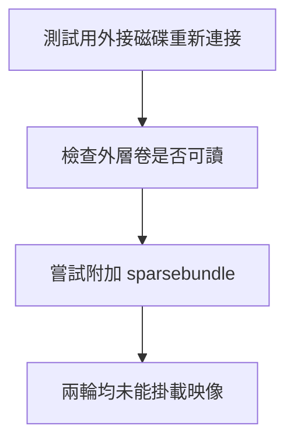

# 已歸檔：未採用的掛載實驗方案

::: warning 實驗方案，不是當前功能
以下保留 2026 年 9 月在 macOS 27.0（26A428）環境探索過的方法、結果與未採用的原因。它們不構成當前安裝教程，也不表示 AppPorts 曾正式提供相應開關。
:::

## 用磁碟映像承載資料 {#images}

曾考慮在外部儲存中放一個 APFS 磁碟映像，再把映像內部的卷接到應用目錄。它的吸引力是把所需檔案系統封裝在一個檔案中，似乎可以用於更多外接磁碟格式。

在受測 USB 裝置的兩輪意外斷開實驗中，sparsebundle 映像重新接入後無法掛載；原生 APFS 卷也出現過資料庫損壞。ASIF 嘗試在有效拔盤測試前中止，沒有成功或失敗結論。具體過程和計數保留在[意外斷開實驗](/docs/blog/why-mount-and-apfs#unplug-experiment)。

因此目前容器遷移不把獨立的每目錄磁碟映像作為繞過外接磁碟 APFS 要求的選項。這不意味著所有映像在任何環境中都會失敗，也不把有限樣本當成故障率。註：2.2.0 新增的[應用庫映像](/docs/storage-guide#app-library-image)用於承載外部應用庫（例如在 SMB 共享或非 APFS 外接磁碟上儲存應用本體），與此處早期的單容器資料映像實驗不同。

## 用系統掛載表固定位置 {#fstab}

實驗比較過在系統掛載表（fstab）中使用卷 UUID 與裝置編號。受測環境裡，UUID 形式未能掛載；直接裝置編號的形式可以掛載，但編號可能在重啟或重新連線後變化。

一個固定條目也不足以處理使用者資料尚未解鎖、應用容器授權和磁碟延遲上線。因此它沒有成為當前給使用者配置容器遷移的方式。實驗失敗只代表這組配置，不能推論為 macOS 永遠不支援 UUID 掛載。

## 由系統背景服務提前掛載 {#daemon}

曾測試讓系統級程序在登入前或解鎖後直接掛載。FileVault 開啟時，目標使用者資料路徑在解鎖前不可用；解鎖後，管理員身份也不能代替容器訪問所需授權。

另一種嘗試是讓系統級程序僅啟動已有授權的使用者任務。使用者會話存在時可以觸發，會話尚未建立時會失敗；這又引入系統級安裝、重試與額外維護。當前採用使用者側任務接回，不要求使用者安裝這套實驗系統背景服務。

## 只看命令成功、不核對實際位置 {#verification}

舊調查中發現，資料卷已被系統掛到其他位置時，指定掛載點的命令仍可能返回成功，卻沒有把卷接到原目錄。因此當前檢查真實掛載位置，並在需要時重試；僅看“程序已啟動”或“返回成功”都不足以判斷接回完成。

啟動配置調整改善了部分樣本的等待時間，但應用仍可能搶先啟動。完整時序結果與限制見[重啟與自動接回](/docs/blog/why-mount-and-apfs#startup-method)。

這些方案的驗證條件與失敗項繼續保留，避免以後把同一個設想當成已經證明可靠的功能。當前操作入口是[遷移資料](/docs/datamigrae/operation)與[設定與權限](/docs/settings#mount-agent)。
