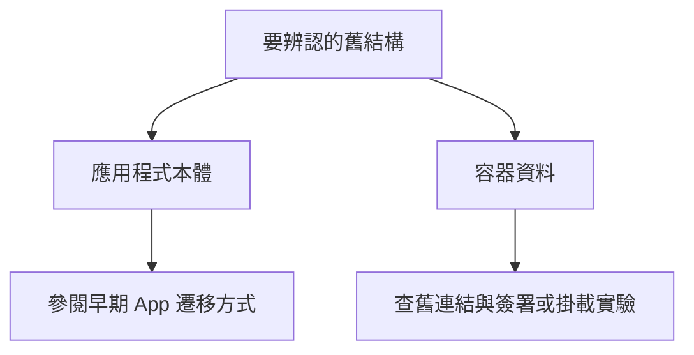

# 歷史功能歸檔索引

這裡保留已停用功能、早期遷移方式和沒有採用的實驗方案，方便使用舊版本或檢查舊遷移的讀者查閱。**歸檔不表示這些功能仍在當前版本中提供，也不表示需要把已有遷移立即重做。**

## 按主題查閱 {#topics}

| 歸檔內容 | 適用階段與狀態 | 當前入口 |
| --- | --- | --- |
| [舊版資料連結與自動重簽名](/docs/archive/data-signing) | 1.8.1 及更早的容器連結方式；1.9.0 的過渡期；1.9.1 開發版停用自動簽名。 | [遷移資料](/docs/datamigrae/operation)、[經典模式](/docs/classic-mode) |
| [早期應用遷移方式](/docs/archive/app-strategies) | Contents 等舊結構與啟動殼實現變化；整體符號連結仍可手動選用，另列預設關閉原型。 | [應用遷移方式](/docs/migration-strategy/portal) |
| [未採用的掛載實驗方案](/docs/archive/mount-experiments) | 2026 年 9 月實驗中的磁碟映像、系統掛載配置與系統背景服務方案；不能當作正式功能。 | [掛載遷移](/docs/datamigrae/baseinfo#mount)、[自動接回實驗](/docs/blog/why-mount-and-apfs#startup-method) |

## 怎樣理解版本說明 {#versions}

目前正文按最新介面和行為整理。某個功能在舊版本出現過，不意味著目前開關仍有效。舊版「遷移後重簽名」「開機自動重簽名」的操作與侷限在歸檔中保留，目前應按[設定與權限](/docs/settings)處理。

需要了解每次釋出的變化，可查[更新日誌](/docs/changelog)。遇到舊方式遷移後的異常，先保留資料和備份，按[macOS 27 升級與修復](/docs/macos-27)檢查，不要僅為復現舊流程而降級或重新簽名。
