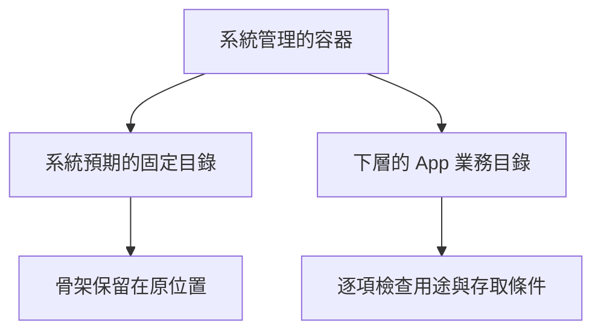

# 為什麼有些資料目錄不能遷移

**研究整理：2026 年 10 月 15 日 · 主要實驗：2026 年 10 月 1 日**

## 摘要 {#abstract}

一次企業微信故障中，資料已經複製，外接卷也成功掛載，應用卻在啟動時崩潰。調查發現，macOS 會檢查容器中的部分固定目錄：路徑看起來沒變，如果這些目錄已經屬於另一個檔案系統，仍可能被拒絕。

後續實驗還發現另一種邊界：有些業務子目錄可以通過啟動前的結構檢查，但變成掛載點以後，跨卷移動、刪除目錄根等操作的行為會改變。AppPorts 因此需要同時考慮系統結構、目錄層級、應用工作流和複製一致性，不能僅憑“這個資料夾能複製”決定是否遷移。

本文依據歷史實驗與 AppPorts 1.9.1 開發程式碼整理。所述程式碼固定在公開提交 `468c788`，不代表這些行為已經全部進入已釋出的 v1.9.0。個人路徑、帳戶標識和業務內容均不公開。

## 1. 起點：遷移成功，為什麼應用打不開 {#starting-point}

[公開問題 #65](https://github.com/wzh4869/AppPorts/issues/65)報告了企業微信遷移部分資料後啟動崩潰。AppPorts 的操作日誌記錄了複製和掛載成功，這只能說明遷移動作完成，不能證明原應用接受了新的目錄佈局。

問題報告與復現實驗的環境並不完全相同：

| 專案 | 問題報告 | 復現實驗 |
| --- | --- | --- |
| 系統 | macOS 27.0.1（26A434） | macOS 27.0（26A428），Apple Silicon |
| 企業微信 | 5.0.11（99998） | 5.0.11（99998），保留官方簽名 |
| 資料儲存 | 外接 APFS | 外接 USB APFS |
| 操作方式 | AppPorts 1.9.0 | 獨立測試卷與同類底層建卷、掛載操作 |

復現並非重新點選 AppPorts 完成整套遷移。實驗保留原目錄，逐項改變佈局，檢查應用主介面、崩潰記錄和實際資料訪問，以縮小原因範圍。

| 對照條件 | 觀察結果 |
| --- | --- |
| 原始資料保持本地 | 正常進入主介面。 |
| 只把 `Data/tmp` 掛到外接 APFS | 很快崩潰；還原本地 `tmp` 後恢復。 |
| 只遷移業務目錄 `Data/Documents/cefcache` | 正常啟動，並觀察到外接資料訪問。 |
| 業務目錄保持外接，`tmp` 換成本地複製副本 | 正常啟動。目錄物件變了，仍可用。 |
| 在上一條件下再次把 `tmp` 掛到外接卷 | 再次出現相同崩潰。 |

失敗樣本中，`tmp` 的常規權限和所有者設定與原目錄一致；本地複製副本通過，也排除了“只要換過目錄物件就會失敗”的解釋。兩次失敗都指向啟動前的容器完整性檢查。

### 為什麼要逐項改變，而不是重新遷移一遍 {#hypotheses}

一次操作同時移動多個目錄，只能說明這組變化之後出現了問題。它不能告訴我們是哪一項造成故障，更不能說明故障來自複製、掛載、授權還是應用自身。

因此實驗先回到能夠正常啟動的本地狀態，再只改變一個條件。第一次只掛出 `tmp` 就重現了失敗；恢復它後，應用又能使用。隨後讓一個已驗證的業務目錄保持外接，再次比較本地和外接 `tmp`，檢查故障是否仍跟隨這個變化。

| 當時需要區分的解釋 | 怎樣核對 | 能得出的結論 |
| --- | --- | --- |
| 檔案沒有複製完整 | 保留原目錄，用本地複製副本與外接副本作對照；同時追蹤系統實際拒絕原因。 | 本地副本可以啟動，失敗不只是“複製過一次”。這不代表該輪檢查了所有業務檔案的全部屬性。 |
| 所有者或權限設定錯誤 | 對比失敗樣本與原目錄的常規權限、所有者和組。 | 這些值相同仍失敗，不能用這幾項的明顯差異解釋樣本。 |
| 目錄物件身份改變 | 本地換用一個新的目錄副本。 | 新目錄物件仍能執行，因此不是目錄物件一變就失敗。 |
| 外接磁碟上的任何資料都會被拒絕 | `tmp` 留本地，只把 `cefcache` 掛到外接卷。 | 業務目錄有成功訪問，不能把故障概括為企業微信一律不能用外接磁碟。 |
| 固定結構被接到了另一個檔案系統 | 對齊失敗日誌、系統判斷分支，再用獨立佈局驗證。 | 三種證據共同指向 `tmp` 的檔案系統裝置號不匹配。 |

“排除”也有範圍：本地副本成功不能證明任何複製器都正確，權限值一致不能證明所有權限機制都無關。它們的作用是縮小這次故障的解釋範圍，讓後續檢查有明確物件。

## 2. 從錯誤日誌到系統檢查，再回到實驗 {#investigation}

對齊失敗程序的系統日誌後，找到一條關鍵原因：

```text
directory tmp is on a different device
```

這裡的 **device 指檔案系統裝置標識**，不是硬碟品牌、介面或“外接磁碟”標籤。同一塊物理硬碟上的兩個 APFS 卷，也可能擁有不同的裝置標識。因此，“都在同一塊硬碟上”“格式都是 APFS”不能讓這項檢查自動通過。

調查接著只讀分析了該版系統的 AppContainer 框架：從錯誤字串定位目錄校驗函式，檢查其控制流程與固定路徑表，再用合成容器直接呼叫系統原校驗函式，進行正反對照。實驗沒有修改校驗返回值，也沒有把會改變系統狀態的註冊介面當作探針。

得到的機制是：校驗會檢查 `Data` 與容器父目錄的裝置關係，再檢查一組固定條目。固定條目存在時，必須是符合要求的真實目錄，並與參照目錄處於同一檔案系統。該校驗不遞迴檢查任意業務後代。

### 第一輪：用同一個卷比較不同位置 {#first-probe}

第一輪隔離探針使用獨立合成目錄和一個新建外接 APFS 卷，每種佈局分別套用微信與企業微信標識。整個過程只呼叫目錄校驗方法，不啟動這兩款真實應用，也不替換它們的目錄。六種佈局、兩個標識，共 12 條結果：

| 合成佈局 | 企業微信標識 | 微信標識 |
| --- | --- | --- |
| 所有結構保持本地 | 通過 | 通過 |
| 將同一個外接卷接到 `Data/tmp` | 拒絕 | 拒絕 |
| 將該卷接到 `Data/cache-probe` | 通過 | 通過 |
| 將該卷接到 `Data/Documents/cache-probe` | 通過 | 通過 |
| `tmp` 改成指向本地目錄的符號連結 | 拒絕 | 拒絕 |
| 恢復本地結構 | 通過 | 通過 |

這裡保持卷不變、改變掛載位置，是為了區分“這個卷不能使用”與“這個位置不能成為另一卷”。兩個業務位置通過，說明所測校驗關注目錄層級。換成本地符號連結仍失敗，則說明滿足裝置關係還不夠：固定條目本身也必須是校驗接受的目錄型別。

### 第二輪：驗證整張表與入口條件 {#second-probe}

第二輪探針先後使用兩個 128 MB 的本機 APFS 磁碟映像與合成目錄，未對真實外接磁碟增刪卷，也未覆蓋真實可移動卷的隱私授權判定。共記錄 144 條結果，其中 136 條預設斷言全部符合預期，另 8 條記錄入口開啟行為。這些包含大量**按預期被拒絕**的樣本，不是 144 次應用成功執行。以下列出與遷移邊界直接相關的對照：

| 合成佈局 | 系統原函式或入口的結果 |
| --- | --- |
| 固定結構保持本地 | 通過。 |
| 11 個固定條目分別直接掛到另一卷 | 均被拒絕。 |
| 11 個固定條目分別改為本地符號連結 | 均被拒絕；連結不能代替要求的真實目錄。 |
| 在各固定條目之下掛載更深的測試子目錄 | 通過所測結構校驗。 |
| 固定表中的某一條目不存在 | 該函式跳過缺失項。 |
| `Data` 入口本身缺失、不可搜尋或經過不允許的連結 | 在入口階段就可能失敗。 |

“缺失項被跳過”並不意味著可以刪除系統目錄來規避限制。上游容器管理還有建立、修復和身份檢查；目錄訪問權限也會影響能否走到這一步。

一個容易誤讀的結果來自 `Data` 的符號連結入口。探針如果故意採用較寬鬆的方式開啟目標目錄，再把已經開啟的目錄交給校驗函式，可能得到通過；用與真實入口一致的“不沿符號連結搜尋”條件開啟時，卻會先失敗。**繞開入口後某個內部函式返回通過，不能證明真實啟動能走通。**

權限實驗也說明了相同問題。校驗沒有逐項要求所有目錄都等於某一個權限數值，但中間的 `Library` 不能被搜尋時，它下面的結構就可能無法檢查。因此不能把“沒有直接比較權限位”寫成“權限不重要”。

### 錯誤為什麼出現在應用啟動時 {#failure-chain}

將本機實現整理成便於閱讀的邏輯，大致是下面這樣。這是調查者對特定系統版本的解釋，不是 Apple 公開原始碼或可供應用呼叫的穩定介面：

```text
取得容器父目錄的檔案系統裝置標識
開啟 Data，並檢查它與參照目錄的裝置關係
逐項檢查固定路徑表：
  條目不存在 → 這一項跳過
  其他讀取錯誤 → 拒絕
  不是要求的目錄型別 → 拒絕
  與參照目錄不在同一檔案系統 → 拒絕
上述檢查通過 → 繼續後續流程
```

本次失敗由目錄檢查向上返回，系統將它彙總為 `EINVAL`，也就是“引數不合法”；沙盒初始化失敗再傳給應用，最終觸發 `SIGTRAP` 退出。這裡的 `EINVAL` 不是掛載命令本身返回的錯誤，所以“掛載成功”和“隨後啟動失敗”可以同時成立。

調查也檢查了已有註冊與沙盒配置快取等可能解釋。已追蹤的呼叫順序中，配置快取不能代替前面的容器檢查；相關路徑也沒有發現微信因 SDK 版本而獲得 `tmp` 豁免。兩款受對照的真實主程式都保留有效官方簽名。這個結論只限定已核對的路徑，不能推廣成整個系統不存在其他身份分支。

探針分別使用微信和企業微信標識。它們幫助核對了這張表的行為，**沒有做真實微信遷走 `tmp` 後啟動的實驗**。結構探針、真實啟動和完整業務測試是三種不同證據。

## 3. 哪些目錄不能整體遷移 {#protected-directories}

先分清這裡的“容器”：它是某個應用在 `~/Library/Containers/` 下的資料空間，與外接磁碟中的“APFS 容器”是不同概念。

普通應用容器可以簡化為：

```text
~/Library/Containers/應用標識/
└── Data/
    ├── Documents/                 固定結構
    │   └── 某項業務資料/           需要單獨判斷
    ├── Library/                   固定結構
    │   └── Application Support/   固定結構
    │       └── 某項業務資料/       需要單獨判斷
    └── tmp/                       固定結構
```

AppPorts 當前保護**普通容器根、`Data` 本身，以及下面 11 個精確節點**。表內路徑均相對於該應用容器的 `Data`，不是使用者個人的 `~/Documents` 或整個 `~/Library`。

| 受保護的精確節點 | 受保護的精確節點 |
| --- | --- |
| `Documents` | `Library` |
| `Library/Application Scripts` | `Library/Application Support` |
| `Library/Caches` | `Library/Images` |
| `Library/Logs` | `Library/Preferences` |
| `Library/Saved Application State` | `SystemData` |
| `tmp` | |

保護的是這些節點自身，不自動等於禁止其所有後代。例如 `Documents` 自身不能整體遷走，不代表其中每個業務子目錄都被相同規則禁止。容器內 `Data` 以外的其他節點也不會被當作普通業務目錄隨意遷移。

還有兩項獨立規則：

- **共享容器根**：`~/Library/Group Containers/組標識` 自身受保護。共享容器有獨立佈局和授權關係，不能直接把上表套在它的根上；下級目錄仍需其他檢查。
- **微信相容範圍**：對 `com.tencent.xinWeChat`，當前路徑策略只放行 `Data/Documents/xwechat_files` 下的直接帳戶子目錄，以及 `Data/Library/Application Support/com.tencent.xinWeChat`。帳戶名稱不影響這裡的解釋，本文不展示真實標識。

微信規則比普通結構表更保守。早期實驗曾在更高的 `xwechat_files` 層級完成訪問，因此不能把它的全部限制都說成“macOS 明文禁止”。這是 AppPorts 當前選定的相容範圍；是否可以實際執行，還要通過卷狀態、佔用和父子路徑等檢查。[路徑策略原始碼](https://github.com/wzh4869/AppPorts/blob/468c7889f367281543c96e9c8f40515c37b65403/AppPorts/Models/DataPathPolicy.swift)



### 同名目錄，為什麼不能只看名字判斷 {#path-ownership}

不同應用都有自己的 `Data/Documents`，它們不因此成為同一個目錄。某個容器中也可能存在通向使用者桌面、下載等個人位置的入口；看見一個熟悉名稱，不足以認定它是應用獨佔的資料。

當前策略以實際使用者的容器根和精確路徑組成部分識別結構，同時檢查表面路徑與解析符號連結後的路徑。它不會因為另一個普通資料夾恰好名叫 `Containers` 就套用全部規則，也不能透過換一條別名路徑解除真實容器的保護。

執行入口還拒絕整體遷移 `~/Library/Containers`、`~/Library/Group Containers` 及包含這些根的上層目錄。因此，結構保護不能用“改選更大的父資料夾”繞過。看見更多目錄、展開結構，或從自選目錄進入，都不等於獲得了新的遷移權限。

## 4. 業務目錄的成功，證明到哪一步 {#business-directories}

排除 `tmp` 後，對企業微信四個已有真實資料的業務目錄繼續測試：

| 相對於容器的路徑 | 用途辨認 |
| --- | --- |
| `Data/Documents/cefcache` | 一項應用業務目錄。 |
| `Data/Documents/Profiles` | 一項應用業務目錄。 |
| `Data/Library/Application Support/WXWork` | 應用支援資料。 |
| `Data/Library/WebKit` | 應用使用的 WebKit 資料。 |

四個目錄共有 15 種非空組合：4 個單項、6 個雙項、4 個三項和 1 個四項。每組主程序至少觀察約 30 秒，同時檢查基礎介面、實際外接訪問和卷身份。15 組均通過這些檢查，未出現新的相關崩潰。

每一組都需要先退出應用，安排該組測試卷的掛載，再啟動應用觀察。檢查不止“視窗出現了”：還要確認基礎介面可用、應用確實開啟了外接資料，以及被訪問的卷就是本組指定的卷。否則，程式可能只是讀到了另一份本地資料。

四個單項還各補了一次完整介面與卷身份核對，因此原記錄有 19 條，仍然只有 15 種不同組合。開啟檔案記錄數也不能當作去重檔案數，同一檔案可能被多個程序或多次開啟。這裡採用“組合數、觀察時長、檢查專案”說明覆蓋範圍，避免把日誌條數當成更多獨立實驗。

這說明固定結構留在本地時，部分業務目錄可以遷出；它沒有證明企業微信全部功能或全部資料都適用。各組沒有都恢復到同一個初始快照，也沒有覆蓋所有遷移順序、長期執行、應用升級、首次登入和斷盤重連。

原問題中的 `UpgradeBeta`、`Wedoc`、`AIModel` 當時沒有真實資料，未用空資料夾代替實際業務測試。因此不能寫成“七個目錄的 127 種組合全部驗證”。

## 5. 為什麼臨時子目錄也值得謹慎 {#temporary-directories}

如果 `tmp` 自身不能遷，遷走它裡面的子目錄是否就可以？為回答這個問題，實驗讀取了 25 個隱藏臨時目錄的獨立副本，在合成容器與自有 APFS 磁碟映像中逐個驗證，沒有移動真實企業微信目錄，也沒有啟動應用。

25 個子目錄均通過系統原結構校驗。隱藏名稱並不是這項校驗的限制。但清空實驗副本後，**刪除掛載點本身全部失敗**，返回 `EBUSY`，即“資源正忙”。隨後另建的隨機臨時兄弟目錄仍留在本機，並不會因為舊目錄遷走而自動進入外接卷。

該輪還對複製與還原前後的相對路徑、檔案型別、權限位、檔案長度、內容雜湊和符號連結目標作了比較，25 份樣本均匹配。但複製使用的是獨立實驗工具，清單沒有覆蓋訪問控制列表、所有延伸屬性和全部時間戳，所以這不是生產遷移器的完整保全驗收。

這區分了三個問題：隱藏目錄是否被掃描發現、內容是否能複製、該目錄的生命週期是否適合長期掛載。補全掃描可以改善佔用顯示，卻不能直接把所有隱藏佔用都算成“可安全釋放”。

更細的檔案操作對照解釋了這個結果：

| 操作 | 本地普通目錄 | 變成獨立 APFS 掛載點後 |
| --- | --- | --- |
| 在目錄內部建立、讀取、刪除檔案 | 成功 | 成功。 |
| 在同一目錄內部改名並替換檔案 | 成功 | 成功。 |
| 從本地 `tmp` 原子移動檔案到遷移目錄 | 成功 | 跨檔案系統，返回 `EXDEV`。 |
| 從本地 `tmp` 建立硬式連結到遷移目錄 | 成功 | 跨檔案系統，返回 `EXDEV`。 |
| 清空後刪除目錄根 | 成功 | 掛載點正忙，返回 `EBUSY`。 |
| 用另一目錄替換該根，或跨父目錄移動該根 | 成功 | 所測操作返回 `EXDEV`。 |
| 同一父目錄內，把根改名為一個不存在的名稱 | 成功 | 所測條件下成功，不能說掛載點一律不能改名。 |

“原子移動”可以理解為一次完成名字或位置的切換，不讓其他程式看到複製到一半的狀態。若應用先在本地臨時目錄寫好檔案，再原子替換外接目錄中的正式檔案，兩個位置分屬不同卷，就不能繼續使用原來的跨路徑操作。有些高階介面會改為複製再刪除，但這已不是相同的原子保證。

這類臨時目錄常會被整體清理、替換或重新生成。即便某個舊子目錄可以掛載，也可能既影響清理，又不能持續把未來臨時檔案放到外接磁碟。這個結論來自隔離的檔案系統實驗，**沒有追蹤並復現企業微信自身的完整清理失敗流程**。

更細的操作矩陣使用自建合成容器和 256 MB APFS 磁碟映像，共記錄 44 條結構、系統呼叫、資料庫與新目錄檢查。建立、讀寫等成功與刪除、跨卷改名等失敗都是結果的一部分，不能寫成“44 次應用執行成功”。其中路徑授權測試使用自定義沙盒規則；SQLite 和隨機新目錄是未套用該規則的檔案系統對照，均不能冒充企業微信的完整執行環境。

想象一個應用每次啟動都建立“臨時目錄 A”，關閉時刪除它，下次又建立“臨時目錄 B”。把 A 放到獨立卷上，首先改變了關閉時刪除 A 的條件；其次 B 仍會在本機建立。即使 A 在那一次啟動中讀寫正常，也沒有實現“以後所有臨時資料都在外接磁碟”。這是根路徑穩定的業務資料與隨機臨時單元的重要區別。

當前程式碼仍有一個需要明確的差別：普通容器策略鎖定 `tmp` 本身，**尚未全面禁止它的所有後代**；微信的額外規則則限制了這棵子樹。本文的“不建議預設遷移隨機臨時目錄”是有實驗依據的建議，不能寫成已經全面實施的攔截功能。

## 6. 為什麼遷移父目錄和遷移子目錄不同 {#topology}

一個業務目錄內部的檔案原本在同一卷。若把它的幾個子目錄分別掛到不同卷，兄弟目錄之間也會新增檔案系統邊界。反過來，如果已有子目錄掛載，再把父目錄整體遷走，還可能漏掉子卷內容或形成重複管理。

歷史隔離實驗發現，舊複製實現使用的一種目錄列舉方式不會繼續進入遍歷途中遇到的子掛載。複製父目錄返回成功，並不意味著其中掛載的資料也已複製。它不是對所有目錄列舉介面的結論，卻足以說明只檢查選中目錄本身不夠。

當前 AppPorts 的路徑關係檢查同時考慮受管父目錄、子目錄、真實掛載、符號連結別名、離線記錄和未完成操作。調整遷移層級，應先透過 AppPorts 還原已有遷移，再選擇新層級；不能把父子遷移疊起來。[路徑關係檢查原始碼](https://github.com/wzh4869/AppPorts/blob/468c7889f367281543c96e9c8f40515c37b65403/AppPorts/Services/DataPathTopology.swift)

如果共同父目錄本身就是受保護的 `Documents` 或 `tmp`，也不能為了維持內部同卷關係而整體遷走。此時需要縮小可相容的資料範圍，或使用應用自身提供的儲存位置設定。

### 一個層級選擇的例子 {#granularity-example}

假設某個應用的業務目錄包含資料庫、附件與它自己的臨時檔案，下面只是示意，不代表某個真實應用的推薦路徑：

```text
業務目錄/
├── 資料庫/
├── 附件/
└── 業務臨時檔案/
```

如果這個業務目錄本身允許遷移，把它作為一個單元接到同一卷，三者內部仍能維持同卷操作。若分別遷移資料庫和附件，而臨時檔案留本地，原先同卷的路徑之間就出現了邊界。能否接受，取決於應用是否需要在這些位置之間原子改名、建立硬式連結，或整體替換目錄。

這不是“父目錄總比子目錄好”的建議。父目錄可能是受保護結構，也可能已經包含受管子項。正確順序是先判斷允許範圍，再判斷檔案關係與現有遷移，最後選擇能夠驗證的穩定單元。

離線記錄也必須參與檢查。拔掉外接磁碟只會讓資料暫時不可見，不會讓原來的遷移關係消失；否則在空入口上再建一套遷移，原盤迴來時就可能出現兩套互相覆蓋的記錄。

## 7. 路徑允許以後，還要確認什麼 {#copy-and-switch}

目錄邊界還有時間上的一面：複製期間，原件可能繼續被背景程式寫入。

### 方法：把內容、屬性與時間分開檢查 {#integrity-method}

2026 年 10 月 1 日，在 macOS 27.0（26A428）、Swift 6.4、arm64 環境中，研究使用合成資料和當時的舊複製實現，分別檢查三類問題。

第一類是靜態屬性：先建立普通檔案、目錄屬性和硬式連結關係，複製後逐項比較。內容雜湊相同，只說明讀到的檔案位元組相同；訪問控制列表決定額外的訪問權限，延伸屬性儲存檔案附加資訊，硬式連結則表示兩個名字指向同一份檔案物件。這些都不能從一個普通檔案的雜湊值推出來。

第二類是複製期間寫入：一個獨立程序提前持有普通檔案或 SQLite 連線，複製器透過已有進度介面與它同步。測試刻意讓“檔案已經複製”和“複製方法返回成功”之間發生新寫入，再檢查目標是否包含變化。控制訊號放在被複製目錄之外，避免訊號檔案自身干擾樣本。

第三類是完整往返：在獨立的 4 GiB、未加密 APFS 磁碟映像中呼叫舊遷移與還原程式，檢查複製之後的切換、備份清理與還原結果。它是程式介面級驗證，不是實際使用者資料的介面遷移，也不是物理拔盤實驗。

### 結果：成功返回與最新資料之間的差距 {#integrity-results}

| 實驗 | 對照方式 | 結果 |
| --- | --- | --- |
| 同卷屬性複製 | 比較內容和各類屬性、檔案關係。 | 普通檔案內容一致，但部分目錄訪問控制、檔案標誌、組屬性和硬式連結關係未完整保留。 |
| 普通檔案靜態對照 | 獨立寫入程序保持靜止。 | 源與目標一致。 |
| 普通檔案晚寫入，兩種時點 | 單個檔案複製後或最後進度回呼中，修改舊檔案並新增檔案。 | 舊方法返回成功，目標遺漏變化。 |
| SQLite 靜態對照 | 連線保持開啟，但不繼續提交。 | 源與目標各 1 行，內容匹配。 |
| SQLite 晚提交，兩種時點 | WAL 已複製後或最後進度回呼中提交新事務。 | 源 3 行、目標 1 行，兩邊完整性檢查均為 `ok`。 |
| APFS 映像靜態往返 | 靜態檔案和已關閉的 100 行資料庫。 | 遷移、還原後的內容一致。 |
| APFS 映像晚寫入往返 | 最後回呼中把源從 19 位元組寫為 48 位元組，並同步。 | 舊流程成功並清理原備份，掛載與還原內容仍是 19 位元組。 |

SQLite 的 WAL 可以理解為資料庫旁邊記錄已提交變化的日誌。該實驗先讓第一條記錄進入 WAL，複製過程經過受控等待時，再提交第二、三條。獨立標記確認新提交已經完成，然後才允許複製器繼續返回。因此，“目標只有一條”不能解釋為寫入還沒提交。

兩邊的 `integrity_check` 都是 `ok`，說明目標是結構可讀的舊版本，而非本樣本中已經證明的物理損壞或撕裂事務。資料庫能開啟，不足以證明最新記錄沒有遺漏。

兩個靜態對照與四個晚寫入場景也不能拿來計算故障率：晚寫入時點是人為安排的，真實進度回呼通常沒有這種等待。實驗的價值在於證明舊方法允許出現這條時序，再據此要求切換和清理前核對；它沒有證明某款真實應用退出後必然繼續寫入。

### 當前實現怎樣回應這些結果 {#copy-current}

當前資料複製器校驗內容及可移植後設資料，遷移流程在切換和清理前複核相應基線；發現原件變化或不能確認身份時保留材料。它也不會為了“複製過去就算成功”而跟隨未知子掛載或忽略不能保全的檔案關係。[複製實現](https://github.com/wzh4869/AppPorts/blob/468c7889f367281543c96e9c8f40515c37b65403/AppPorts/Utils/TreeCopySession.swift)

這並不是凍結任意背景寫入的能力。系統管理的標籤、普通檔案屬性和特殊節點還分別有處理規則，不能把早期實驗中的拒絕範圍原封不動當作今天的功能限制。

| 發現的問題 | 當前對應措施 | 仍不能保證什麼 |
| --- | --- | --- |
| 只隱藏按鈕，其他入口仍可能操作結構目錄 | `DataPathPolicy` 分類，`DataOperationSafety` 在執行時重新檢查。 | 不能靜態推知所有第三方應用的工作流。 |
| 已有父子遷移或離線關係被忽略 | 同時檢查真實路徑、別名、受管記錄和未完成操作。 | 不能靠把盤拔掉或換入口消除歷史關係。 |
| 應用退出，但還有程序持有資料 | 操作時檢查關聯應用及可識別的寫入佔用；檢查失敗會停止。 | 這是當時的觀察，不能鎖住任意未來寫入。 |
| 內容相同，屬性或檔案關係已改變 | 獨立資料樹複製器檢查內容、可移植屬性和受支援的關係。 | 不能承諾新舊 inode、訪問時間或物理壓縮形式完全相同。 |
| 複製後原件繼續變化 | 完成進度回呼後、切換或清理前複核相應內容基線。 | 不能將曾經通過的一次檢查當作永久證明。 |
| 原件或落點出現無法解釋的新內容 | 保留材料、記錄失敗或恢復狀態，不覆蓋另一份資料。 | 不能自動判斷兩份獨立變化的業務資料應如何合併。 |

執行檢查的實際入口可在[DataOperationSafety](https://github.com/wzh4869/AppPorts/blob/468c7889f367281543c96e9c8f40515c37b65403/AppPorts/Services/DataOperationSafety.swift)中核對。對應[迴歸用例](https://github.com/wzh4869/AppPorts/blob/468c7889f367281543c96e9c8f40515c37b65403/AppPortsTests/DataOperationSafetyTests.swift)分別檢查結構節點、離線和父子記錄、舊連結、損壞記錄庫以及佔用者；這些用例不是新的真實應用相容性宣告。

### 完整性實驗沒有回答的問題 {#integrity-limits}

同卷屬性實驗不能證明任意目標檔案系統都能保留任何所有者或屬性。映像中的靜態往返不能代替物理外接磁碟、系統斷電或全部應用功能驗證。舊反例推動了當前保護，但不據此斷言當前版本仍產生相同結果。

使用上仍應先儲存並退出相關應用、下載、構建或同步任務。未知佔用或檢查錯誤應先處理，完整性驗證不能代替獨立備份。

## 8. 給使用者的判斷方法 {#practical-boundary}

| 看到的情況 | 怎樣理解 |
| --- | --- |
| 容器根、`Data` 或固定結構顯示鎖定 | 該節點不能整體新遷移；可以繼續檢視允許的業務子目錄。 |
| 微信某層不提供遷移 | 可能來自額外相容規則，並非目錄越深就越自由。 |
| 臨時目錄佔用空間，甚至可以選中 | 佔用、顯示和適合長期遷移是三件事。 |
| 父目錄或子目錄已有遷移 | 先處理現有關係，不要疊加遷移。 |
| 檢查發現寫入、衝突或無法完整讀取 | 停止本次操作，保留現有資料並查明原因。 |
| 舊版曾遷走現在被保護的目錄 | 新遷移限制不會取消歷史還原出口；從[還原指南](/docs/restore)處理。 |

一個候選要真正適用，需要同時滿足：系統結構允許、路徑關係無衝突、資料可以驗證、應用接受新佈局。看到“可遷移”也仍需在完成後檢查原有內容和儲存功能。

## 9. 研究範圍與參考 {#references}

系統內部檢查依據 macOS 27.0（26A428）的特定實現，不是 Apple 承諾不變的公開介面。真實應用矩陣範圍有限，其他版本、共享容器成員、助手程式、長期使用及硬體異常仍需要分別驗證。本次寫作整理已有記錄並核對程式碼，沒有重新執行破壞性實驗。

- [公開問題 AppPorts #65](https://github.com/wzh4869/AppPorts/issues/65)：事故背景；問題報告與本地復現的系統版本不同。
- [本文的容器結構實驗](/docs/blog/data-migration-boundaries#starting-point)：真實啟動和系統函式探針的條件與限制。
- [本文的資料完整性實驗](/docs/blog/data-migration-boundaries#copy-and-switch)：屬性、背景寫入和往返反例。
- [AppPorts 路徑策略與迴歸用例](https://github.com/wzh4869/AppPorts/blob/468c7889f367281543c96e9c8f40515c37b65403/AppPortsTests/DataPathPolicyTests.swift)：包括微信額外範圍與歷史行為。
- [Apple 公開 XNU 檔案系統實現](https://github.com/apple-oss-distributions/xnu/blob/main/bsd/vfs/vfs_syscalls.c)：可查跨卷改名、硬式連結和掛載根刪除相關規則。公開原始碼不保證與受測核心逐行同版，本文結果另有本機對照。

接著閱讀：[為什麼 AppPorts 選擇掛載遷移，又為什麼是 APFS](/docs/blog/why-mount-and-apfs) · [遷移資料](/docs/datamigrae/operation) · [名詞解釋](/docs/glossary)
