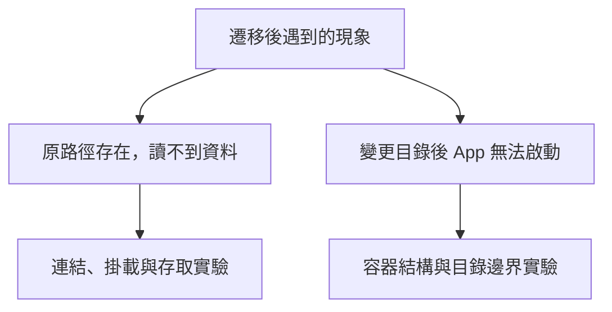

# 部落格文章列表

AppPorts 的一些選擇，來自看似成功的遷移之後暴露的問題。這裡把實驗、失敗和後來的改進串起來，解釋這些選擇是怎樣形成的。

## 為什麼選擇掛載遷移，又為什麼是 APFS {#mount-and-apfs}

符號連結還在，應用為什麼讀不到資料？磁碟映像看起來更靈活，為什麼沒有成為預設方案？從最初的訪問實驗，到拔盤、重啟和真實外接磁碟驗證，回顧這條路線的取捨。

[閱讀：為什麼 AppPorts 選擇掛載遷移，又為什麼是 APFS](/docs/blog/why-mount-and-apfs)

## 為什麼有些資料目錄不能遷移 {#directory-boundaries}

一次企業微信啟動崩潰，讓調查從 `tmp` 目錄追到了系統容器檢查。哪些目錄必須留在本機？為什麼子目錄能掛載，也不一定適合遷移？這篇文章給出證據和當前邊界。

[閱讀：為什麼有些資料目錄不能遷移](/docs/blog/data-migration-boundaries)

## 怎樣閱讀這些文章 {#reading}

文章標明實驗日期、系統與應用版本，並區分真實應用測試、隔離樣本和程式碼核對。過去一次成功或失敗，只能說明相應條件下的結果；當前行為以文章註明的程式碼基線為準。

想直接操作，可從[快速開始](/docs/faststart)進入。原先獨立的六篇實驗已融入這兩篇文章，可按下面的主題直接定位。遇到陌生概念，可查[名詞解釋](/docs/glossary)。

## 按實驗主題查閱 {#experiments}

| 想了解的事情 | 所在章節 |
| --- | --- |
| 連結還在，應用為什麼讀不到 | [符號連結的路徑與簽名對照](/docs/blog/why-mount-and-apfs#symlink-experiment) |
| 掛載後，哪些應用可用、哪些仍被拒絕 | [掛載與系統授權](/docs/blog/why-mount-and-apfs#mount-experiment) |
| 原生 APFS 和映像如何應對意外斷開 | [兩輪拔盤實驗](/docs/blog/why-mount-and-apfs#unplug-experiment) |
| 重啟後為什麼還要等資料接回 | [啟動時序與實際掛載位置](/docs/blog/why-mount-and-apfs#startup-method) |
| 為什麼保護容器骨架、怎樣找到這條規則 | [真實崩潰與系統探針](/docs/blog/data-migration-boundaries#starting-point) |
| 檔案複製完，為什麼還不算驗證完整 | [屬性、晚寫入與完整往返](/docs/blog/data-migration-boundaries#copy-and-switch) |

已停用的功能和未採用的方案，另見[歷史功能歸檔](/docs/archive/overview)。
