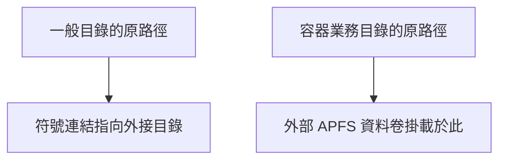

# 資料遷移方式

應用儲存資料時，通常會訪問一個固定位置。AppPorts 要解決的不只是把檔案複製出去，還要讓應用在遷移後仍能找到需要的資料。

## 普通目錄：連結遷移 {#symlink}

對適用的普通目錄，AppPorts 把資料移到外接儲存，在原位置留下一個符號連結。應用訪問原位置時，會沿連結找到外部資料。

工具快取、部分應用支援檔案和自選目錄可以採用這種方式，具體以檢查結果為準。連結依賴目標仍在原位置；手動移動外部資料後，原連結可能失效。

## 容器資料：掛載遷移 {#mount}

一些應用的資料放在系統管理的“容器”裡。容器有自己的訪問限制，不能假設在原位置放一個連結，應用就能訪問連結指向的任何地方。

對符合條件的容器業務目錄，AppPorts 會在外接磁碟建立專用 APFS 資料卷，把資料複製進去，再把卷接到原目錄。應用仍從原來的路徑訪問資料，這個過程叫**掛載遷移**。

| 比較 | 連結遷移 | 掛載遷移 |
| --- | --- | --- |
| 原位置保留什麼 | 指向外部位置的連結 | 接入外部資料卷的目錄 |
| 典型用途 | 工具目錄、自選資料夾和適用的普通資料 | 通過檢查的容器業務資料 |
| 外部儲存條件 | 取決於內容與檔案系統能力 | 當前要求APFS |
| 是否自動重簽應用 | 當前遷移流程不自動重簽 | 不需要替換應用簽名 |

## 為什麼不是整個容器都能搬 {#structure}

容器中既有業務資料，也有系統要求保持原狀的結構。即使複製和掛載成功，改變受保護的結構仍可能讓應用無法啟動。

因此，AppPorts 可以展示某個目錄，卻不提供遷移按鈕。不要把“看得見”理解成“可以移動”，也不要透過自選目錄繞過保護。相關實驗見[為什麼有些容器目錄不能搬](/docs/blog/data-migration-boundaries#starting-point)。

## 遷移成功還需要什麼 {#access}

應用能否使用遷移後的資料，還取決於外接磁碟線上、系統授權和應用自身行為。AppPorts 有權移動資料，不等於應用已經獲得讀取外部儲存的權限。

遷移完成後，確認狀態正常，再開啟應用檢查原有內容和儲存功能。重要資料應另有備份；副本檢查不能保證任意背景程式都不會繼續改寫源資料。

相關內容：[遷移資料的步驟](/docs/datamigrae/operation) · [掛載與系統授權實驗](/docs/blog/why-mount-and-apfs#mount-experiment) · [經典模式](/docs/classic-mode) · [名詞解釋](/docs/glossary)

延伸閱讀：[為什麼 AppPorts 選擇掛載遷移，又為什麼是 APFS](/docs/blog/why-mount-and-apfs) · [資料目錄的遷移邊界](/docs/blog/data-migration-boundaries)。
