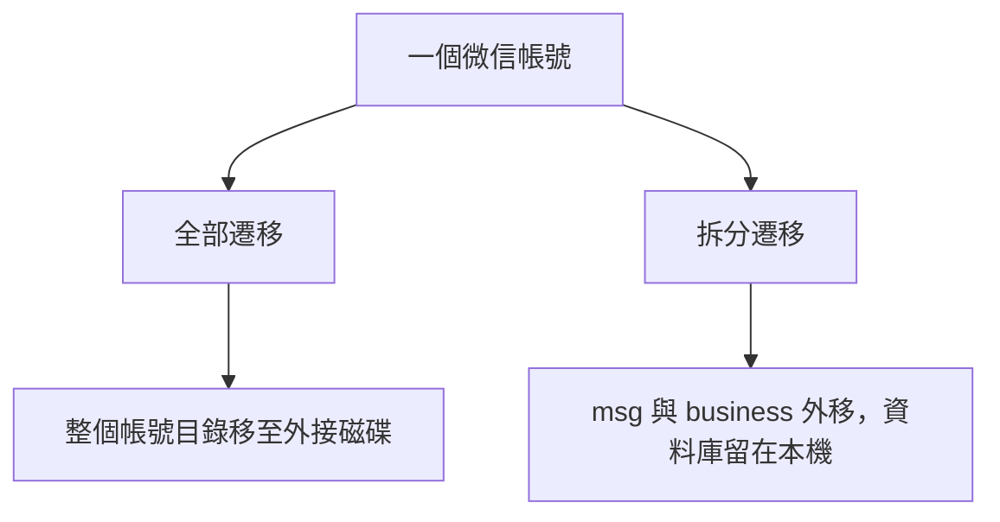

# 遷移資料

資料遷移適合移動應用產生的資料、工具目錄或自己的資料夾。它與應用本體遷移相互獨立：應用留在本機，也可以遷移適用的資料。

## 先找到要遷移的內容 {#choose}

| 內容 | 從哪裡進入 |
| --- | --- |
| 應用的聊天記錄、快取等關聯資料 | 左側邊欄「應用程式資料」，選取應用，再展開目錄。 |
| 套件管理器快取、模型等工具資料 | 左側邊欄「工具目錄」，檢視已識別項目。 |
| 自己的專案、素材或其他資料夾 | 左側邊欄「目錄遷移」，點選本地資料夾區域的「+」，選擇來源資料夾和外部目標。 |

*點選 Caches 左側的箭頭，選取 com.microsoft.VSCode，在清單底部查看完整路徑。再點一次箭頭即可收合。*

「應用程式資料」在目前頁面工作階段內會重用完整掃描結果，減少來回切換應用時的重複等待；權限、目標磁碟、遷移記錄或掛載狀態變化時會自動重新檢查，也可點選側欄底部的「重新整理快取」重新測量。缺少完全磁碟取用權限時，頁面會單獨提示權限未就緒並提供檢查入口，不會把受限讀取顯示為沒有資料。

左側應用程式清單會顯示每個應用程式偵測到的資料總量。有已遷移資料的應用程式會排在前面，並顯示「已遷移」和「本地」明細。搜尋框旁的選單可選「按大小」（初始選項）、「預設」或「按首字母」，分別為已遷移組和其他應用程式排序。外接磁碟離線、資料卷宗未解鎖或自動掛載已暫停時，大小可能不完整；接回原磁碟並恢復掛載後，可使用「重新整理快取」重新測量。

應用資料列表預設只顯示可遷移、可掛載和需要處理的項目。開啟「顯示鎖定目錄結構」會補回可操作項目之上的鎖定祖先，用來說明層級；沒有可操作內容的鎖定目錄不會因此出現。要查看所有不可遷移目錄，開啟「顯示不支援遷移目錄」。是否顯示零位元組目錄由第三個開關控制。**列表提供遷移操作，也不代表執行檢查一定通過**：空間、權限、正在使用資料的程序，以及與已有遷移的父子關係仍需核對。

點選「已連結」「掛載遷移」「現有軟連結」等狀態統計，可以只看匹配項目；列表會保留必要的父級路徑。各狀態數字不會隨這一次選擇而縮小，但仍受其他搜尋與篩選條件影響。再次點選或清除篩選可恢復，切換應用或分頁也會重置篩選。

標為「使用者目錄入口」的桌面、下載、圖片等快捷入口，並不是這個應用獨佔的資料，不統計目標大小，也不提供遷移或還原。大小旁的「本卷大小」「目標大小」說明統計範圍；父目錄和子列不能簡單相加，顯示大小也不等於遷移後一定釋放的空間。

## 遷移前的準備 {#prepare}

1. 備份重要資料，連線目標外接磁碟並在側欄確認空間。
2. 儲存工作，完全結束使用這些資料的應用、工具和背景任務。
3. 點選側欄底部設定齒輪，在「準備狀況」中檢查權限。遷出資料時 AppPorts 須從「應用程式」資料夾執行。
4. 核對目錄名稱和位置，避免僅憑大小猜測它屬於哪個應用。

檢測到關聯應用仍在執行時，AppPorts 可以提供「退出應用程式並繼續」，請求應用正常結束。若應用仍等待儲存或結束確認，先處理完它的提示，再回到 AppPorts 點選「繼續」。

## 普通目錄遷移 {#linked}

對提供「遷移」按鈕的普通目錄，點選後檢查目標位置，再確認開始。AppPorts 會複製並檢查資料，隨後在原位置建立[符號連結](/docs/glossary#symlink)。完成後通常顯示「已連結」。

工具目錄的常見例子包括 npm、Gradle 的快取，以及部分模型和編輯器資料。工具本身的任務也需要結束；正在下載、建置或寫入的目錄不適合同時移動。

自選資料夾應是使用者目錄內的真實資料夾，不能是整個使用者目錄，也不能與已管理的目錄相互包含。目標位置會在新增時顯示，確認後再遷移。

若舊連結指向已斷開的外接磁碟，而你不需要搬回舊內容、只想讓應用重新產生本機目錄，可在「連結詳情」中選擇「強制解除連結」。確認後 AppPorts 會移除本地連結並建立空目錄，無需連線外接磁碟，也不會刪除外接磁碟原件；詳見[還原、接回與解除連結](/docs/restore#unlink)。

## 容器資料掛載遷移 {#mount}

預設模式下，適用的容器資料使用「遷移」按鈕，檢查通過後執行掛載遷移；開啟經典模式時，它會單獨顯示為「掛載遷移」。這需要 **APFS 外接儲存**、足夠空間和正確權限。

1. 預設模式點選「遷移」（經典模式選擇「掛載遷移」），閱讀儲存和權限檢查結果。
2. 條件不足時選擇其他位置，或保留本地資料；不必為了繼續而清空現有磁碟。
3. 加密目標按提示為新資料卷宗設定密碼，選擇是否儲存到本機鑰匙圈；詳見[加密磁碟](/docs/storage-guide#encrypted-drives)。
4. 檢查本次資料與目標，確認遷移。操作完成後狀態應為「已掛載」。
5. 開啟原應用；若 macOS 詢問是否允許存取可移動宗卷，按你的使用意願授權。
6. 檢查原有內容能否讀取，並驗證一次正常儲存。

對單個「已掛載」的資料卷宗點選列內的「卸載」，會卸載該卷宗並**持續保留暫停狀態**，不影響同磁碟其他資料卷宗；重新啟動 AppPorts 或重新插入外接磁碟不會自動解除這項暫停，需要恢復時請明確點選「掛載」（若卸載失敗而卷宗仍線上，可點選「恢復自動掛載」）。

掛載遷移不會替換應用簽名，但應用仍受系統授權和自身相容性限制。看不到原資料時應先停止繼續寫入，按[資料不可見排查](/docs/faq#missing-data)檢查。

## 微信帳號：全部遷移或拆分遷移 {#wechat}

對識別到的微信帳號目錄點擊遷移後，在微信帳號遷移面板選擇：

- **全部遷移**：遷移所選帳號的整個目錄。
- **拆分遷移（`msg + business`）**：遷出 `msg` 與 `business` 媒體目錄，資料庫（`db_storage`）和設定保留本機；確認框分別列出媒體大小與本機保留大小。

等目錄大小讀取完整後，再開始遷移。切換方式前，先完整還原該帳號已遷移的資料。拆分後離線時，媒體或檔案/影片入口與其他受管離線目錄同樣保持唯讀可瀏覽、拒絕新建寫入，避免登入時因路徑權限錯誤而崩潰；能否繼續查看文字訊息仍取決於微信版本，不保證所有內容在未連接磁碟時可用。加密目標還需[設定資料卷宗密碼](/docs/storage-guide#encrypted-drives)。

「僅大檔案與影片（`msg/file + msg/video`）」只遷移這兩個目錄，聊天附件與資料庫會留在內部磁碟。與其他目錄共用的檔案會在外接磁碟另存一份，仍占用原來的內部磁碟空間。還原時將外接磁碟上的版本遷回，其他目錄裡的檔案原樣保留。

*既有拆分遷移的範例。帳號列標出 msg/file 和 msg/video 的合計範圍與「已掛載」狀態，可從右側還原。下一列 WMPF 仍在本機。*

## 怎樣看遷移進度 {#progress}

「總體進度（估算）」包含準備、掃描、複製、磁碟寫入、各輪驗證、切換和收尾；多個目錄會合算為同一任務的總體百分比。目前目錄另有「準備 → 掃描 → 複製 → 驗證 → 切換 → 收尾」階段提示。**總體百分比、目前目錄階段與已複製位元組表示不同範圍，不能互相替代。** 複製達到 100% 不代表任務完成，空間釋放也要等清理完成。

*複製階段的範例。上方 19% 是整體進度估算，下方 50% 是目前目錄的複製進度。*

掃描和驗證會顯示已處理項目數、讀取位元組或目前檔案。長時間沒有新進展時，視窗會說明距離上次活動的時間；先結合階段和提示判斷，不要只因百分比暫時不變就拔除磁碟或強制結束。

## 完成後與異常情況 {#after}

開啟應用前先連線外接磁碟，並確認資料已接回；若應用或資料位於目前選取的 [APFS 應用庫映像](/docs/storage-guide#app-library-image)，從已重新整理的本機入口啟動時會先無視窗嘗試接回映像和其中的資料卷宗。顯示「待掛載」時按提示掛載。外接磁碟離線或資料卷宗卸載後，本機受管目錄呈現唯讀空目錄以保護掛載點，「外接磁碟未連線」或可讀空目錄都不等於資料已被刪除或已還原回本機。其他狀態見[徽章與狀態](/docs/badges#data)。

需要恢復本機存放或重建入口時，閱讀[還原與接回](/docs/restore)。中斷或只剩清理未完成時，保留 AppPorts 提示的副本，不要反覆建立新的遷移。

相關內容：[兩種資料遷移方式](/docs/datamigrae/baseinfo) · [外接磁碟準備](/docs/storage-guide#apfs) · [經典模式](/docs/classic-mode)

想了解鎖定目錄和父子層級限制的來由，可閱讀[資料目錄的遷移邊界](/docs/blog/data-migration-boundaries)。

## 在任務中心管理遷移 {#task-center}

在左側邊欄開啟「任務中心」（有未結束任務或異常時會顯示數量與提醒標記），查看應用、應用資料、工具目錄和目錄遷移任務。點擊任務名稱開啟詳細資料；其中的「加入背景」只收起視窗，任務繼續在 AppPorts 內執行，可以切換頁面後再回來查看。這不表示結束 AppPorts 後仍可繼續遷移。

*在任務中心點選已完成的 IINA 範例任務，查看詳細資料，再用「任務列表」返回清單。*

- 選取一個或多個遷移任務，使用「暫停」「繼續」或「取消任務」。暫停要等到可暫停的位置；入口切換等關鍵步驟可能先完成。
- 取消後若顯示「正在取消，等待安全收尾」，請保持磁碟連接並等待。取消不會撤銷已完成的遷移步驟，也不保證立即釋放佔用空間。
- 互不衝突的任務可以並行，路徑或資源衝突的任務會排隊；排隊不等於停滯。
- 開啟「應用程式更新守護」後，背景接手的 ShipIt 更新也會同步到任務中心展示階段與結果；這類觀察記錄不提供暫停或取消，失敗或中斷時可在詳細資料中點選「復原更新」。
- 「清空已完成」和列末移除按鈕只刪除任務顯示記錄，不刪除檔案，也不處理尚未完成的恢復或清理。

重新開啟 AppPorts 後，上次未結束的任務需要先檢查遷移記錄，不會僅憑任務歷史自動重新遷移。出現「需要處理」時開啟詳細資料的「處理異常」（或更新任務的「復原更新」），按目前記錄繼續；詳見[異常恢復](/docs/restore#recovery)。

*任務中心範例。這項任務顯示「需要處理」，開啟詳細資料即可查看原因和可用操作。*

## 遷移期間的啟動保護 {#launch-protection}

遷移或遷回應用資料時，經過已更新的 AppPorts 原生 macOS 啟動入口開啟關聯應用，會提示等待完成；複製暫停時也會保持保護，排隊尚未執行的任務不會因此阻止啟動。

這不能攔截所有啟動方式：直接開啟外接磁碟真實應用、仍在本機的應用本體、舊入口和 iOS 包裝應用均可能繞過。仍須先完全結束應用及背景寫入工具，並等待任務和安全收尾結束後再開啟。
