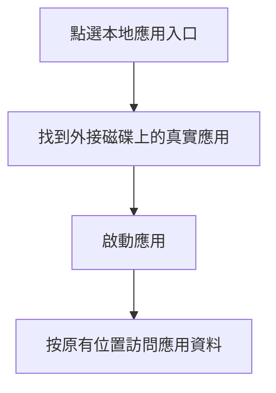

# 應用遷移方式

應用搬到外接磁碟後，AppPorts 會為它保留合適的本地入口。真正佔空間的應用與點選時使用的入口，可能不在同一個位置。

## 真實應用與本地入口 {#portal}

普通應用預設使用輕量的**啟動殼**，也叫 Stub Portal。你點選本地入口，入口再啟動外接磁碟上的真實應用。它不是第二份完整應用，也不是備份；外接磁碟不線上時，入口本身不能代替真實應用執行。

最後一步解釋了為什麼「遷移應用」和「遷移資料」分開：應用本體移走後，聊天記錄和其他資料可能仍在本機。

如果應用存放在 [APFS 應用庫映像](/docs/storage-guide#app-library-image)中（或關聯了該映像內的資料卷宗），重新整理為新版格式（版本 8）的本機入口在點開時會先執行一次無視窗準備，嘗試把所需映像及其中的資料卷宗接回，再開啟真實應用；普通實體外接磁碟上的應用入口保持獨立啟動，不附加這一步。

## 不同內容怎樣保留入口 {#types}

| 內容 | AppPorts 的處理方式 |
| --- | --- |
| 普通 macOS 應用 | 使用啟動殼指向外部真實應用。 |
| 支援遷移的 iPhone／iPad 應用 | 使用適合其包裝結構的啟動入口；能否遷移仍受系統和應用條件限制。 |
| 包含多個應用的資料夾或套件 | 使用資料夾鏡像，為其中應用建立入口，其餘受管內容透過連結關聯。 |
| 手動選擇傳統連結遷移 | 右鍵「使用傳統連結遷移」，將整個應用放在外部，本地保留符號連結。它仍是可用的手動選項，相容性取決於應用。 |
| 歷史遷移項目 | 識別舊入口，提供相應的還原或解除操作。 |

舊版的整體符號連結、Contents 目錄入口可能仍出現在已有遷移中。「仍能識別」不代表目前新遷移預設使用它們。目錄結構或應用內部路徑的特殊依賴，也可能影響相容性。

## 更新保護與更新守護 {#updates}

自更新程式在外部儲存上的行為並不一致：有些應用可直接完成自更新，有些在跨卷寫回時會因權限歸屬失敗，也有些會在更新過程中改動或刪除外部副本。

對檢測到自更新器的應用（網易雲音樂、WorkBuddy 等已確認按普通應用處理的項目除外），AppPorts 在遷移或接回前提供兩種選擇：

- **非鎖定遷移（預設）**：不對應用套件加鎖，應用可嘗試繼續使用自身更新。在「設定 → 背景代理」開啟**應用程式更新守護**後，即使結束 AppPorts，背景也會在已適配的 ShipIt 更新明確失敗時驗證完整快取新版的開發者簽名，完成安裝或安全替換舊版、清理殘留重試狀態，並把結果同步到任務中心；失敗項可在任務詳細資料使用「復原更新」恢復已核驗舊版。
- **鎖定遷移**：對外部應用套件加鎖，降低外部副本被更新流程意外破壞的風險，但應用內更新可能受限。需要更新時可先透過 AppPorts 遷回本機；之後改為非鎖定遷移或遷回本機時，AppPorts 會一併清除該應用使用者快取（`Caches/<Bundle ID>` 與 `.ShipIt`）上的保護鎖。

應用清單不再展示 `Sparkle`、`Electron` 等底層框架標籤，由遷移前確認與更新狀態徽章直接表達處理方式。更新守護不會重簽應用或拼合增量修補檔，也不保證所有更新框架或全部 ShipIt 變體都能自動處理成功；具體操作見[遷移應用後的更新](/docs/core#updates)。

## 這對你意味著什麼 {#limits}

本地入口儘量保留熟悉的開啟方式，但它不能消除外接磁碟依賴，也不能保證所有外掛、系統權限和應用自身更新都不受影響。遷移完成後，應從平時使用的入口啟動，並檢查常用功能。

相關內容：[本地入口與真實應用](/docs/glossary#local-portal) · [徽章與狀態](/docs/badges) · [資料遷移方式](/docs/datamigrae/baseinfo)

早期 Contents、整體符號連結及啟動殼實現變化見[歷史應用遷移方式](/docs/archive/app-strategies)。
