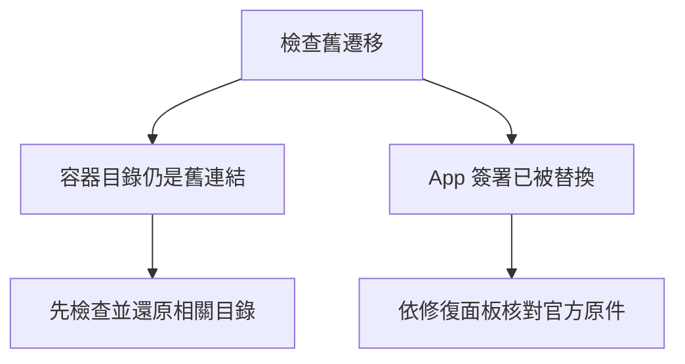

# macOS 27 與遷移方式的變化

舊方式遷移的應用在 macOS 27 上出現啟動或資料訪問問題時，需要分別檢查**資料位置、應用簽名和系統授權**。它們相互關聯，但不是同一件事。

## 為什麼舊做法可能遇到問題 {#why}

應用容器是系統為應用管理的資料區域。應用訪問它時，系統會檢查應用身份、權限以及部分目錄結構。

把容器裡的資料改成指向外部位置的符號連結，可能讓訪問離開原有授權範圍。對應用重新簽名又可能改變它的開發者身份與授權，導致已有的容器訪問記錄不再匹配。

在 macOS 27.0 的受測環境中，官方簽名和被重簽後的微信表現不同，部分被重簽樣本無法正常開啟。這是需要排查的證據，不代表所有應用、所有系統版本都具有相同結果。

## AppPorts 為什麼調整遷移方式 {#changes}

掛載遷移讓適用的業務資料卷接到原路徑，保留真實應用簽名。當前遷移與獨立手動簽名分開，避免把“想換一個存放位置”變成“順便更改應用身份”。

AppPorts 還會保護容器的關鍵結構，並區分“簽名已替換”和“簽名待檢查”。後者可能只是外接磁碟離線或讀取失敗，不能直接當成簽名損壞。

掛載仍需要儲存條件和授權，也不能把任意容器目錄都變成可遷移物件。具體差異見[資料遷移方式](/docs/datamigrae/baseinfo)。

## 更新、升級和修復的區別 {#upgrade}

| 動作 | 解決什麼 | 不會自動完成什麼 |
| --- | --- | --- |
| 更新 AppPorts | 獲得對應版本的檢查、遷移和恢復改進 | 不會自動把舊連結轉換成掛載，也不會自動修復過去的簽名。 |
| 升級 macOS | 更換系統版本 | 不會替你檢查舊遷移是否仍適用。 |
| 修復已有遷移 | 按狀態恢復資料路徑和應用身份 | 不等於要求所有使用者升級到 macOS 27。 |

如果你正在使用舊式容器遷移，應在升級系統前檢查；已經遇到問題時，先保留資料和副本，再走修復流程。單純的簽名錯誤不證明資料損壞，是否有資料問題需要另外核對。

## 去哪裡繼續 {#next}

操作步驟見[macOS 27 升級與修復](/docs/macos-27)。想了解實驗證據，可以讀[符號連結實驗](/docs/blog/why-mount-and-apfs#symlink-experiment)、[掛載與授權實驗](/docs/blog/why-mount-and-apfs#mount-experiment)和[容器目錄結構實驗](/docs/blog/data-migration-boundaries#starting-point)。
